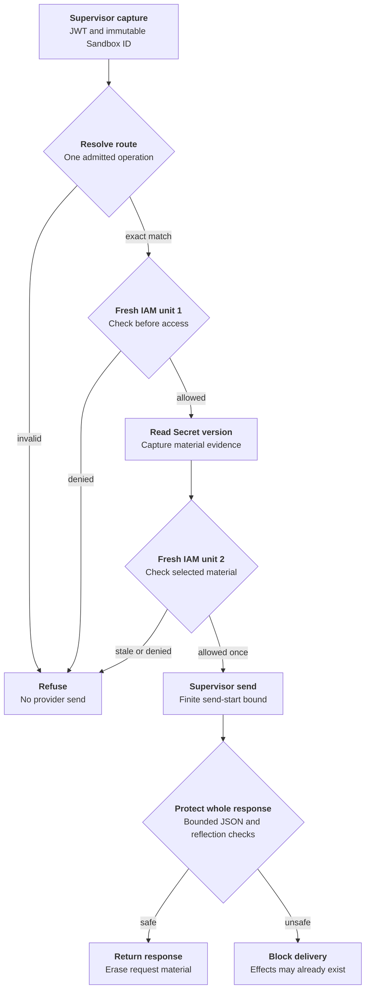

# Protected credential request flow

## Overview

A trusted supervisor resolves a static credential for one admitted inference
request, obtains a fresh send decision, and submits the complete provider response
for protection. OCC owns identity mapping, current IAM decisions, versioned Secret
selection and response policy. OpenShell owns injection and the business send.
This describes the implemented OCE side and its wire contract; it does not prove
a deployed supervisor or no-bypass networking. The
[feature reference](../reference/credential-sources/protected-inference.md) owns
supported operations and configuration.

## Entry Points

- Trigger: an installed supervisor sends `HttpCredentialAccess.Resolve`, followed
  by `AuthorizeSend` and `HttpResponsePreReturn.Evaluate` over authenticated TLS.
- Source: `apps/controller/src/drivers/egress-proxy/openshell-authority.ts:createOpenShellEgressAuthority`
- Source: `packages/occ/src/index.ts:createEgressForwarder`
- Assumptions: source admission and Agent deployment produced an exact plan;
  a future verified applied-capability receipt permits installation; the Agent is running;
  its service principal holds exact source `operate` permission.

## Flow

The supervisor edges describe the required counterpart contract. Wire fixtures
exercise that contract; deployed enforcement remains a separate qualification.

## Execution Trace

### 1. Admit source and install the revision plan

`packages/occ/src/index.ts:admitStaticEgressSource`,
`packages/occ/src/index.ts:admitEgressPlan`

New protected sources store a closed live/static descriptor after source/Secret
permission checks and candidate validation. Existing sources require explicit
source-update opt-in. Deployment freezes execution, source generation, model
grant, binding and route identities in `AgentRevision.egressPlan`.

`apps/controller/src/drivers/compute/kubernetes/index.ts:prepareRevision`,
`apps/controller/src/drivers/egress-proxy/openshell.ts:attachmentStatus`

Compute passes the selected Driver's attachment to Sandbox provisioning. The
Sandbox returns its full prepared network configuration, including auxiliary
rules. The adapter compares every loaded rule and middleware against that output
and the protected plan. The gateway observations cannot prove that the running
supervisor applied the protected capability, so the adapter refuses installation
until an authenticated, instance-fenced applied-capability receipt is available.
Missing counterpart or mismatched policy also leaves provisioning incomplete or failed.

### 2. Capture identity, operation and first authority decision

`apps/controller/src/drivers/egress-proxy/openshell-identity.ts:verify`,
`packages/occ/src/egress.ts:resolve`

The TLS adapter verifies the extension JWT and matching request Sandbox ID. The
Forwarder maps that peer to persisted installation state and classifies one exact
route through its registered provider. It copies request bytes and reserves the
request ID before asynchronous authorization. Unsupported or ambiguous operations
refuse before Secret access. Replay reservations and outstanding handles are bounded.

`packages/occ/src/index.ts:checkEgressUse`

Each check opens a fresh platform transaction. An enclosing controller transaction
is refused, so native IAM cannot reuse one policy snapshot for both checks. The
check verifies current Namespace/Agent state, admitted revision, installation,
source generation, withdrawal and exact Agent source permission. Denials record
phase and internal request attribution without material.

### 3. Resolve versioned material and authorize its sole send

`apps/controller/src/drivers/secret/kubernetes/index.ts:readCredentialInput`,
`packages/occ/src/egress.ts:authorizeSend`

The selected Secret Driver verifies ownership and reads UID/resourceVersion from
the authoritative API. The registry retains material only for this bounded
request. It returns credential headers, opaque handle and nonsecret material
evidence to the authenticated supervisor.

The second RPC must echo the original deadline, evidence and injection digest.
The registry consumes the handle before IAM I/O. A separate fresh check additionally
validates material identity and the durable rejection fence. The allowed permit
expires at the earliest request/material/identity bound and within one second.
Revocation can still race the subsequent send; the permit authorizes no retry.

### 4. Protect response and finish

`packages/occ/src/egress.ts:protectResponse`,
`apps/controller/src/drivers/egress-proxy/openai-provider.ts:protectedJson`

The response service requests whole-body inspection, matches the original peer
and request ID, and removes visible headers outside its allowlist. The provider
policy parses bounded JSON and rejects unsupported responses or selected-material
reflection. A provider 401 persists a version-specific rejection. Material is
removed after response handling or the original deadline. Restart loses handles
and fails closed; no send outcome is reconstructed.

## Debugging and Verification

Run `node --test tests/integration/static-egress.test.mjs` for the real API,
authentication, native IAM, controller, versioned Kubernetes Driver and TLS gRPC/
provider wires. Run `node --test tests/integration/postgres-static-egress.test.mjs`
with the [PostgreSQL prerequisites](../testing/postgresql.md) for persisted plans,
constraints, installation idempotency, rejection fencing and fresh native IAM.

These tests use passive storage and runtime-observation fixtures. They do not
prove a real model turn, supervisor enforcement, Kubernetes NetworkPolicies,
chart installation or published image compatibility. See
[verification boundaries](../testing/static-egress.md).

## Related docs

- [Credential source lifecycle](credential-source-lifecycle.md)
- [Protected static inference](../reference/credential-sources/protected-inference.md)
- [OpenShell Sandbox provisioning](openshell-sandbox-provisioning.md)
- [RFC 0020 proposal](../../specs/rfcs/0020-egress-proxy-credential-lifecycle/index.md)

## Manual Notes

None.

## Changelog

- 2026-10-14 12:34: Document accompanying static egress implementation and its qualification limits. (authoring-run/fe204745-17c9-4662-82e0-e194d7c187cb - dc5648b67d2618cc43ef07562298e986a94674e7)
