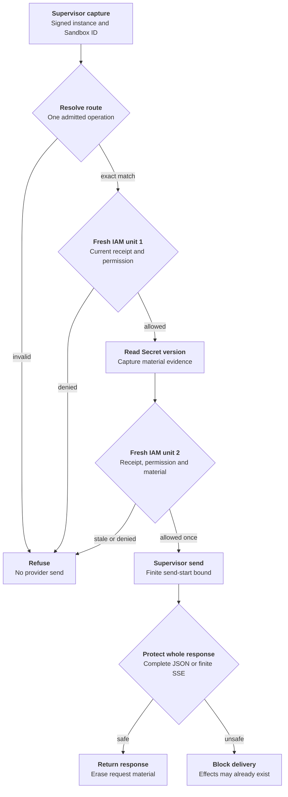

# Protected credential request flow

## Overview

A trusted supervisor resolves a static credential for one admitted inference
request, obtains a fresh send decision, and submits the complete provider response
for protection. OCC owns identity mapping, current IAM decisions, versioned Secret
selection and response policy. OpenShell owns injection and the business send.
This describes the implemented OCE side and its wire contract; it does not prove
a deployed supervisor or no-bypass networking. The
[feature reference](../reference/credential-sources/protected-inference.md) owns
supported operations and configuration.

## Entry Points

- Trigger: an installed supervisor sends `HttpCredentialAccess.Resolve`, followed
  by `AuthorizeSend` and `HttpResponsePreReturn.Evaluate` over authenticated TLS.
- Source: `apps/controller/src/drivers/egress-proxy/openshell-authority.ts:createOpenShellEgressAuthority`
- Source: `packages/occ/src/index.ts:createEgressForwarder`
- Assumptions: source admission and Agent deployment produced an exact plan;
  a current verified loaded-enforcement receipt permits installation; the Agent is running;
  its service principal holds exact source `operate` permission.

## Flow

The supervisor edges describe the required counterpart contract. Wire fixtures
exercise that contract; deployed enforcement remains a separate qualification.

## Execution Trace

### 1. Admit source and install the revision plan

`packages/occ/src/index.ts:admitStaticEgressSource`,
`packages/occ/src/index.ts:admitEgressPlan`

New protected sources store a closed live/static descriptor after source/Secret
permission checks and candidate validation. Existing sources require explicit
source-update opt-in. Deployment freezes execution, source generation, model
grant, binding and route identities in `AgentRevision.egressPlan`.

`apps/controller/src/drivers/compute/kubernetes/index.ts:prepareRevision`,
`apps/controller/src/drivers/egress-proxy/openshell.ts:attachmentStatus`

Compute passes the selected Driver's attachment to Sandbox provisioning. The
Sandbox returns its full prepared network configuration, including auxiliary
rules. The adapter compares every loaded rule and middleware against that output
and the protected plan. It then validates the authenticated gateway
`LoadedEnforcementEvidence`: exact Sandbox, current instance, policy version/hash,
configuration/environment revisions and enforced capability. The persisted
installation includes an immutable instance/configuration fingerprint. Missing
counterpart, receipt or mismatched policy leaves provisioning incomplete or failed.
The gateway producer must fence reports and queries against current registration
and effective configuration; this consumer does not infer evidence from a manifest.

### 2. Capture identity, operation and first authority decision

`apps/controller/src/drivers/egress-proxy/openshell-identity.ts:verify`,
`packages/occ/src/egress.ts:resolve`

The TLS adapter verifies the extension JWT, its signed registered `instance_id`
and matching request Sandbox ID. The instance must equal the installation fence. The
Forwarder maps that peer to persisted installation state and classifies one exact
route through its registered provider. It copies request bytes and reserves the
UUIDv7 request ID before asynchronous authorization. Its embedded creation time
fixes the 30-second replay horizon, so resubmission cannot extend it. Pending
resolution reserves active capacity before any verifier await. Unsupported or ambiguous operations
refuse before Secret access. Replay reservations and outstanding handles are bounded.

`packages/occ/src/index.ts:checkEgressUse`

Each check opens a fresh platform transaction. An enclosing controller transaction
is refused, so native IAM cannot reuse one policy snapshot for both checks. The
check verifies current Namespace/Agent state, admitted revision, installation,
source generation, withdrawal and exact Agent source permission. The Driver
requeries current policy-status evidence during each check and compares it with
the stored fence. Replacement, missing evidence or changed configuration refuses
even when the saved installation was once valid. Denials record
phase and internal request attribution without material.

### 3. Resolve versioned material and authorize its sole send

`apps/controller/src/drivers/secret/kubernetes/index.ts:readCredentialInput`,
`packages/occ/src/egress.ts:authorizeSend`

The selected Secret Driver verifies ownership and reads UID/resourceVersion from
the authoritative API. The registry retains material only for this bounded
request. It returns credential headers, opaque handle and nonsecret material
evidence to the authenticated supervisor.

The second RPC must echo the original deadline, evidence and injection digest.
The registry consumes the handle before IAM I/O. A separate fresh check additionally
validates material identity and the durable rejection fence. The allowed permit
expires at the earliest request/material/identity bound and within one second.
Revocation can still race the subsequent send; the permit authorizes no retry.

### 4. Protect response and finish

`packages/occ/src/egress.ts:protectResponse`,
`apps/controller/src/drivers/egress-proxy/openai-provider.ts:protectedEvents`,
`apps/controller/src/drivers/egress-proxy/openai-responses.ts:validResponsesEvent`

The response service requests whole-body inspection, matches the original peer
and request ID, and removes visible headers outside its allowlist. The provider
policy parses bounded JSON or complete finite SSE using closed provider event
schemas and rejects unsupported responses or selected-material reflection, including
joined text deltas. No SSE event is released early. The original deadline and
4 MiB limit still apply. A provider 401 persists a version-specific rejection. Material is
removed after response handling or the original deadline. Restart loses handles
and fails closed; no send outcome is reconstructed.

### 5. Configure the regular Harness caller

`apps/controller/src/worker.ts:resolveRevisionSecretContext`,
`apps/controller/src/drivers/compute/plugin-runtime.ts:codexToml`

The worker obtains nonsecret endpoint configuration through the registered
provider's normalizer. The admitted inference grant disables provider tools in
protected Codex configuration while retaining local tools and ordinary Harness
components. HTTP Responses is selected with WebSockets and automatic request/stream
retries disabled. The provider-owned classifier recognizes the bounded selected
client payload; unknown operations fail before credential access.

## Debugging and Verification

Run `node --test tests/integration/static-egress.test.mjs` for the real API,
authentication, native IAM, controller, versioned Kubernetes Driver and TLS gRPC/
provider wires. Run `node --test tests/integration/postgres-static-egress.test.mjs`
with the [PostgreSQL prerequisites](../testing/postgresql.md) for persisted plans,
constraints, installation idempotency, rejection fencing and fresh native IAM.

These tests use passive storage and runtime-observation fixtures. They do not
prove a real model turn, supervisor enforcement, Kubernetes NetworkPolicies,
chart installation or published image compatibility. See
[verification boundaries](../testing/static-egress.md).

## Related docs

- [Credential source lifecycle](credential-source-lifecycle.md)
- [Protected static inference](../reference/credential-sources/protected-inference.md)
- [OpenShell Sandbox provisioning](openshell-sandbox-provisioning.md)
- [RFC 0020 proposal](../../specs/rfcs/0020-egress-proxy-credential-lifecycle/index.md)

## Manual Notes

None.

## Changelog

- 2026-10-14 14:11: Consume current instance-fenced evidence, finite replay identity and selected Responses HTTP/SSE profile. (01a13a97-c578-77a2-81a7-7366f1380110 - e42cb1674fadaf14ba3d61a4164d1ad3fde9935c)

- 2026-10-14 12:34: Document accompanying static egress implementation and its qualification limits. (authoring-run/fe204745-17c9-4662-82e0-e194d7c187cb - dc5648b67d2618cc43ef07562298e986a94674e7)
