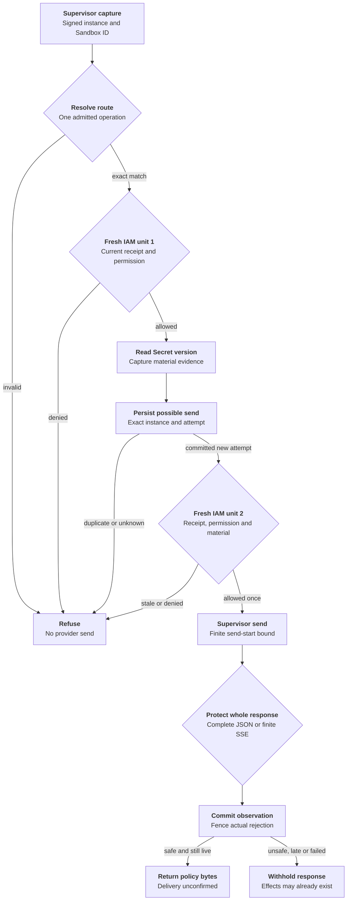

# Protected credential request flow

## Overview

For an admitted inference request, the trusted OpenShell supervisor resolves a
static credential, obtains a fresh send decision, and submits the complete provider
response for protection. OCC owns identity mapping, current IAM decisions, versioned
Secret selection and response policy. The supervisor runs outside the Agent and
owns injection and the business send.

Protected revision admission and execution are blocked by all shipped Computes.
The request flow below describes the retained OCE protocol implementation and its
synthetic fixtures, not a currently deployable protected execution. See the
[execution cutoff](../reference/credential-sources/protected-inference.md#execution-admission-cutoff).

This flow describes the implemented OCE side and the required counterpart contract.
It does not prove a deployed supervisor or no-bypass networking. The
[feature reference](../reference/credential-sources/protected-inference.md) owns
supported operations and configuration.

## Entry Points

- Trigger: an installed supervisor sends `HttpCredentialAccess.Resolve`, followed
  by `AuthorizeSend` and `HttpResponsePreReturn.Evaluate` over authenticated TLS.
- Source: `apps/controller/src/drivers/egress-proxy/openshell-authority.ts:createOpenShellEgressAuthority`
- Source: `packages/occ/src/index.ts:createEgressForwarder`
- Assumptions: source admission and Agent deployment produced an exact plan;
  a current verified loaded-enforcement receipt permits installation; the Agent is
  running; its service principal holds exact source `operate` permission.

## Flow

The supervisor edges describe the required counterpart contract. Wire fixtures
exercise that contract; deployed enforcement remains a separate qualification.

## Execution Trace

### 1. Admit source and install the revision plan

`packages/occ/src/index.ts:admitStaticEgressSource`,
`packages/occ/src/index.ts:admitEgressPlan`

New protected sources store a closed live/static descriptor after source/Secret
permission checks and candidate validation. Existing sources require explicit
source-update opt-in. OCC records an explicit v2 `executionAdmission` decision
from the selected egress capability, independently of bindings. Protected plans
freeze execution, source generation, grant and route identities. Empty routes
retain protected semantics and require deny-all.

`packages/contracts/src/egress.ts:assertExecutionReleaseAllowed`,
`apps/controller/src/worker.ts:resolveRevisionSecretContext`

OCC calls Compute's admission validator before storing the revision. Every shipped
Compute refuses protected mode. The worker refuses before resolving launch context;
Compute prepare/activate also check before effects. Missing, unsupported and
inconsistent decisions fail closed. PostgreSQL stores `execution_admission` inside
`admitted_spec` and rejects old snapshots on read without relabeling them. The
schema blocks old writes. Protected snapshots put a required reader version in
Harness authentication, which the previous reader refuses before reaching Compute.
Release still requires Compute-owned authority, an inventory of the readers in
the installation, and evidence that an empty protected plan enforces deny-all.

The remaining installation trace is retained protocol code, reached by synthetic
fixtures only while that cutoff remains in place.

`apps/controller/src/drivers/compute/kubernetes/index.ts:prepareRevision`,
`apps/controller/src/drivers/egress-proxy/openshell.ts:attachmentStatus`

Compute passes the selected Driver's attachment to Sandbox provisioning. The
Sandbox returns its complete prepared source policy from
`apps/controller/src/drivers/sandbox/openshell.ts:provisionHarness`.
The adapter compares the full source revision against that output and checks the
protected routes and middleware against the plan. It requires the authenticated
gateway's `LoadedPolicyObservationV1`, binding the unchanged source hash to the
effective policy and its nested enforcement evidence. Full policies must match
except for the exact name-only runtime rule allowed by the
[V1 contract](../reference/credential-sources/protected-inference.md#loaded-enforcement).
The evidence also binds Sandbox, current instance, policy version,
configuration/environment revisions and enforced capability. The immutable local
fingerprint includes both supplier hashes and both complete decoded policies.

`apps/controller/src/drivers/egress-proxy/openshell.ts:enforcementEvidence`

Installation and revalidation use the same V1 checks. Missing V1, widening or a
changed fence refuses; LOADED and legacy field 3 cannot substitute. The gateway
producer must compare full typed policies, including fields unknown to this
consumer, and fence reports and queries against current registration and effective
configuration. The local fingerprint does not compute a canonical supplier hash
or attest the supervisor. Request authorization still runs before Secret access
and before send.

`apps/controller/src/drivers/compute/egress-enrollment.ts:HARNESS_EGRESS_ENROLLMENT_HELPER`,
`apps/controller/src/drivers/sandbox/openshell.ts:enrollHarness`

Compute adds `OPENCLAW_EGRESS_ENROLLMENT_REVISION_ID` from the immutable admitted
revision only to protected provider Harness requirements. The generated helper
requires exact equality between this literal and the manifest's enrollment
execution revision before opening its authenticated listener on the existing
service port. Missing or mismatched values refuse. Compute's private status
revision, port, container name and Pod UID remain suppressed; the provider
receives the transport verifier, not the raw transport token.

The generated Harness waits on this listener before running the first model probe. Compute awaits the
installation commit, requeries current evidence and calls the selected Sandbox
Driver. The Driver checks the exact Sandbox and service, reads the execution/plan
challenge and echoes its fresh process nonce using the existing transport token.
The Harness closes that listener before starting Codex. Restart creates a new
challenge; a stale release cannot unlock the replacement. The 180-second wait
fails closed with a held startup failure. Reconciliation can repeat readiness
exchanges, but enrollment neither resolves material nor retries business requests.
The active-revision branch in `apps/controller/src/worker.ts:prepareRevision` can
repeat this sequence when work is queued. The default Kubernetes selection has no
periodic maintenance interval, so Harness-only restart recovery is not automatic;
see the [supported recovery boundary](../reference/credential-sources/protected-inference.md#installation-configuration).

### 2. Capture identity, operation and first authority decision

`apps/controller/src/drivers/egress-proxy/openshell-identity.ts:verify`,
`packages/occ/src/egress.ts:resolve`

The TLS adapter verifies the extension JWT, its signed registered `instance_id`
and matching request Sandbox ID. The gateway validates the supervisor-supplied
instance against its authenticated Sandbox registration before signing it; this
trusts the supervisor and does not attest its binary. The instance must equal the
installation fence. The Forwarder maps that peer to persisted installation state
and classifies one exact route through its registered provider. It copies request bytes and reserves the
UUIDv7 request ID before asynchronous authorization. Its embedded creation time
fixes the 30-second replay horizon, so resubmission cannot extend it. Pending
resolution reserves active capacity before any verifier await. Unsupported or
ambiguous operations refuse before Secret access. Replay reservations and
outstanding handles are bounded.

`packages/occ/src/index.ts:checkEgressUse`

Each check opens a fresh platform transaction. An enclosing controller transaction
is refused, so native IAM cannot reuse one policy snapshot for both checks. The
check verifies current Namespace/Agent state, admitted revision, installation,
source generation, withdrawal and exact Agent source permission. The existing
`credentialNamespace` mapping supplies Compute's runtime placement to the Driver;
IAM and audit retain logical Namespace identity. The Driver requeries current
policy-status evidence during each check and compares it with the stored fence.
Replacement, missing evidence or changed configuration refuses even when the saved
installation was once valid. Denials record phase and internal request attribution
without material.

### 3. Resolve versioned material and authorize its sole send

`apps/controller/src/drivers/secret/kubernetes/index.ts:readCredentialInput`,
`packages/occ/src/egress.ts:authorizeSend`

The selected Secret Driver verifies ownership and reads UID/resourceVersion from
the authoritative API. The registry retains material only for this bounded
request. It returns credential headers, opaque handle and nonsecret material
evidence to the authenticated supervisor.

The second RPC must echo the original deadline, evidence and injection digest.
The registry reserves the handle, then uses
`packages/occ/src/egress-send-receipts.ts:EgressSendReceipts.begin` to commit
possible dispatch before permission. The key includes authenticated sender Ref,
instance, stable request/use ID and attempt ID; the binding includes exact
store-qualified material and original deadline. An existing attempt, failed write
or unknown commit refuses permission, including after an authority restart.

A separate fresh identity and policy check follows persistence and additionally
validates material identity and the durable rejection fence. The registry checks
cancellation, live handle ownership and deadline again after that check. The allowed permit
expires at the earliest request/material/identity bound and within one second.
Revocation can still race the subsequent send; the permit authorizes no retry.

### 4. Protect response and finish

`packages/occ/src/egress.ts:protectResponse`,
`apps/controller/src/drivers/egress-proxy/openai-provider.ts:protectedEvents`,
`apps/controller/src/drivers/egress-proxy/openai-responses.ts:validResponsesEvent`

The response service requests whole-body inspection, matches the original peer
and request ID, and removes visible headers outside its allowlist. The provider
policy parses bounded JSON or complete finite SSE using closed provider event
schemas and rejects unsupported responses or selected-material reflection, including
text deltas joined across item IDs as exposed by the Codex consumer. Indexed
events must belong to an unfinished item. Supported function-call arguments are
parsed once as bounded JSON, including their completed delta accumulation, before
release. This does not recursively decode arbitrary string encodings. No SSE event
is released early. The original deadline and 4 MiB limit still apply.

Authenticated preflight claims one response stream. The provider classifier
requires a structured 401 `invalid_api_key` / `invalid_request_error` error;
status alone does not fence material. `EgressSendReceipts.observe` commits the
safe response decision and exact rejection fence atomically before the adapter
replies. Blocked responses can still establish rejection. Receipts contain no
bodies, headers, material values or credential-bearing handles. Persistence
failure withholds bytes, and the deadline/cancellation check repeats after commit.

Observation is distinct from final supplier proof: the current best-effort
`session_end` notification does not attest application of this decision.
Therefore post-send outcomes remain uncertain and unsettled even after NORMAL;
recovery reads the exact attempt and never retries. Material is erased after
response handling or deadline. Pre-permission refusals can settle as undispatched;
a possibly issued permission cannot become a refusal.

### 5. Configure the regular Harness caller

`apps/controller/src/worker.ts:resolveRevisionSecretContext`,
`apps/controller/src/drivers/compute/plugin-runtime.ts:codexToml`

The worker obtains nonsecret endpoint configuration through the registered
provider's normalizer. The admitted inference grant disables provider tools in
protected Codex configuration while retaining local tools and ordinary Harness
components. HTTP Responses is selected with WebSockets and automatic request/stream
retries disabled. The runtime manifest preserves that profile; the generated
`--ignore-user-config` probe passes explicit zero request/stream retries and does
not repeat a protected probe after timeout. The provider-owned classifier
recognizes the bounded selected client payload; unknown operations fail before
credential access.

## Debugging and Verification

The [static egress testing guide](../testing/static-egress.md) gives commands,
fixture boundaries and end-to-end prerequisites. The authority integration covers
real API, IAM, controller and TLS wire paths with storage and runtime-observation
fixtures. The PostgreSQL integration covers persisted plans, installation and
rejection state with a disposable database. The enrollment integration runs the
actual generated entrypoint and selected Sandbox Driver against local fixtures,
with a substituted CLI. The provider preparation case in
`tests/conformance/kubernetes-compute.test.mjs` also runs the enrollment helper
with the environment and manifest produced by `prepareRevision`. It exercises a
real local HTTP challenge, revision refusals and private-field suppression;
Kubernetes and provider dependencies remain fixtures.

Those checks do not establish a packaged model turn, installed supervisor
response protection, Kubernetes NetworkPolicies, chart installation or published
image compatibility.

## Related docs

- [Credential source lifecycle](credential-source-lifecycle.md)
- [Protected static inference](../reference/credential-sources/protected-inference.md)
- [OpenShell Sandbox provisioning](openshell-sandbox-provisioning.md)
- [RFC 0020 proposal](../../specs/rfcs/0020-egress-proxy-credential-lifecycle/index.md)

## Manual Notes

None.

## Changelog

- 2026-10-15 04:06: Record the accompanying v2 admission cutoff and refusal before Compute release. (authoring-run/f0b2d2f6-37a8-4c41-b2e8-6c0c61ed8d5a - 0647e70303cd583ed64286f0ae11c1fa1896ac6a)

- 2026-10-14 21:54: Join durable sender receipts to the authority, separate response observations from supplier proof, and fence positive rejection atomically. (authoring-run/c11e8dcb-9e87-4682-b47e-e8640a65706d - fc20eb0174eaf8ae9d4ccb327ec65236c49ef4fb)

- 2026-10-14 21:15: Bind protected provider enrollment to a dedicated admitted-revision literal in the accompanying source fix. (authoring-run/a26c0140-0882-40ec-949d-c5fc6eecd0da - 765f1ef22aeba3e98c58a739700c9a0ffba14af4)

- 2026-10-14 14:11: Consume current instance-fenced evidence, finite replay identity and selected Responses HTTP/SSE profile. (01a13a97-c578-77a2-81a7-7366f1380110 - e42cb1674fadaf14ba3d61a4164d1ad3fde9935c)

- 2026-10-14 12:34: Document accompanying static egress implementation and its qualification limits. (authoring-run/fe204745-17c9-4662-82e0-e194d7c187cb - dc5648b67d2618cc43ef07562298e986a94674e7)
