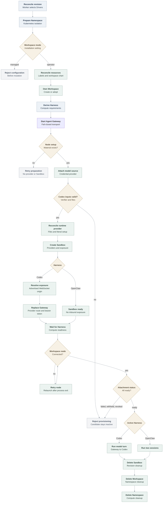

# OpenShell Sandbox provisioning flow

## Overview

Kubernetes Compute delegates dedicated Harnesses to OpenShell. Operator mode owns Namespace Workspaces; managed mode fails before mutation.
[Credential sources](credential-source-lifecycle.md) provide model access without
Agent Secret permission. Codex authenticates Gateway requests through revision-owned
provider files and OpenShell's bearer-passthrough endpoint, replacing the direct
Harness Service.

Workspace-node setup exposes a scoped bootstrap token through a revision-owned
provider file; it remains development-only.

## Entry Points

- Trigger: a worker reconciles an Agent revision that selects the OpenShell
  Sandbox Driver and Kubernetes Compute Driver.
- Source: `apps/controller/src/drivers/sandbox/openshell.ts:ensureNamespace`
- Source: `apps/controller/src/drivers/sandbox/openshell.ts:provisionHarness`
- Source: `apps/controller/src/drivers/compute/kubernetes/index.ts:prepareRevision`
- Assumptions: the Installation selected Kubernetes Compute, the OpenShell
  Sandbox, and the OpenShell Credential Gateway through one `openshell` Backend;
  the tenant Namespace and baseline isolation exist; and the Gateway is ready in
  operator workspace mode.

## Flow

## Execution Trace

### 0. Create the development control plane

`scripts/dev-up`, `internal/occdev/openshell_k3d.go:upK3d`,
`internal/occdev/openshell.go:prepareOpenShell`,
`internal/occdev/kubernetes.go:writeInstallation`

The Installation selects OpenShell, the Gateway, Sandbox and Credential Gateway;
`binaries` lists x64/ARM64 Codex. Credential-source profiles govern legacy egress.

`scripts/dev-up` runs `occ dev up`. With `OCC_DEVELOPMENT_CONTROL_PLANE=kubernetes`,
preflight rejects port collisions, then records engine, cluster, namespace, port and key destination.

Both profiles import larger OCE images first, avoiding k3s eviction of idle OpenShell images.
Launchers [verify three local image digests and revisions](../guides/deploy/local-openshell-images.md)
before creating resources. Omitting selectors uses the release. `prepareOpenShell`
rechecks candidates. Import preserves collision, Linux and cleanup checks. Neither
import nor Helm pulls candidate images.

On Sandbox rollout failure, `captureAgentSandboxRollout` reads only the fixed
Deployment, UID-linked ReplicaSets and Pods, and associated Warning reasons.
It marks incomplete results, omits text, environment, labels and logs, and returns
the original error for rollback. Its 15-second context allows three seconds and
256 KiB per command, 32 KiB per record. Pipe draining cannot kill descendants;
writer latency and durability are outside the budget.

After Helm, `network.providerHarness` records Gateway ClusterIP, Pod selector and TCP/8080.
The Agent Gateway aliases only the advertised hostname, preserving HTTP Host.
NetworkPolicy limits access to those Pods and port.

[Compose](../guides/deploy/local-kubernetes-development.md) runs PostgreSQL, OCC and the k3d worker.
Kubernetes-only uses `oce-system` and in-cluster auth. Private Envoy routing and
operator Workspaces admit only API, worker, supervisor callbacks and Agent Gateways.
`prepareComposeRoutingFiles` sets private ownership. Installation files are `0644`
in private state. Cleanup verifies ownership, removes recorded resources and retains recovery state on failure.

In [protected development](../guides/deploy/local-openshell-images.md#select-the-protected-profile),
initialization and the API start with zero workers. Only after tenant access, network
policies and Gateway rollout succeed does Helm request one worker.

### 1. Prepare the Namespace and OpenShell Workspace

`apps/controller/src/drivers/compute/kubernetes/index.ts:ensureNamespace`

Compute establishes quota, limits and baseline NetworkPolicies before
`SandboxDriver.ensureNamespace`. Managed mode rejects before Kubernetes or
Gateway use. Operator mode applies namespace labels, workspace-chart resources
and provider NetworkPolicies, then checks health; optional namespace-local
readiness comes first. Development uses the central Gateway endpoint.

`apps/controller/src/backends/openshell.ts:clientForNamespace` passes raw
endpoints, including bracketed IPv6, unchanged to the gRPC client. HTTP
origins keep port 80 explicit; HTTPS and nondefault ports retain their behavior.

The Workspace uses Compute's physical namespace name (`oce-` plus a 15-character
digest, within OpenShell's 19-character limit). The Driver reads it, creates it
if missing, or rereads after concurrent `ALREADY_EXISTS`. Adoption requires the
expected name, OCC Namespace ID label, managed-by label and active phase;
conflicts fail Namespace preparation.

### 2. Derive the provider-owned Harness request

`apps/controller/src/drivers/compute/kubernetes/index.ts:prepareRevision`

Compute derives `provisionHarness` image, command, labels, environment, mounts,
optional identity, and resources from its ordinary Deployment shape.
First deployment keeps the Agent Service inactive. Compute starts the Gateway on
fail-closed transport, waits for readiness and its Agent-owned node setup Secret,
then passes the Secret reference to the SandboxDriver. Credential attachment and
provider/Sandbox creation wait for both prerequisites.
The local OpenShell profile disables projected workload identity. If it is
enabled, OpenShell rejects the revision before Gateway mutation because the
pinned API cannot preserve the exact Agent ServiceAccount and token.
For `credential_source`, Compute renders the catalog login mode without a model
Secret and passes revision and `attachForRevision` provider names through
`requirements.credentialAttachments`.
For Codex, it reads the exact Agent transport Secret in the control plane and
adds only its SHA-256 verifier as `APP_TOKEN_SHA`. It converts the admitted plugin
snapshot into `runtime.json`/`config.toml` workload files and removes their ConfigMap
paths from the environment.

`OpenShellSandboxDriver.configureAgent` selects full access with user review.
`deploy/runtime/openclaw-codex-full-access-profile.patch` sends `:danger-full-access` on thread and turn requests only when the OpenShell
endpoint selects that profile. If native policy returns a constrained thread,
the Gateway fails the request before starting a turn. First Agent can read a
prior PAT revision frozen with `workspace-write`; a new deployment must freeze
the current policy and leaves the prior revision unchanged.
OpenShell blocks nested bubblewrap user namespaces; model readiness does not
prove shell execution.

PAT bootstrap (`prepareHarnessAuth`;
`apps/controller/src/drivers/compute/kubernetes/runtime-entrypoints.ts:AGENT_RUNTIME_ENTRYPOINT`)
writes an opaque placeholder to private `auth.json`, clears the child override,
and validates native login status. Scoped [PAT routes](../reference/drivers/openshell-credential-gateway.md#source-type-catalog)
admit bootstrap and model traffic; failure keeps revisions inactive.
For API-key sources, the credential gateway derives the profile from immutable `config.base_url`,
defaulting to OpenAI `/v1`. Its shared validator rejects invalid endpoints before
[registration](credential-source-lifecycle.md#1-admit-the-registration-request).
The profile binds credentials to the full base path, including prefixes such as
`/api/v1`, followed by `/**`. `attachForRevision` rejects custom endpoints for
native OpenClaw. For Codex,
`apps/controller/src/drivers/compute/plugin-runtime.ts:codexConfigurationToml`
selects a named provider with the normalized endpoint and HTTPS Responses transport.

### 3. Validate and serialize the Sandbox

`apps/controller/src/drivers/sandbox/openshell.ts:provisionHarness`

Only dedicated Codex or OpenClaw revisions pinned to this Driver are accepted.
Kubernetes, filesystem, process and binary-scoped network policy use the
`v0.1.3-pre.2` wire contract. Landlock is required; unsupported enums, inherited
keys, old `passthrough` TLS spelling and missing executable paths fail before
launch. Readiness `timeoutMs` must be a positive safe integer. The Installation
loader names it; startup instead logs `startup-error` / `STARTUP_FAILED` before
Kubernetes calls. Duplicate names and reserved `workspace-node-enrollment` fail
before Driver construction. Rename them, retaining binaries and endpoints.

After the setup-Secret gate above, `provisionHarness` creates or adopts the
runtime provider with the final node envelope, never a placeholder. Renewal
version-fences `UpdateProvider` to `node_setup_json` only. A configured
post-create delay gives the process time to listen. Compute then rolls the
Gateway to the exposed route and waits for that Deployment before observing
workspace-node enrollment.

Dedicated Codex requires one lowercase `APP_TOKEN_SHA`, no `APP_SERVER_TOKEN`,
and two bounded plugin-free runtime inputs. Selected plugins, repository broker
configuration, malformed files, and other Secret-backed environment fail before
Gateway mutation.

The shared `oce-codex-runtime` profile backs a revision-owned provider with
read-only `runtime.json`, `config.toml`, and `node-setup.json`. The last file holds
the validated Agent-owned setup Secret’s complete expiring envelope, including
`bootstrapToken`. This development diagnostic avoids credential rewriting:
OpenClaw signs that token in its device proof.
Before renewal, the Driver requires the same endpoint and TLS fingerprint, an
expired stored envelope, a later live expiry, and unchanged runtime and CA
configuration. The Sandbox network policy limits the connection to the exact
Gateway endpoint and `/usr/local/bin/node`. Foreign ownership or other drift
fails before Sandbox creation.

The Driver mounts a revision-scoped Agent PVC subpath at
`/sandbox/.openclaw-runtime`; persistent subpaths mount below
`/sandbox/.openclaw-mounts`. It rewrites admitted `/home/node` paths beneath the
runtime home, declared as `harnessHome` for native hook credentials. Codex hook
commands trust the provider-file Gateway CA and reach the Gateway route only when
the node does: an in-cluster routing hostname or two clusters. Exact mount paths
such as `OPENCLAW_NODE_STATE_DIR` use a process-created `state` child, so atomic
writes cross neither a symlink nor a root-owned mount. Workspace, node identity, sessions, and generated images
remain separate. `/tmp` stays on the bounded ephemeral image layer.

Credential attachments must use the OCC `oce-cs-` name shape and cannot repeat
a static provider. The profile binds them to the exact native Codex executable;
a changed runtime dependency path fails the startup model probe.

Native OpenClaw uses a separate verification bridge, not a supported local
first-Agent path.

### 4. Call the versioned gateway contract

`apps/controller/src/drivers/sandbox/openshell-gateway-client.ts:createSandbox`

Create includes Sandbox identity, spec, Workspace scope and `request_id`.
Unresolved creates persist; completed records expire after 24 hours. After
`REQUEST_OUTCOME_UNCERTAIN`, `REQUEST_ID_PAYLOAD_MISMATCH` or
`REQUEST_REPLAY_UNAVAILABLE`, advance to the next of 16 revision-derived IDs
only if `getSandbox` finds nothing. The Workspace-unique name prevents duplicates.
At 1,000 live or unresolved admissions, `RESOURCE_EXHAUSTED` maps to transient
`SANDBOX_ADMISSION_LIMIT_REACHED`. Revision convergence waits without spending
attempts; Namespace work retries normally.

Codex requests one unnamed bearer-passthrough exposure on `APP_SERVER_PORT` and
requires its `service_urls` entry. Native OpenClaw connects outbound, requests
no exposure and rejects returned URLs. The Driver creates only after `getSandbox`
finds no Sandbox. Adoption, including `ALREADY_EXISTS`, requires matching
Workspace, labels, annotations and full spec, with neither deleting nor stopped
state. For Codex, `GetService` must confirm the unnamed bearer-passthrough
endpoint on the admitted port. Workspace `sandbox:write` permits replacement
and is the trust boundary.

`apps/controller/src/drivers/sandbox/openshell-gateway-client.ts:OpenShellGatewayRequestFailure`
drops supplier text and attaches fixed `method`, `grpcStatus` and
`validationCategory` fields. `apps/controller/src/worker.ts:revisionFailureLogFields`
logs them without changing retries. Categories are `POLICY_SAFETY`,
`POLICY_MIDDLEWARE_VALIDATION` or `UNKNOWN`; only exact `CreateSandbox` status-3
policy prefixes qualify. Request values never enter these fields or the exception
message.

The Backend shares clients by endpoint and retries setup. It checks cancellation
after preparing credentials, before dispatch; stalled initialization or file reads
remain unbounded. After dispatch, cancellation stops local gRPC, not remote effects.

`GetService` distinguishes the local client URL from its advertised origin.
`harnessEndpoint` validates the exposure and returns that WebSocket origin,
`/sandbox/enterprise` workspace root and optional public Backend CA from
`apps/controller/src/backends/openshell.ts:publicRootCertificate`.

`apps/controller/src/drivers/sandbox/openshell.ts:harnessStatus` probes the authenticated WebSocket handshake before
reading a held-failure document. `apps/controller/src/drivers/sandbox/openshell-service-transport.ts:serviceWebSocketHandshake`
destroys HTTP refusal responses immediately, so unfinished bodies cannot retain
connections after the probe returns.

The revision provider survives an uncertain create; revision cleanup deletes
the Sandbox first.

Runtime opens reported absolute provider paths; Gateway failures prevent readiness.

OpenShell's supervisor opens the node connection. Kubernetes-only uses the
in-cluster WSS route; Compose uses the Agent Gateway Service URL. In both cases,
policy binds the node executable and supervisor to the exact destination. The
supervisor relaunches an exited node and falls back to direct signaling when
process-group signaling returns `EPERM`.

### 5. Observe readiness or clean up

`apps/controller/src/drivers/compute/kubernetes/index.ts:prepareRevision`

Compute verifies revision ownership and resolves `harnessEndpoint` before
replacing the fail-closed Gateway. It sets `APP_SERVER_URL`,
`OPENCLAW_REMOTE_WORKSPACE_ROOT` and the configured provider host alias. It projects
`codexPermissionProfile` as `OPENCLAW_CODEX_PROVIDER_PERMISSION_PROFILE`.
`apps/controller/src/drivers/compute/kubernetes/index.ts:reconcileHarnessTrust`
validates `tls.caBundle` into a separate immutable revision ConfigMap, preserving
the earlier snapshot. Only that Gateway mounts the combined public endpoint/execution
CA bundle via `NODE_EXTRA_CA_CERTS`. Node `ws` verifies certificates and
hostnames; unspecified trust retains system roots.

Preparation preserves serving predecessors. Activation re-resolves the endpoint.
Both reconcile trust before rollout; drift requires a new revision.
Compute admits configured provider egress, keeps the Agent Service inactive and
omits its Harness route. Drivers without `harnessEndpoint`
retain Kubernetes routing and `/home/node/workspace`.

Compute keeps the revision inactive until the provider Pod and enrolled workspace
node are ready. On each retry, the Harness wrapper refreshes provider setup or keeps
the last valid value if unavailable. It restarts workspace-node one second after
every exit, without an attempt limit; shutdown ends retries.

For bound sources
Compute calls `attachmentStatus`, which reads
`GetSandboxProviderStatus`. `pending` or a missing status retries; `failed`,
`withheld`, `revoked`, or `absent` fails the revision; only `ready` for every
attachment completes preparation. On revision
shutdown, `shutdownRevisionRuntime` calls `cleanup` with the revision. The
Gateway client sends `DeleteSandbox` with the same `workspace_scope`; a missing
Sandbox is an idempotent success. Codex cleanup then verifies and deletes the
revision provider. Namespace cleanup removes the shared profile after its
runtime providers are gone. Compute removes the public trust ConfigMap through
`apps/controller/src/drivers/compute/kubernetes/index.ts:deleteRetiredRevisionArtifacts`
after revision workloads terminate.

Namespace deletion calls `cleanup` without a revision after revision resources
are gone. OpenShell verifies Workspace ownership, deletes remaining owned runtime
providers and the shared profile, sends idempotent `DeleteWorkspace`, then removes
workspace-chart resources and NetworkPolicies in reverse order. A terminating
Workspace remains retryable after a lost response. Compute deletes the Kubernetes
namespace only after this cleanup succeeds.

## Debugging and verification

See [OpenShell tests](../testing/openshell.md) for prerequisites and proof coverage.
In Compose, `network.providerHarness.address` must match the `openshell-gateway`
ClusterIP and the Agent Gateway must use `ws://*.openshell.localhost:8080/`.

## Related docs

- [OpenShell Sandbox Driver](../reference/drivers/openshell-sandbox.md) and [OpenShell Credential Gateway](../reference/drivers/openshell-credential-gateway.md)
- [Credential source lifecycle](credential-source-lifecycle.md)
- [OpenShell tests](../testing/openshell.md)
- [Kubernetes Compute Driver](../reference/drivers/kubernetes-compute.md)
- [Harness execution topology](harness-execution-topology.md)

## Manual Notes

[keep this for the user to add notes. do not change between edits]

## Changelog

- 2026-10-15 18:46: Defer protected development worker startup. (authoring-run/acc80b35-b98a-4e59-83ac-8fd4bf78050e - 05750c084)

- 2026-10-15 08:47: Select explicit Codex permissions. (authoring-run/7eb24321-3670-4154-adde-41a0f1b36728 - 04514330688378316bd0641b8d5560da56aeff85)

- 2026-10-15 02:25: Distinguish API-key and PAT isolation. (authoring-run/c11897e0-33a6-4276-b620-aaec6d57ab00 - 07eb950b5)

- 2026-10-14 14:04: Scope PAT authentication and OpenShell prerequisites. (authoring-run/dba0a6cb-33d9-40fd-b38b-e20cddf4b75f - 96a2b79fa)

- 2026-10-14 20:27: Release refused WebSocket probes. (authoring-run/01a10a81-070c-7aa3-97d0-fbce8f285d4d - 4727e9b109a2127150e03e39e859d45e0668f82f)
- 2026-10-14 17:56: Trace closed gRPC validation diagnostics in the accompanying uncommitted change. (authoring-run/0bb26444-920f-4713-8f19-4c0b7f35e048 - 18c3d7449ca95914c2e248455ccc72b044a27855)

- 2026-10-14 16:28: Trace public Harness endpoint trust projection and retirement in the accompanying uncommitted change. (authoring-run/c696045b-5231-4253-a4bd-823334718d6a - a071498ddb2ac4dd5d9a22ec678cf0d602c61a0a)

- 2026-10-14 12:17: Document candidate preflight/import in the accompanying uncommitted change. (authoring-run/217a5c5f-ae2d-47c4-9dd6-d16ed0244627 - dc5648b67d2618cc43ef07562298e986a94674e7)

- 2026-10-13 14:11: Reconcile setup-Secret ordering and preserve service-IPv6 history alongside credential endpoint safeguards. (agent:roboclaw:dashboard:9d0532e1-befb-4fc3-935e-7cd2a0c72110 - 90268463bbd255c3c13a0e0bdeb437728189eb1a)

- 2026-10-13 13:57: Reconciled development image import order with upstream rollout diagnostics. (authoring-run/503e74ea-e82a-4d1a-8081-fcf4fc4e6868 - 96272fa0a5e4f359ed354abb1918e44986c19e76)

- 2026-10-10 13:04: Reconcile native hook HOME/CA flow with endpoint safeguards; trim repeated narration. (agent:roboclaw:dashboard:9d0532e1-befb-4fc3-935e-7cd2a0c72110 - 90268463bbd255c3c13a0e0bdeb437728189eb1a)

- 2026-10-10 12:40: Declare the Sandbox HOME for native hook credentials; hooks trust the file-delivered Gateway CA. (fix-1017)

- 2026-10-09 23:18: Accept bracketed IPv6 endpoints. (authoring-run/6eefb93e-33fb-450a-9657-51ebe15a686e - 21f34928437fb7d6f4391ba4af5d3e15bf9ce480)

- 2026-10-09 20:27: Integrate main lifecycle, native workspace and readiness contracts without dropping endpoint safeguards. (agent:roboclaw:dashboard:9d0532e1-befb-4fc3-935e-7cd2a0c72110 - 90268463bbd255c3c13a0e0bdeb437728189eb1a)

- 2026-10-09 19:45: Cover both runtime architectures in the development credential policy. (authoring-run/1e7118f7-bdb0-4564-894c-02f990f75e67 - bd540bcdef63cdc719e73192e4dbe99c365953c3)

- 2026-10-09 15:30: Record bounded Agent Sandbox failure metadata before the original error returns and rollback proceeds; tighten setup prose. (authoring-run/54f8d1c2-fb6e-4074-999f-5185af50a86f - 8bfec22f49b207c16afce21bd9a941ee0e9cd95d)

- 2026-10-06 22:10: Preserve HTTP port 80 when creating the OpenShell gRPC target. (authoring-run/88f2e095-3f3a-4d9b-a878-663034cdde6e - 2fc8320cf8bfbf9d7ea20757ef3fe32d7157e6aa)

- 2026-10-06 15:57: Recorded the development image-import order that keeps pinned OpenShell images available until their workloads start. (authoring-run/473c1419-a5a2-4774-ac8d-33d6a265ae06 - 99641a7ab00ad8fdd987e27e9ee838814e5f535a)

- 2026-10-06 11:17: Reconciled endpoint flow with current namespace and provider provisioning; condensed repeated prose. (agent:roboclaw:dashboard:9d0532e1-befb-4fc3-935e-7cd2a0c72110 - b6dc6b87a461ad33374e133d15cc739d8e074fea)

- 2026-10-05 16:17: Documented version-fenced workspace-node setup renewal through the revision provider and supervisor refresh. (authoring-run/4f3e6ccd-a967-48c8-9d5d-f29a6d338d7d - fd9a082e2587432bde6282748a82e3025a64fd1a)

- 2026-10-05 11:36: Trace pre-registration endpoint validation and condense repeated setup and runtime details. (agent:roboclaw:dashboard:9d0532e1-befb-4fc3-935e-7cd2a0c72110 - 9958ef0412565864efba7b13995536d7c2a51d22)

- 2026-10-05 00:06: Bind immutable credential-source endpoints to provider profiles and Codex runtime configuration while retaining existing default endpoint limits for other consumers. (authoring-run/4e4824a1-f107-44c2-90bf-00fe13ff650c - d269c6d03)

- 2026-10-05 12:50: Removed repeated setup and wire-contract detail while preserving the current OpenShell provisioning sequence and moved older entries to the history page. (authoring-run/fd7f6cdb-1d1d-40d5-8d4a-d6d80cd946e7 - 4b5afe0cb653f7dd99fccdb2e3432cbf60e6a03e)

- 2026-10-02 16:26: Passed OpenShell's provider-local workspace root to the dedicated Gateway while preserving the canonical Kubernetes Harness root. (authoring-run/3bf937d5-c422-419e-af2d-754abe024ca4 - 987c8c2b4ace1e152262ef6920b6d0f9ff26a086)

[OpenShell Sandbox provisioning documentation history](openshell-sandbox-provisioning/history.md) preserves the older dated entries.
