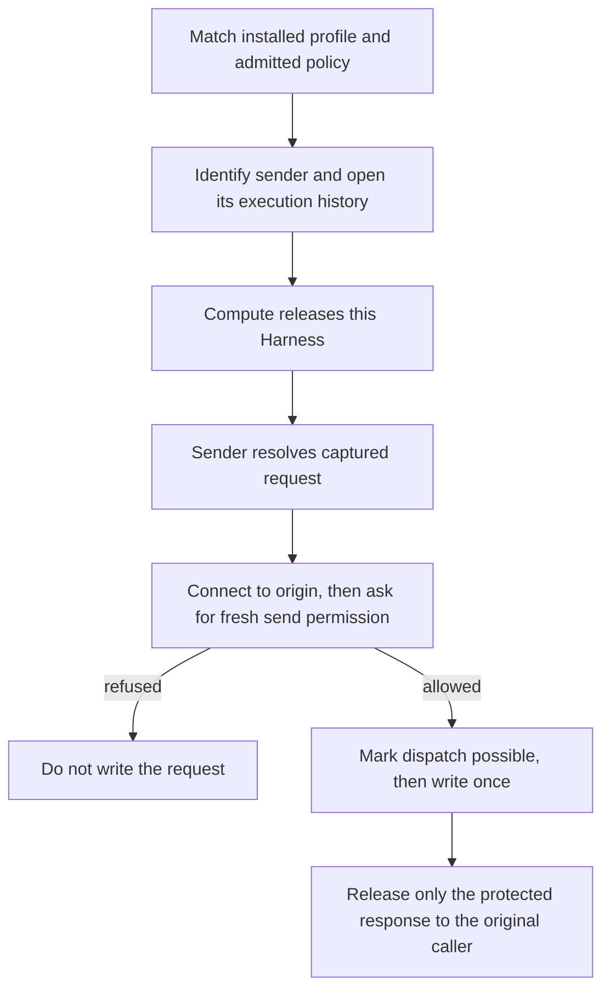

# How Strands admits a protected execution and sends one request

## Overview

Compute releases the Harness only after the controller identifies its installed sender.
For each request, that sender asks Credential Proxy what it may use, then asks again
whether it may send. A lost reply is an uncertain outcome, not permission to retry.

This flow describes the opt-in Strands backend. For installation requirements, including
the network enforcement it relies on, see the [driver reference](../reference/drivers/strands-box-credential-proxy.md).
For the authority's side of the exchange, see [protected credential requests](credential-source-egress.md).

## Entry Points

- `apps/controller/src/backends/strands-box.ts:createStrandsBoxDrivers` adopts the source and enrolls the Harness.
- `runtimes/strands-credential-proxy/src/exchange.rs:run` resolves, authorizes, sends and waits for a protected response.

## Flow

## Execution Trace

### 1. Admit the installed source, then identify this sender

`apps/controller/src/backends/strands-box.ts:createStrandsBoxDrivers` checks the
installation profile and the protected source admission. The Agent does not choose the
authority or origin. `apps/controller/src/drivers/strands-box/installation.ts:provision`
applies Compute’s node selector to both the sender Pod and the Harness Pod. If several nodes
match, Kubernetes can schedule the two Pods on different nodes. The controller challenges
the sender and checks its running image, policy, exchange key and projected bearer commitment.
A new profile cannot confer its admission on an old sender.

`runtimes/strands-credential-proxy/src/history.rs:load` opens history for this execution,
not a shared provider-success counter. The example one-hour policy counts the current
attempt; startup and denied attempts can count too. This is not rollback protection.

### 2. Release the Harness; renew the bearer through maintenance

`apps/controller/src/backends/strands-box.ts:enrollHarness` checks the startup ID and
exact plan, reidentifies the sender, then obtains and checks Compute's release
acknowledgment. Maintenance checks an already serving Harness rather than enrolling it again.

`apps/controller/src/drivers/strands-box/execution-bearer.ts:reconcileStrandsExecutionBearer`
renews the 30-minute bearer in its last five minutes and waits for the same sender to
prove the new projection. Compute normally requests maintenance every two minutes.
A stalled projection does not extend expiry; a business request does not mint a bearer.

### 3. Resolve, connect, then authorize the first application write

`runtimes/strands-credential-proxy/src/exchange.rs:run` binds the captured request,
policy, challenge and response custody to one authenticated exchange. Resolution can
select material; it is not permission to send. The sender establishes the origin TLS
connection _before_ final authorization. A withdrawal between the two decisions can
therefore prevent the application request without implying that no connection was made
or no material was selected.

The sender checks the permit and first-write deadline, marks dispatch possible, then
calls `runtimes/strands-credential-proxy/src/origin.rs:dispatch` once on that socket.
If the reply is lost, preserve the uncertainty; do not replay the request.

### 4. Protect the complete reply; retire the execution without reopening it

`runtimes/strands-credential-proxy/src/exchange.rs:run` sends the complete response,
including trailers, to the authority. It releases only the accepted response on the
original exchange. A forbidden final trailer can withhold a reply even though the
origin received the request. There is no fallback to the unprotected body.

`apps/controller/src/backends/strands-box.ts:withdrawBinding` retires this
single-binding execution. Retirement stops the sender first, keeps the network fence
while either Pod remains, and retains history until revision cleanup. It does not
retroactively cancel an application write.

## Debugging and Verification

Compare the sender receipt with the controlled origin's decrypted application observations,
not just a TLS connection or an HTTP status. The
[installed adverse test](../../tests/integration/strands-box-credential-proxy-installed-k3d-real.test.mjs)
checks withdrawal after resolution, an uncertain lost reply, and two overlapping callers
each receiving only its own reply. Test source describes the check, not which image passed it.

## Related docs

- [Configure and qualify the Strands installation](../reference/drivers/strands-box-credential-proxy.md)
- [Trace the authority's resolution and send decision](credential-source-egress.md)

## Manual Notes

None.

## Changelog

- 2026-10-20 00:59: Clarify that both Pods use the same node selector. (authoring-run/f4c34bfc-32a3-4c9c-a8da-8d991ae3e723 - 8b3b1d2e)
- 2026-10-16 00:05: Trace source admission through sender retirement. The public identifier records the October 20 import. (authoring-run/f4c34bfc-32a3-4c9c-a8da-8d991ae3e723 - 55bf9040)
