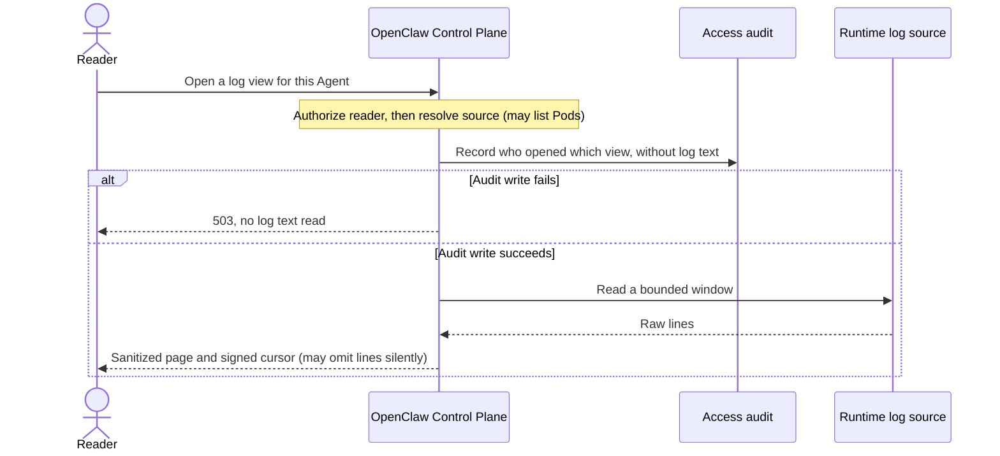

# Proposal: Agent runtime status and log reads

- **ID on this branch:** RFC-0019. Before merge,
  [use the current base to renumber](../../docs/contributing/specifications.md#files-and-numbering)
  this proposal, its file, index entry and links.
- **Created:** 2026-10-01
- **Last updated:** 2026-10-15
- **RFC PR:** https://github.com/openclaw/openclaw-enterprise/pull/854

## Read the container that just exited

An Agent keeps restarting. The person on call can run `occ agent runtime AGENT_ID` to see
the last exit and restart count, then `occ agent logs AGENT_ID --source agent --previous`
to ask for that instance’s output. Reading the current container would show the _next_
attempt. Waiting through one more restart can put the useful output beyond reach. Before
[#696], getting those lines meant obtaining cluster access and using `kubectl`.

**Decision requested.** Keep a separately authorized, audited way to read recent runtime
text in the console and CLI, without building a central log archive. The implementation
landed before this RFC. We need a human decision on the access and disclosure defaults
below, particularly who may read across redeployments and whether a diagnostic that can
silently miss lines is sufficient. Record any required change against the implementation;
merging a description cannot narrow an existing permission.

OpenClaw Control Plane (OCC) records who opened the view
_before_ reading log text. If that write fails, the reader gets `503` and OCC reads no text.
OCC stores no log text, but the reader can download what it returns. Filtering can leave
a secret, a reply or tool output visible. Grant `read_logs` to someone trusted with that
possibility, not simply to everyone who can see whether an Agent is healthy.

## From a reader’s permission to the first page

This is the implemented order for opening a view. OCC authorizes every poll but audits
admission once per view. The [runtime logs flow](../../docs/flows/agent-runtime-logs.md)
traces the requests. In the example above, a delegated reader may be allowed to run
`occ agent logs` without permission to run `occ agent runtime`.

1. **Authorize this Agent.** Both routes are under `…/agents/:agentId/deployments/:deploymentId`.
   For `GET /runtime`, require Agent `operate` and `read`, plus `read` on the revision. For
   `GET /runtime/logs`, require Agent `read` and either `read_logs` or qualifying `administer`.
   The [controller](../../packages/occ/src/index.ts) resolves the revision within the
   exact Agent and Namespace. It tries `read_logs` first and considers `administer` only if
   no [Restriction](../../migrations/0041_restriction_read_logs.sql) applies to `read_logs`.
   Under the [IAM contract](../../packages/contracts/src/index.ts), no action implies
   `read_logs`, and `read_logs` implies no other action. An administrator can _grant_ it;
   bootstrap does not grant it ([#737], [#739]). Text access follows the Agent across
   revisions without a separate revision grant ([#745]).
2. **Limit the read, then resolve the source.** After authorization, both routes allow
   two tokens per second, burst ten, per principal and Agent; exhaustion returns `429`.
   Each API replica admits up to 16 concurrent reads, then returns `503 RUNTIME_LOGS_UNAVAILABLE`.
   OCC audits an access denial without spending a token ([#1187]). Resolving a container
   can involve listing Pods before the view audit. The ordering guarantee concerns the
   first read of _text_, not the first contact with Kubernetes.
3. **Record admission, then ask for text.** OCC writes an `access` audit,
   `openclaw.agents.runtime_logs.view` (or `.download` for each download), with the
   admitting action, source, Pod, container, `previous` and tail, never the text.
   The row shows who opened which view, not every line they received. A different Pod,
   container or `previous` selection opens another view. A restart or new UID under the
   same Pod name continues this one. OCC authorizes each poll; expiry starts another
   audited view. Status reads are not audited.
4. **Return only the sanitized page.** The [HTTP handler](../../apps/controller/src/http/runtime-logs.ts)
   accepts `source` (`gateway`, `agent`, `sandbox`), `pod`, `container`, `previous`,
   `tailLines` (1–1000), `sinceSeconds`, `cursor`, `download` and `minLevel`. It returns
   [fixed errors](../../apps/controller/src/http/errors.ts), never Driver or cluster error text.

### What the runtime can actually provide

**Kubernetes.** Cluster roles cannot distinguish one Agent’s logs from another’s. Both
Helm charts default `agentRuntimeLogs.enabled` to true, granting the tenant API, Gateway
observer and execution roles `get` on `pods/log` and `get,list` on `events` ([#967]). Turning
the switch off makes both routes return `501` before authorization, disclosing the setting.
The roles retain `get,list` on `pods` and `get` on `pods/proxy`.

The Driver resolves revision labels, Pod ownership and the declared container. Status
covers up to eight Pods per role, 16 main and init containers per Pod ([#1994]), and the
newest 100 Pod Events ([#1938]). Events name the container. The CLI prints Events and Harness status, the console exposes
failure `code` on collapsed rows, and status reports the current termination if available,
otherwise the prior one ([#747], [#1946]). A settled volume-binding retry is suppressed
once the Pod has a node ([#1354]). Status rejects invalid or offset timestamps
([#2139], [#2153]); log timestamps accept kubelet offsets and preserve precision ([#1934]).
Docker and SSH omit the optional runtime methods. Driver-owned logging returns `501`.

For the opening example, the CLI chooses the first main container and has no container
flag. The Driver requests timestamped `pods/log` with a 1 MiB limit, then checks the Pod
again for replacement. If it is gone, the requested UID and restart count stand. Any
Kubernetes `400` on a _previous_ read becomes an empty page, so an empty result does not
establish that the process wrote nothing. On a _current_ read, [#1922] deliberately asks
for logs even if status still says `ContainerCreating`. Only a never-started container (no restart, container ID or prior termination)
and kubelet’s matching `400 BadRequest` naming that Pod, container and `ContainerCreating` or
`PodInitializing` become an empty page. Stale status cannot hide output already available.

**OpenShell.** Here `source=sandbox` means policy and supervisor activity, not Harness
stdout or stderr. OCC offers it only for a revision provisioned by the selected Sandbox
Driver, using `sandbox:read` and a client exposing only `GetSandboxLogs`. Impossible `since_time` values are rejected ([#726], [#2147]).
“Not found” also covers provisioning or concealment by Workspace membership. Dedicated
Harness status distinguishes running, starting, lost (OCC will not restart it), unknown,
and a restart with last exit code and restart number ([#2076], [#2089]). Reading Harness
output would require attach and `sandbox:write`; this path does not escalate to it.
The 2000-line buffer disappears on gateway restart, push drops are inferred, and CONNECT
allows lack a policy generation. Existing tests use synthetic lines and loopback gRPC.

### What can reach the reader

[One sanitizer boundary](../../packages/occ/src/runtime-logs/sanitize.ts) supplies both JSON
and download. It labels container records `operational` and Sandbox records `activity`;
the serializer rejects a `content` label. That is a check on classification, not a guarantee
that the body is free of conversation or credentials.

- Keep recognized wrapper fields and OpenClaw console keys. Without a subsystem, retain
  only warning or error, because lower levels can carry chat replies ([#869]). Unrecognized
  Codex tracing text becomes `Codex message withheld` ([#928], [#969]). Drop payload keys
  such as `prompt`, `messages`, `body` and `headers`; count withheld structured runs, including
  multiline JSON and Codex JSON-RPC ([#742]). Plain text can still contribute up to 4 KiB.
- Redact retained strings, including argv credentials, auth and cookie headers, JWTs, token
  prefixes, cloud keys, URL credentials and query values. Long-token heuristics cover
  particular hex or mixed-case-and-digit base64 shapes of at least 40 characters. Short or
  unfamiliar secrets can survive, as can prompt or tool fragments in text, Sandbox
  `cmd_line` or `url`. PEM masking spans container lines and pages, but only one string at
  a time in Sandbox messages ([#741]). Mask infrastructure names in standard Kubernetes
  Events; console and CLI escape invisible or direction-changing characters ([#1362], [#1371]).
- Accept up to 32 KiB per input line, emit up to 8 KiB, and bound a read to 1000 lines and
  ten seconds. The 512 KiB response limit includes envelope and cursor. Measure a prefix
  that fits; do not promise the largest possible prefix ([#1981], [#2270]). Apply
  `minLevel` _after_ sanitizing and signing the cursor. Unknown levels, gaps and withheld
  counts survive. A sparse page does not trigger a deeper read to fill it. The CLI offers
  `--level` and rejects an explicit zero or subsecond `--since` ([#807], [#2110]).

### What following can miss

Polling about every two seconds avoids a held kubelet connection per viewer and repeats
authorization. It rereads overlapping windows, not a durable sequence. The
[signed cursor](../../packages/occ/src/runtime-logs/cursor.ts) is not encrypted. It binds
principal, Agent, revision and source; mismatch returns `400`. The CLI follows with `tailLines=1000`. The same principal can
replay the cursor for up to an hour. Version 2 uses 96-bit keyed hashes under a cursor-secret
subkey, so the reader cannot test guesses about a secret line offline. A verified
version 1 cursor expires into a newly audited view ([#2274]).

For containers, reread two seconds of overlap. At the last delivered timestamp, remember
how many lines were delivered, whether the count is complete, and up to 16 line hashes
([#1896], [#1918]). If ordered timestamps, the complete count and hashes establish position,
skip exactly that count. Otherwise identical new lines can be suppressed _without a gap_,
potentially every new line at that instant once there are more than 16. A response-size
cut saves the raw-window position and masking state. A Driver byte cut normally resumes
by time and reports truncation; skipping an overlong line reports `window_exceeded`.

For Sandbox, reread five seconds of overlap and consume up to 48 remembered hashes once
each. After a response-size cut, verify a keyed hash of the observed window before using
the saved position. Both sources can flag `stream_replaced`, `window_exceeded`,
`cursor_expired`, `truncated` or `buffer_lost`, as applicable. A reset can repeat lines;
an identical replacement can be undetectable. See [Read one page](../../docs/flows/agent-runtime-logs.md#3-read-one-page)
for the algorithm. A quiet follow is not evidence that nothing happened.

## Decisions a human reviewer still owns

The implemented answers below are open to review. If one is unacceptable, identify the
permission, runtime or Collector change needed, rather than recording a stronger promise here.

| Choice | Implemented default and its consequence |
| --- | --- |
| Enable the cluster permission by default? | Yes. OCC and the Driver, rather than cluster RBAC alone, enforce the Agent boundary. |
| Who can read across redeployments? | Agent `read` plus `read_logs` or qualifying `administer`, without revision `read`. Delegate through the Namespace IAM Role API; there is no log-only share in the console. |
| What must the audit prove? | Admission of each view and download. It does not reconstruct which lines the reader saw. |
| Is best-effort follow sufficient? | Yes for recent diagnostics, including sparse level-filtered pages and possible silent loss. A complete incident record would need a different source and retention decision. |
| What if Sandbox activity is insufficient? | The read-only path stops there. Filing the missing OpenShell capabilities upstream remains open. |
| May operational message text reach the logging backend? | Yes, in the narrow cases below. Backend retention and access are a separate disclosure boundary. |

[Production observability](0012-production-observability.md) owns the Collector. Gateway
`logs.tail` cannot diagnose a down Gateway; using Loki as the source would require retaining
text the Collector normally strips. The [Harness wrapper](../../apps/controller/src/drivers/compute/kubernetes/runtime-entrypoints.ts)
also removes expected Codex stderr noise unless `RUST_LOG` starts at debug or trace. At
the recorded baseline its filters matched 0.158 shapes, while the image had moved to
0.163.0-alpha.2 ([#2029]); renamed records could let noise through. Startup probes preserve
a bounded failure cause, including provider usage limits ([#1096], [#2289]).

Collector `codex.turn` and `codex.tool_call` bodies are fixed. `codex.operational` retains
short message text only for `codex_app_server` targets and two fixed retries, excluding
credential words and argv credentials; `gateway.startup_failed` follows those rules.
Failed startup phases retain `occ.code`. Gateway settings overrides export a warning
without attributes, and sign-in provider outage warnings use four fixed-vocabulary
attributes ([#806], [#811], [#863], [#879], [#896]). Operators upgrading the Collector
must refresh its configuration Secret.

## Implementation and source boundary

The initial slices ([#696]–[#811]) merged September 30–October 1, 2026. Follow-ups through
[#2274] merged by October 13. This is a retrospective proposal, not an acceptance or
deployment record. The original source baseline was `07590c64e`, with keyed cursors at
`84755c0ab`. A selective comparison to `main` at `00bbc7cd9` on October 15 also found the
page-sizing and startup-probe changes ([#2270], [#2289]); it was not a runtime test.
Related decisions: [Agent access](0010-agent-access.md) and [sign-in](0001-oidc-sign-in.md).

For the implementation rationale, see CLI and download ([#711]), fixtures and policy
provenance ([#730]), and Harness noise filtering ([#793], [#876]). Follow behavior changed
with quiet-view resume ([#933]), byte limits and bursts ([#939], [#973]), and oversized
lines ([#1102], [#1108]). The console ([#1213]) and CLI ([#1591]) later separated log
presentation from their other commands and views.

## References

- Guide: [Agent logs](../../docs/guides/topics/agent-logs.md); flow:
  [Agent runtime logs](../../docs/flows/agent-runtime-logs.md); security:
  [Console and API runtime log reads](../../docs/reference/security.md#console-and-api-runtime-log-reads).
- Code: [packages/occ/src/runtime-logs/](../../packages/occ/src/runtime-logs/index.ts),
  [apps/controller/src/http/runtime-logs.ts](../../apps/controller/src/http/runtime-logs.ts),
  [apps/controller/src/console/agents/logs.mjs](../../apps/controller/src/console/agents/logs.mjs),
  [internal/occcli/agent_runtime.go](../../internal/occcli/agent_runtime.go),
  [deploy/logging/collector.yaml](../../deploy/logging/collector.yaml).
- Tests: [runtime-logs-content](../../tests/conformance/runtime-logs-content.test.mjs),
  [occ-api-security](../../tests/conformance/occ-api-security.test.mjs).

[#696]: https://github.com/openclaw/openclaw-enterprise/pull/696
[#711]: https://github.com/openclaw/openclaw-enterprise/pull/711
[#726]: https://github.com/openclaw/openclaw-enterprise/pull/726
[#730]: https://github.com/openclaw/openclaw-enterprise/pull/730
[#737]: https://github.com/openclaw/openclaw-enterprise/pull/737
[#739]: https://github.com/openclaw/openclaw-enterprise/pull/739
[#741]: https://github.com/openclaw/openclaw-enterprise/pull/741
[#742]: https://github.com/openclaw/openclaw-enterprise/pull/742
[#745]: https://github.com/openclaw/openclaw-enterprise/pull/745
[#747]: https://github.com/openclaw/openclaw-enterprise/pull/747
[#793]: https://github.com/openclaw/openclaw-enterprise/pull/793
[#806]: https://github.com/openclaw/openclaw-enterprise/pull/806
[#807]: https://github.com/openclaw/openclaw-enterprise/pull/807
[#811]: https://github.com/openclaw/openclaw-enterprise/pull/811
[#863]: https://github.com/openclaw/openclaw-enterprise/pull/863
[#869]: https://github.com/openclaw/openclaw-enterprise/pull/869
[#876]: https://github.com/openclaw/openclaw-enterprise/pull/876
[#879]: https://github.com/openclaw/openclaw-enterprise/pull/879
[#896]: https://github.com/openclaw/openclaw-enterprise/pull/896
[#928]: https://github.com/openclaw/openclaw-enterprise/pull/928
[#933]: https://github.com/openclaw/openclaw-enterprise/pull/933
[#939]: https://github.com/openclaw/openclaw-enterprise/pull/939
[#967]: https://github.com/openclaw/openclaw-enterprise/pull/967
[#969]: https://github.com/openclaw/openclaw-enterprise/pull/969
[#973]: https://github.com/openclaw/openclaw-enterprise/pull/973
[#1096]: https://github.com/openclaw/openclaw-enterprise/pull/1096
[#1102]: https://github.com/openclaw/openclaw-enterprise/pull/1102
[#1108]: https://github.com/openclaw/openclaw-enterprise/pull/1108
[#1187]: https://github.com/openclaw/openclaw-enterprise/pull/1187
[#1213]: https://github.com/openclaw/openclaw-enterprise/pull/1213
[#1354]: https://github.com/openclaw/openclaw-enterprise/pull/1354
[#1362]: https://github.com/openclaw/openclaw-enterprise/pull/1362
[#1371]: https://github.com/openclaw/openclaw-enterprise/pull/1371
[#1591]: https://github.com/openclaw/openclaw-enterprise/pull/1591
[#1896]: https://github.com/openclaw/openclaw-enterprise/pull/1896
[#1918]: https://github.com/openclaw/openclaw-enterprise/pull/1918
[#1922]: https://github.com/openclaw/openclaw-enterprise/pull/1922
[#1934]: https://github.com/openclaw/openclaw-enterprise/pull/1934
[#1938]: https://github.com/openclaw/openclaw-enterprise/pull/1938
[#1946]: https://github.com/openclaw/openclaw-enterprise/pull/1946
[#1981]: https://github.com/openclaw/openclaw-enterprise/pull/1981
[#1994]: https://github.com/openclaw/openclaw-enterprise/pull/1994
[#2029]: https://github.com/openclaw/openclaw-enterprise/pull/2029
[#2076]: https://github.com/openclaw/openclaw-enterprise/pull/2076
[#2089]: https://github.com/openclaw/openclaw-enterprise/pull/2089
[#2110]: https://github.com/openclaw/openclaw-enterprise/pull/2110
[#2139]: https://github.com/openclaw/openclaw-enterprise/pull/2139
[#2147]: https://github.com/openclaw/openclaw-enterprise/pull/2147
[#2153]: https://github.com/openclaw/openclaw-enterprise/pull/2153
[#2274]: https://github.com/openclaw/openclaw-enterprise/pull/2274

[#2270]: https://github.com/openclaw/openclaw-enterprise/pull/2270
[#2289]: https://github.com/openclaw/openclaw-enterprise/pull/2289
