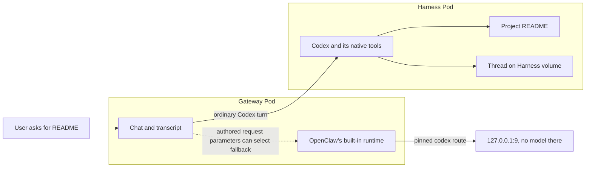

# Proposal: Keep a dedicated Codex Agent’s project work in its Harness

- **ID:** RFC-0019
- **Created:** 2026-10-01
- **Last updated:** 2026-10-15
- **RFC PR:** [#853](https://github.com/openclaw/openclaw-enterprise/pull/853)

## Summary

Ask Codex to “read the project README.” The project is in the Harness Pod,
beside Codex. In an early dedicated deployment, Codex could instead list the
Gateway’s empty workspace, then run a shell command in that Pod. After a
restart, the Gateway could show the old chat while Codex had lost the thread
it needed to continue. These were two ways to break the same user expectation:
Codex should come back to *this project, in this conversation*.

**Decision requested.** Kubernetes Compute Driver and Harness maintainers:
accept or revise the boundary shipped in [#808][pr-808], [#814][pr-814],
[#824][pr-824] and [#2273][pr-2273]. The Gateway routes the conversation and
keeps its transcript. Codex reads the project and keeps its thread in the
Harness. We remove specific ways a *model turn* could act in the Gateway, while
leaving an *operator* able to administer it. This is narrower than a guarantee
that the Gateway cannot run a model or that every tool runs in the Harness.

The consequential open choice is [#830][pr-830]. An owner can configure
ordinary turns to fall back to the Gateway, where the deliberately unreachable
model route makes them fail. Closing that route more broadly could also disable
legitimate Gateway image, PDF and utility models. Please decide that tradeoff
separately. Accepting this record would not authorize landing #830.

## What happens when the user asks for the README

Codex’s native read runs beside the README. A file transferred through the
Gateway reaches that same workspace via the [paired node](../../docs/flows/workspace-files.md).
On restart, the Gateway resumes by thread ID, which is useful only if the
Harness still has the thread. For non-OAuth logins, the Harness mounts its
claim’s `codex-sessions` at `/home/node/.codex/sessions`; other Codex home
state stays Pod-local. OAuth already keeps `CODEX_HOME` in `codex-home`, which
a new OAuth source can empty. The [storage split](0003-gateway-harness-storage-split.md),
[workspace plan](../plans/38-harness-rwo-workspace-plan.md) and
[authentication contract](0005-harness-auth-binding.md) explain those boundaries.

The wrong-Pod read and lost thread were dogfood finding D74. After the first
fix, D86 found the model could still open a Gateway terminal, undo its own tool
exclusions with `openclaw`’s `config.set`, or schedule a script. An operator
chat arrives with `operator.admin`, so OpenClaw treats the turn as an owner
turn even when the model is following instructions from an untrusted README.
An “owner only” tool is therefore not an operator-only tool.

## What the Gateway changes, and when

The [Gateway wrapper](https://github.com/openclaw/openclaw-enterprise/blob/00bbc7cd976ab7be317ce1e0a9d36ad72ce10567/apps/controller/src/drivers/compute/kubernetes/runtime-entrypoints.ts)
applies these settings *before each OpenClaw start*, including a respawn when
the Harness peer changes. It does so when `OPENCLAW_WORKSPACE_NODE_ID` or
`OPENCLAW_WORKSPACE_NODE_PATH` is set, even before the node arrives. It is not a
continuous policy check: an operator’s later configuration edit can hot-reload
immediately, as D86 showed. Gateways without a workspace node do not get this rewrite.

1. **Remove the second set of file and shell tools.** With a Codex plugin entry,
   the wrapper adds fourteen names to `codexDynamicToolsExclude`, preserving the
   owner’s exclusions. They are `ls`, `read`, `write`, `edit`, `apply_patch`,
   `exec`, `process`, `gateway_exec`, `gateway_process`; `terminal` and `portal`
   (shell input and port proxy); and `openclaw`, `plugins`, `gateway`
   (configuration, plugin code and self-update, which OCC owns). OpenClaw’s
   filter recognizes `bash` as `exec`. Excluding `exec` also prevents it from
   adding Gateway, sandbox or node shell projections. Codex’s native tools remain.
2. **Stop background work that bypasses that tool list.** With
   `cron.triggers.enabled: false`, stream schedules and model-written script
   payloads or conditions cannot execute in the Gateway. A timed automation can
   still run a Codex turn in the Harness. We also set
   `agents.defaults.compaction.memoryFlush.enabled: false`: the pre-compaction
   model run got *unfiltered* Gateway `read` and `write`, then left its memory in
   a workspace the Harness never saw. We turned the flush off, not into a safe flush.
3. **Keep provider configuration from silently moving the turn.**
   `pinCodexProviderTransport` matches trimmed, case-insensitive `codex` and
   `openai` keys. It keeps model selection, limits, costs and `agentRuntime`;
   drops transport, request, headers, credentials and local-service settings; and
   points `codex` (adding that bundled provider if absent) at
   `http://127.0.0.1:9` with `api: openai-responses`. An `openai` row with an
   authored `baseUrl` or `api` gets the same stub. Without either, it retains
   OpenClaw’s default transport. None of the route overrides that would make
   Codex declare `fallbackRuntime: "openclaw"` survives *in those rows*.
   If the Codex plugin entry is absent, the wrapper applies only this provider
   step, and only if `APP_SERVER_URL` names a remote Harness.

For an owner diagnosing a deployment, there are two different outcomes.
[Admission](https://github.com/openclaw/openclaw-enterprise/blob/00bbc7cd976ab7be317ce1e0a9d36ad72ce10567/apps/controller/src/drivers/compute/kubernetes/index.ts)
refuses a shape the wrapper cannot rewrite with HTTP 400 `INVALID_REQUEST` and
a setting path. It checks the provider objects and model lists even without the
plugin entry; with the entry, it also checks the exclusions list, plugin
configuration, triggers and the object path down to `memoryFlush`. A malformed
document reaching the wrapper can still prevent startup. For an accepted
setting that is overridden, look in `occ agent logs` for
`runtime.gateway_settings_overridden`: names, never values, and a start-time
warning rather than an Agent condition ([#874][pr-874], [#895][pr-895],
[#896][pr-896], [#1549][pr-1549]).

## Where a turn can still reach the Gateway

**An ordinary turn can fall back and fail.** Nonempty `agents.defaults.params`,
agent `params`, or non-run-control model `params` can make
`hasAuthoredProviderRequestParams` select the built-in runtime for *every* turn.
The stub then fails in the Gateway. This is why “Codex never hands the Gateway
a turn” would be an incorrect contract. D87–D90 also found that `sessions_spawn`
and `subagents` were callable. In D89 only `codex/<model>` passed the model
allowlist; a spawned run reaching the built-in runtime relied on the transport
pin, not on exclusion of the spawn tool.

**Another provider can make the built-in runtime usable.** Its `exec`, `read`
and `write` are local to the Gateway. An owner can supply another provider with
a Secret-bound `apiKey: "${VAR}"` and an allowing `agents.defaults.modelPolicy`;
admission does not check that policy. NetworkPolicy was the remaining barrier
in the live check. A bound `OPENAI_API_KEY` can also credential the default
`openai` transport. Admission requires references for that key,
`ANTHROPIC_API_KEY`, `ANTHROPIC_AUTH_TOKEN` and `CODEX_ACCESS_TOKEN`, but admits
a literal `CODEX_API_KEY`. The Codex app-server reads that last key, not the
built-in OpenAI provider. Separately, [#765][pr-765] removed app-server tokens
from Codex child environments, not from every same-UID process; [#796][pr-796]
and [#1994][pr-1994] restricted the OAuth seed writer’s mount to `codex-home`,
prepared as UID 1000 with mode `0700` after removing a planted file or link.

**Some model tools still have local effects.** In an unsandboxed run,
`skill_workshop` can write skills under the Gateway agent directory that later
prompts load; it runs no commands. `personal_instructions` also writes for later
prompts. Owner-enabled plugins can add local tools outside the fourteen names.
`secrets` can list or delete entries in a Gateway store OCE does not use,
`web_fetch` uses Gateway network access under OpenClaw’s SSRF policy (default
not reverified), and media or PDF tools can write in the Gateway workspace.

**The operator retains deliberate access.** An operator can select
`/model <ref> --runtime openclaw`; the live stub test saw no request reach the
model proxy. The model cannot issue that override or choose an arbitrary Gateway
method. The Control UI terminal still gives the operator a Gateway shell;
`screen terminal_show` can open it in their browser but cannot type into it.
At the recorded OpenClaw pin, the operator’s separate `openclaw.chat` assistant
turn receives the host’s privileged tool scope and gets `openclaw` back. That
last distinction comes from source, not a live test.

## Decisions still owned by Compute Driver and Harness maintainers

First decide whether to keep #824’s narrow provider pin, repair and adopt
[#830][pr-830], or ask OpenClaw for an `agentRuntime` policy that can forbid
fallback and session overrides, then retire the pin. #830 would stub *every*
provider (including image, PDF, utility and hook models), require explicit
`modelPolicy.allow`, strip request parameters and `OPENAI_*`, `CODEX_*` and
`ANTHROPIC_*` credential names from `env`, and refuse every `CODEX_*` name at
admission. Review at `4916f264c` found it
could *widen* an alias-only allowlist. It was open and held for human direction
on October 15, not the design already shipped.

Maintainers can decide three things independently: whether to refuse
`agents.defaults.params` before accepting an unusable deployment, whether to
disable the operator terminal on paired Gateways, and whether to surface
overrides as an Agent condition. The recorded defaults are to admit those
parameters, retain the terminal and warn in logs.
Sharing the Harness’s read-write-once volume would not fix Gateway credentials
or network access. Routing each tool through the node would duplicate Codex’s
native tools. Rewriting at start also covers previously admitted configuration.

## Evidence to carry forward to the next runtime pin

The changes landed October 1 (#808, #814, #824) and October 13, 2026 (#2273).
At Enterprise `00bbc7cd9` on October 15, the relevant wrapper, admission and
session-mount paths were present, and the runtime still pinned OpenClaw
`90d30a117`. The OpenClaw behavior above was examined in source at that pin on
October 13. Neither source observation proves what image is running.

| Earlier evidence | What a maintainer still needs to distinguish |
|---|---|
| #808 dogfood at `769c8cd88`: local tools absent, thread resumed after restart | A real controller stop/start with the Harness thread intact, not just a surviving transcript. |
| #814 dogfood at `f22a584e6`: then-eleven exclusions, stream refused, no Gateway shell child | The actual tool list and background paths at the new pin. Names stayed stable over three prior pin changes while implementations changed. |
| #824 applied by hand: normal turn in Harness, operator’s built-in turn hit the stub | The deployed wrapper, default-transport `openai` case and authored-parameter failure were not all exercised by that test. |
| #2273 conformance and runtime-image checks | No dogfood run of that change. All the live observations above predate `90d30a117`. |

[pr-765]: https://github.com/openclaw/openclaw-enterprise/pull/765
[pr-796]: https://github.com/openclaw/openclaw-enterprise/pull/796
[pr-808]: https://github.com/openclaw/openclaw-enterprise/pull/808
[pr-814]: https://github.com/openclaw/openclaw-enterprise/pull/814
[pr-824]: https://github.com/openclaw/openclaw-enterprise/pull/824
[pr-830]: https://github.com/openclaw/openclaw-enterprise/pull/830
[pr-874]: https://github.com/openclaw/openclaw-enterprise/pull/874
[pr-895]: https://github.com/openclaw/openclaw-enterprise/pull/895
[pr-896]: https://github.com/openclaw/openclaw-enterprise/pull/896
[pr-1549]: https://github.com/openclaw/openclaw-enterprise/pull/1549
[pr-1574]: https://github.com/openclaw/openclaw-enterprise/pull/1574
[pr-1994]: https://github.com/openclaw/openclaw-enterprise/pull/1994
[pr-2273]: https://github.com/openclaw/openclaw-enterprise/pull/2273
