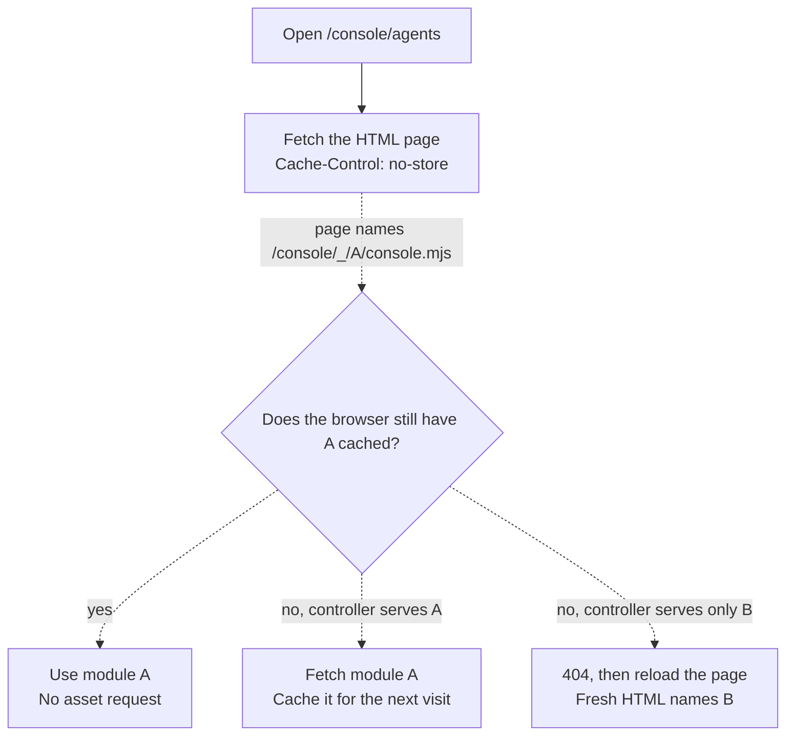

# Proposal: Let a repeat Console visit reuse the same build’s assets

- **ID:** RFC-0019 on this draft branch. Allocate the [next available number](../../docs/contributing/specifications.md#files-and-numbering) before merge.
- **Created:** 2026-10-02
- **Last updated:** 2026-10-15
- **Review:** [Draft PR #904](https://github.com/openclaw/openclaw-enterprise/pull/904), for Console, controller HTTP and release owners

## Decide from a repeat visit

Reopen `/console/agents` on the same build. The browser needs fresh agent data, but it also
downloads `console.mjs`, its imports, the styles and the font again. An October 2 local k3d
observation (D55) recorded a 5–13 second load and 43 requests through a VM port forward.
Host load was around 250. That tells us what to measure, not how many seconds caching would save.

**Console owners: measure a first visit and an ordinary second visit** on a quiet host, then
through a production-like ingress. Leave the browser cache enabled. Record time until the page
is usable, which assets crossed the network, and whether the wait was for those assets or the
API. If repeat visits already take less than about a second, close D55 and keep the current policy.

If downloading the same assets is the material delay, keep the HTML fresh and put the build
revision in asset URLs. The consequential tradeoff is an upgrade halfway through a page load:
a controller that no longer has the requested revision must return `404`, even if that means
the person has to reload. Serving the new module at the old URL could mix builds and cache the
mistake for a year. No cache policy has been selected or implemented by this proposal.

## Fetch the page to discover the build, then reuse that build

In the [October 15 source snapshot](https://github.com/openclaw/openclaw-enterprise/commit/00bbc7cd976ab7be317ce1e0a9d36ad72ce10567),
the [controller](../../apps/controller/src/index.ts) sets [`Cache-Control: no-store`](../../apps/controller/src/http/errors.ts)
before serving the Console, with no `ETag` or `Last-Modified` validator. The [build script](../../scripts/build-console-metadata.mjs)
already writes a full Git revision into the [HTML page](../../apps/controller/src/console/index.html).
Use it in the page’s script and link URLs so relative imports stay under the same revision.
The solid arrow below is the existing page request. Dashed arrows are the proposal, with `A` and `B`
standing for full build revisions.

**Controller owners:** send `Cache-Control: public, max-age=31536000, immutable` only on a
successful response for a known public asset at `/console/_/<revision>/<path>`. A proxy’s
cache key must include that path. Keep `no-store` on the HTML, API, errors and old unversioned
URLs. Preserve the [asset allowlist and content security policy](../../apps/controller/src/console-assets.ts).
A development build with no revision keeps today’s URLs and needs nothing new to run `pnpm dev`.

**Release owners:** establish that a revision names the same bytes across rebuilds, replicas and
rollbacks. Include the generated `default-codex-preset.mjs` and the two modules served from
`packages/contracts`, not just the files in `console/`. Move the absolute mascot references
under the revision too, or explicitly leave that image uncached. Browsers and proxies may retain
public code for a year, even after a build is withdrawn. Fresh HTML selects a build for the next
visit, but cannot recall cached bytes or update an already open tab.

Verify with two builds. On a normal return to A, the browser should fetch the HTML but need no
network request for versioned assets it still has. Switch to B and request an uncached A module:
expect A’s bytes if still served, otherwise `404` without immutable caching. Reload against B,
then roll back to A, and check that every asset named by each page resolves to that build.
During a rolling update, reloading may not recover until the controllers agree on the build.

## When a different change would help more

- **Revalidate with `ETag` and `no-cache`** if we can save the bytes but cannot guarantee an immutable URL. A `304` still costs a request for each file.
- **Bundle at build time** if the first visit is also slow because the browser discovers imports in waves. Account for source maps and for development, Storybook and browser tests that use the source files directly.
- **Enable HTTP/2 at the ingress** if HTTP/1.1 connection stalls dominate. Operators can do this alongside either cache policy. It does not improve a plain HTTP port forward.
