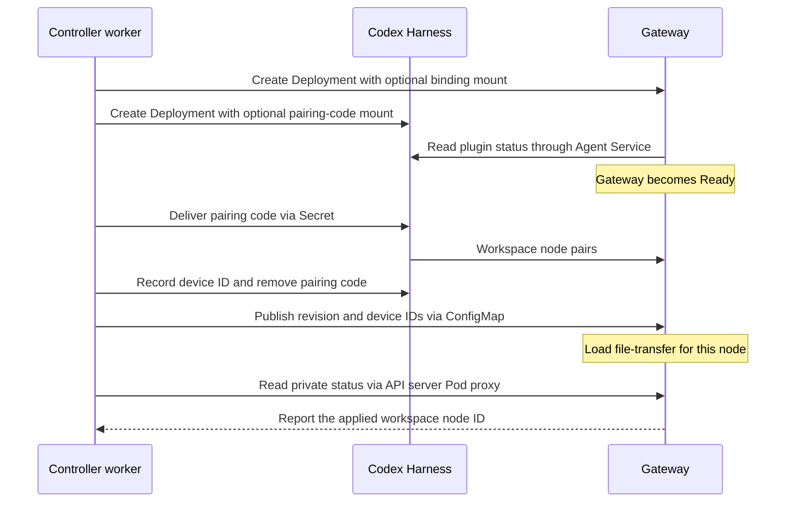

# Proposal: Activate a dedicated Kubernetes Agent after its Gateway loads the workspace node

- **ID:** RFC-0019
- **Created:** 2026-10-01
- **Last updated:** 2026-10-15
- **RFC PR:** [#855]. The implementation landed before this design review.

## Summary

On the first deploy of a dedicated Codex Agent, we used to replace its running Harness to give the
workspace node a pairing code, then replace its Gateway to tell it which node had paired. When the
status proxy is configured, we propose keeping both running. Activation waits for the Gateway to
report that it loaded `file-transfer` for the paired node, then checks that the node is ready.
**Gateway Ready means we can issue the pairing code. It is too early to declare the workspace connected.**

Consider the [regression test][ratchet] where `node-1` has paired but the kubelet hasn't delivered
the binding to the Gateway. Preparation can finish: the controller has written the right binding.
Activation stays pending: the Gateway hasn't reported `node-1`. The distinction lets a slow volume
catch up without another pairing code, a Pod restart, or a claim that a file transfer succeeded.

**Decision requested.** Compute owners, review that activation rule and the fallback for installations
where the controller cannot read private Gateway status. Security owners, decide whether a short-lived
pairing code readable by Codex and tenant-scoped permission to patch Pods are acceptable. This is a
retrospective proposal, based on `main` at `07590c64e`; the activation, fallback and test details below
also match source at `00bbc7cd9` (October 15). Neither source revision tells us what an installation runs.

## Follow one first deploy, from empty workspace to activation

This path is for a model-key-authenticated Codex Agent whose Harness is a Kubernetes Deployment.
The Harness runs Codex and the workspace node. The Gateway needs that node's identity to configure
file transfer. A *pass* is one attempt on the serial controller worker; ending a pass pending lets
the worker try again. The [Compute driver][index] owns preparation and activation, and the
[entrypoint wrappers][entry] observe what actually reached each workload.

1. **Start both workloads before either value exists.** The driver creates the Agent Service
   (selecting this first revision), network policies, Harness route, then Gateway and Harness
   Deployments. Codex can start immediately; its supervisor waits for a complete code at
   `/run/openclaw-node-setup` before starting the node host. The Gateway polls Harness plugin
   status every 250 ms, with no local deadline. If the Harness never reports, the Gateway can
   occupy its volume and scheduling slot until the controller's convergence deadline.
2. **Pair once.** After Gateway Ready, the controller projects only `setupCode` from an optional
   Secret, mode `0440`. It annotates the running Harness Pod to prompt a kubelet volume refresh.
   [A k3d experiment][#612] saw delivery in 1.3–1.7 seconds with the annotation, versus 58–84
   seconds without it. The [enrollment client][enrollment] observes pairing on one Gateway
   connection, reading every 250 ms. Once paired, the controller records `deviceId`, removes
   `setupCode` from the Secret, and prompts another refresh. Removal is asynchronous too.
3. **Publish the binding, then check who applied it.** In that same pass, the controller writes
   `{revisionId, deviceId}` to the Agent's binding ConfigMap and annotates the Gateway Pod once.
   The wrapper polls its mount at `/run/openclaw-workspace-node` every second, changes only
   `plugins.*` and `cloudWorkers.*`, and checks `plugins.list` over the Gateway SDK. It reports
   `workspaceNodeId` once `file-transfer` becomes active, or, if already active, appears in a new
   registry generation. Reloading also re-establishes the Codex app-server session.
4. **Activate on the Gateway's report.** Through the API server's Pod proxy, the controller checks
   the revision, Gateway container, Pod UID and applied node ID. It then checks that the workspace
   node is ready. The acknowledgment is evidence the Gateway loaded the binding; exercising a file
   transfer would answer a different question.

## What a maintainer should expect to observe

### Measured effect

The [first-deploy test][ratchet] went from five workload starts across three pending preparation
passes ([#588]) to **one Harness start, one Gateway start, one pending pass**. It counts Deployment
template renders and infers Gateway restarts, making workloads ready as soon as the controller
waits for them. Preserve that test property; real kubelets may need many more polls. Local k3d
reports during the September–October 2026 implementation included a 28.4-second deploy
(`81207521e`) and earlier 99.6–123.7-second deploys under different loads. They establish no
latency target and predate the [SandboxDriver][#1400] and [OAuth Job][#1994] paths.

- **Paired, activation pending.** The worker can spend eight seconds waiting per setup ID, then
  20 seconds per revision and node waiting for the binding acknowledgment. Each budget spans
  attempts, yields after at least one read if another Agent's work is claimable, and lives in a
  controller-local map capped at 1,024 entries. The [missing-ack test][ratchet] spends 20 seconds
  on the first attempt, then reads once on each retry; a late acknowledgment still works. At 30
  seconds the wrapper may explain `RELOAD_NOT_CONFIRMED`. Missing or unconfirmed application is
  retried up to convergence (default 900 seconds); `GATEWAY_UNAUTHORIZED` fails the revision.
- **Gateway starts twice.** Check
  `network.pluginStatusProxySourceCidrs`. The profile renderer requires it; the production
  `installation.yaml` example omits it. Without it, the controller puts `OPENCLAW_WORKSPACE_NODE_ID`
  in the Pod specification and replaces the Gateway so it loads the node at startup. Activation then
  checks Gateway and workspace node readiness, without an acknowledgment that the Gateway applied the
  binding. With the proxy configured but no acknowledgment, activation stays pending. The k3d
  launcher admits the API server's observed `cni0` source (a `/32`) to TCP 18791; all-address sources
  are rejected.
- **Peer or credential failure.** A changed Harness can make the Gateway drop readiness and
  respawn OpenClaw in the same container. Failed verification, three unsuccessful attempts to
  serve, or more than five respawns in ten minutes can force a container restart; so can a changed
  binding device ID. The [worker][worker] fails known held startup errors promptly, including
  rejected model credentials. The optional early check can reject a 401 at the default provider
  endpoint; passing it doesn't validate the key.
- **Different Harness or a redeploy.** ChatGPT sign-in first seeds the credential volume with a
  bounded [bootstrap Job][#1994] (two retries, 300-second deadline). A [SandboxDriver
  Harness][#1400] waits for Gateway and code before provisioning. Native OpenClaw workers still
  take setup by environment variable; embedded Agents use one Pod. A dedicated *replacement*
  stops the serving workloads before it prepares their successors, even though the Service still
  selects the old revision. A replacement that cannot start leaves the Agent unavailable.

## Open questions for reviewers

These are implemented defaults awaiting judgment. If an owner rejects one, record the required
change rather than treating this retrospective as approval.

| Owner decision | Consequence of keeping the default |
| --- | --- |
| Security: let Codex read the pairing code? | Every UID-1000 Harness process can read it, and the node child's arguments expose it too. We rely on single use and expiry, project just one key, then remove it. We chose the volume over a new private delivery endpoint after [#612]; [#616] explicitly requested security review. |
| Security and tenant operators: let the worker patch Pods? | Three annotation patches prompt refresh; only a 404 is ignored. Both charts include Pod `patch` in the worker role; operators [bind it in each tenant namespace](../../docs/guides/deploy/production-agents.md#grant-tenant-rolebindings). That permission can also change labels a Service selects. The binding contains IDs only; the driver checks Agent ownership and refuses a foreign ConfigMap. |
| Compute: require the status-proxy source for in-place activation? | Without a trusted acknowledgment path, we pay for a second Gateway start. A different acknowledgment channel is an alternative; relaxing the activation check would change its meaning. |
| Controller: wait on the serial worker? | We save a polling interval on an idle worker and yield to claimable work. Restarting the controller resets the budgets. Concurrent work for different Agents is a separate design choice. |
| Compute: accept interruption on replacement? | [Documented downtime](../../docs/reference/drivers/kubernetes-compute.md#execution-modes) can become an outage, including on a rejected credential. [Proposal #1045](https://github.com/openclaw/openclaw-enterprise/pull/1045) would check the replacement before stopping its predecessor. The earlier [activation-evidence proposal](https://github.com/openclaw/openclaw-enterprise/pull/458) closed without merging. |
| Operators: allow CPU overcommit? | The profile requests `100m` CPU, limit four cores (dev launcher: two). Quota on `limits.cpu` counts the limit; concurrent bursts can overcommit a node. Gateway memory request/limit is `1792Mi`/`3Gi`; Harness is `768Mi`/`6Gi`. |

## Implementation and prior decisions

The September 29–October 4, 2026 changes are useful entry points for a maintainer:

- [Mount the code from the first start][#616], [mount the binding][#640], [create both workloads
  together][#652], [handle a changed peer][#668], [admit the k3d status proxy][#791].
- [Observe pairing within a pass][#816], [bound pairing][#821] and [acknowledgment][#877],
  [yield to waiting work][#892], [read plugins through the SDK][#857], [fail unauthorized activation][#1128].
- [Avoid recursive volume ownership changes][#580]; handle predecessor stops and policies
  ([#584], [#620], [#698], [#752]); report startup and credential failures ([#583], [#871],
  [#1070], [#838], [#932]); size resources ([#683], [#841], [#866], [#1168], [#1178]).

Two older driver comments still describe replacing the Harness for enrollment. Follow the
[conformance cases][ratchet] and [superseded enrollment plan](../plans/40-workspace-enrollment-without-harness-restart.md)
for that history. We [closed the proposal to overlap startup and model probes](https://github.com/openclaw/openclaw-enterprise/pull/595)
without merging it, and rejected caching a credential-derived probe digest on a volume Codex can read.
See also the [workspace plan](../plans/38-harness-rwo-workspace-plan.md), [Harness execution](../../docs/reference/harness-execution.md),
[Kubernetes storage](../../docs/reference/drivers/kubernetes-compute/storage-and-credentials.md)
and [networking](../../docs/reference/drivers/kubernetes-compute/networking-and-isolation.md) contracts.

[ratchet]: ../../tests/conformance/kubernetes-compute.test.mjs
[worker]: ../../apps/controller/src/worker.ts
[enrollment]: ../../apps/controller/src/gateway/node-enrollment-client.ts
[#588]: https://github.com/openclaw/openclaw-enterprise/pull/588

[#612]: https://github.com/openclaw/openclaw-enterprise/pull/612
[index]: ../../apps/controller/src/drivers/compute/kubernetes/index.ts
[entry]: ../../apps/controller/src/drivers/compute/kubernetes/runtime-entrypoints.ts
[#580]: https://github.com/openclaw/openclaw-enterprise/pull/580
[#583]: https://github.com/openclaw/openclaw-enterprise/pull/583
[#584]: https://github.com/openclaw/openclaw-enterprise/pull/584
[#616]: https://github.com/openclaw/openclaw-enterprise/pull/616
[#620]: https://github.com/openclaw/openclaw-enterprise/pull/620
[#640]: https://github.com/openclaw/openclaw-enterprise/pull/640
[#652]: https://github.com/openclaw/openclaw-enterprise/pull/652
[#668]: https://github.com/openclaw/openclaw-enterprise/pull/668
[#683]: https://github.com/openclaw/openclaw-enterprise/pull/683
[#698]: https://github.com/openclaw/openclaw-enterprise/pull/698
[#752]: https://github.com/openclaw/openclaw-enterprise/pull/752
[#791]: https://github.com/openclaw/openclaw-enterprise/pull/791
[#816]: https://github.com/openclaw/openclaw-enterprise/pull/816
[#821]: https://github.com/openclaw/openclaw-enterprise/pull/821
[#838]: https://github.com/openclaw/openclaw-enterprise/pull/838
[#841]: https://github.com/openclaw/openclaw-enterprise/pull/841
[#855]: https://github.com/openclaw/openclaw-enterprise/pull/855
[#857]: https://github.com/openclaw/openclaw-enterprise/pull/857
[#866]: https://github.com/openclaw/openclaw-enterprise/pull/866
[#871]: https://github.com/openclaw/openclaw-enterprise/pull/871
[#877]: https://github.com/openclaw/openclaw-enterprise/pull/877
[#892]: https://github.com/openclaw/openclaw-enterprise/pull/892
[#932]: https://github.com/openclaw/openclaw-enterprise/pull/932
[#1070]: https://github.com/openclaw/openclaw-enterprise/pull/1070
[#1128]: https://github.com/openclaw/openclaw-enterprise/pull/1128
[#1168]: https://github.com/openclaw/openclaw-enterprise/pull/1168
[#1178]: https://github.com/openclaw/openclaw-enterprise/pull/1178
[#1400]: https://github.com/openclaw/openclaw-enterprise/pull/1400
[#1994]: https://github.com/openclaw/openclaw-enterprise/pull/1994
