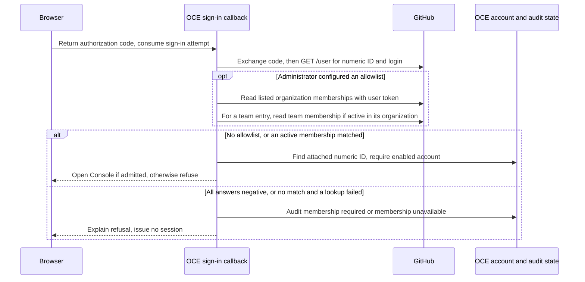

# RFC: GitHub organization and team allowlist for sign-in

- **ID:** RFC-0019 (provisional; earlier references say RFC-0061)
- **Owner:** freeqaz (decision), authentication maintainers (sign-in callback)
- **Created:** 2026-10-04
- **Last updated:** 2026-10-15
- **Decision:** Open in [#1229](https://github.com/openclaw/openclaw-enterprise/pull/1229).
  At the owner's request, [#1231](https://github.com/openclaw/openclaw-enterprise/pull/1231)
  implemented the allowlist on October 4 while review continued.

## Summary

Removing someone from a GitHub team does not, by default, stop them signing in to OpenClaw
Enterprise (OCE). We propose letting an administrator require **active membership in any listed
organization or team at the next GitHub sign-in**. GitHub confirms membership; OCE still decides
whether the person has an enabled account. If we cannot confirm a match, we refuse the sign-in.

Suppose Maya signs in at 09:00 and leaves the allowed team at 10:00. Once GitHub reports her
removal, OCE refuses her next GitHub sign-in. Her 09:00 session can still last until 17:00
because OCE sessions last up to eight hours without refresh. To offboard Maya at 10:00,
[disable her OCE account](../../docs/reference/authentication/external-sign-in.md#session-and-recovery-controls).
Detaching GitHub also ends all her open sessions, but she can sign in again with another enabled
method. Revoking sessions alone leaves every sign-in method available.

**Decision for freeqaz:** accept this optional sign-in check with that session boundary, or require
[a stronger offboarding guarantee](#mid-session-membership) before accepting it. The immediate operational uncertainty is
also specific: a misconfigured GitHub App may return `404` for a real member. The maintainer's
[next check](#residual-risk) is to establish what that person and the administrator actually see.

## What the membership check changes

[RFC-0007](0007-human-federated-sign-in/index.md) binds an existing OCE account to a numeric
GitHub user ID. If GitHub suspends or deletes the GitHub account, the code exchange or
[`GET /user`](https://docs.github.com/en/rest/users/users#get-the-authenticated-user) already
fails. Leaving a team is different: the person can still authenticate to GitHub.
[Documenting offboarding](https://github.com/openclaw/openclaw-enterprise/pull/1225) did not close that gap.

Like the Google hosted-domain restriction, the allowlist narrows who can use one sign-in method.
It creates no accounts, grants no OCE roles, and leaves Google, [OIDC](../../docs/guides/deploy/oidc-sign-in.md)
and password sign-in (including recovery) unchanged. Service keys also need separate revocation.

## Check at sign-in

For a team-only policy, list `acme/platform`, **not** both `acme` and `acme/platform`. Entries
are alternatives: listing `acme` would let any active organization member pass this check.
For the team entry alone, we check the organization first, then the team (child-team members count).
An invitation still pending at GitHub does not satisfy either check.

The [callback](../../apps/controller/src/auth/github.ts) checks listed organizations, then teams,
reusing each organization answer. Team lookup uses the validated, URL-encoded login from the
same profile; a malformed login fails that lookup. Exchange, profile and membership requests
share a ten-second deadline. The [transport](../../apps/controller/src/auth/provider-transport.ts)
refuses redirects and limits each response to 64 KiB. We discard the user token after these calls.

### Refusal and audit

The first active match suffices, even after a failed lookup. We then apply the ordinary
`EXTERNAL_IDENTITY_REJECTED` or `ACCOUNT_DISABLED` checks. With both lists empty we go straight to
those checks, with no membership request or new refusal. Otherwise, if there is no match:

| What the callback knows | What the person and administrator see |
| --- | --- |
| **Every answer was negative:** `404` or `200` with `state: pending`. Only `200` with `state: active` matches. | `MEMBERSHIP_REQUIRED`. The Console explains the membership requirement and suggests accepting a pending invitation or contacting an administrator. |
| **At least one lookup failed:** deadline, transport error, redirect, oversized or malformed answer (including unknown state), or another status such as `401`, `403`, `429` or `503`. | `MEMBERSHIP_UNAVAILABLE`. The Console suggests trying later or contacting an administrator. We stop at the deadline and report the *first* failure, so an earlier `503` is not overwritten by a timeout. |

Both [audit reasons](../../packages/occ/src/state/human-authentication.ts) record an
`authentication.login` denial, `provider: github` and the authenticated numeric `subject`, extending the
[denial context from #1164](https://github.com/openclaw/openclaw-enterprise/pull/1164).
Any GitHub user can reach this point, but a junk callback cannot. We have not looked up the OCE
account. If every membership answer was negative, we return `MEMBERSHIP_REQUIRED` even when
the account is disabled.
The [callback](../../apps/controller/src/auth/index.ts) returns to `/console/?authError=github` with
`authReason=membership` or `membership-unavailable`; the Console accepts these reasons only for
GitHub. Where password sign-in is available, both messages offer “or use your password.”

### GitHub outage or a known member refused

A final `MEMBERSHIP_UNAVAILABLE` refusal also logs `authentication.provider-unavailable-warning` at WARN,
with `step: membership` and a bounded cause, status or transport code. It does not log the URL,
login, organization or token. A code-exchange or profile outage remains `PROVIDER_UNAVAILABLE`.

A `403` can mean a blocked App, unaccepted permission or a missing SAML session. A missing
installation or wrong slug may instead produce `404`: *every member* could see “membership
required,” with no unavailable warning. [Check the slug, installation and permission](../../docs/reference/authentication/external-sign-in.md#organization-and-team-allowlist)
before telling a known member to request access again. We have not qualified which status GitHub
returns in these cases; check an ordinary organization and a SAML-enforced one before claiming support.

### GitHub App, not OAuth App

Install the App in each listed organization and have its owner accept
[`Members: read`](https://docs.github.com/en/rest/authentication/permissions-required-for-github-apps#organization-permissions-for-members).
GitHub documents that permission for both [organization membership](https://docs.github.com/en/rest/orgs/members#get-an-organization-membership-for-the-authenticated-user)
(user token) and [team membership](https://docs.github.com/en/rest/teams/members#get-team-membership-for-a-user)
(user or installation token). It also lets the installation token list the organization's members
and teams. The permission itself grants no code or settings access; a reused App can have other permissions.

The documented setup uses a GitHub App, although OCE does not enforce the App type. The callback
requests no OAuth scope and uses the user token GitHub already issues, limited to the intersection
of the person's access and the App's permissions. No App private key moves into the controller.

### Configuration

| [API process setting](../../docs/reference/settings/production.md#github-sign-in-and-trusted-proxies) | Helm list (rendered comma-separated) |
| --- | --- |
| `OCC_AUTH_GITHUB_ALLOWED_ORGS` (organization logins) | `auth.github.allowedOrgs` |
| `OCC_AUTH_GITHUB_ALLOWED_TEAMS` (`org/team-slug`) | `auth.github.allowedTeams` |

At most ten entries across both lists. The API trims, lowercases and deduplicates before counting;
Helm and the installation profile count before deduplication. Organization names allow up to 39
letters, digits or hyphens, starting with a letter or digit. Team slugs allow lowercase letters,
digits, hyphens and underscores, up to 100 characters.

Invalid settings fail startup, as does a list without the GitHub client ID, client secret or
recovery user ID. Helm also requires `auth.github.enabled`; installation preflight
(`controlPlane.github`) rejects invalid or non-lowercase entries. Restart the API to apply a
change at subsequent sign-ins. Clearing both lists restores the default; no migration is required.

## Rationale and alternatives

If no entry confirms active membership and a lookup failed, we refuse sign-in and say we could
not check membership. Calling that nonmembership, or silently rejecting the attached identity,
would send the person to fix the wrong problem. [Targeted GitHub App lookups](#github-app-not-oauth-app)
avoid asking people to publish their membership (which cannot establish team membership anyway),
paginating unrelated `/user/orgs` or `/user/teams`, or requesting OAuth App `read:org` access to
every organization's memberships that its policy allows. Using an installation token here would
bring the private key across the repository credential service boundary.

## Unresolved questions

1. **Offboarding during a session (freeqaz).** No recheck today. Shorter sessions reduce the
   window but require more sign-ins. Periodic checks need an outage policy and either stored
   user and refresh tokens or a repository credential service call to `GET /orgs/{org}/members/{login}`.
   GitHub `organization` (`member_removed`) or `membership` (`removed`) events would need a public
   webhook, secret verification and replay handling. None replaces the operator's OCE offboarding action today.
2. **Installation and SAML failures (authentication maintainers).** Establish the actual response
   and whether our [refusal and recovery guidance](#residual-risk) fits it, particularly for `404`.
3. **Dedicated sign-in App.** The guide reuses the repository integration's App. A separate App
   can have only Members: read and no repository permissions; changing client ID creates a new
   provider instance and requires reattaching every identity. The recommendation remains open.

## Delivery and verification

[#1231](https://github.com/openclaw/openclaw-enterprise/pull/1231) delivered the check, operator
guidance and collector's `step: membership` export. This account describes source at
[`00bbc7cd97`](https://github.com/openclaw/openclaw-enterprise/tree/00bbc7cd976ab7be317ce1e0a9d36ad72ce10567),
not an assertion that an installation has enabled the policy. Recorded coverage uses loopback
GitHub responses: `github-login-transport.test.mjs` covers requests and decisions,
`postgres-github-org-allowlist.test.mjs` covers audit and absence of a session,
`sign-in-chart-parity.test.mjs` and `profile-renderer.test.mjs` cover configuration, and
`tests/browser/console.test.mjs` covers the two messages. Those tests cannot resolve the live GitHub question above.
