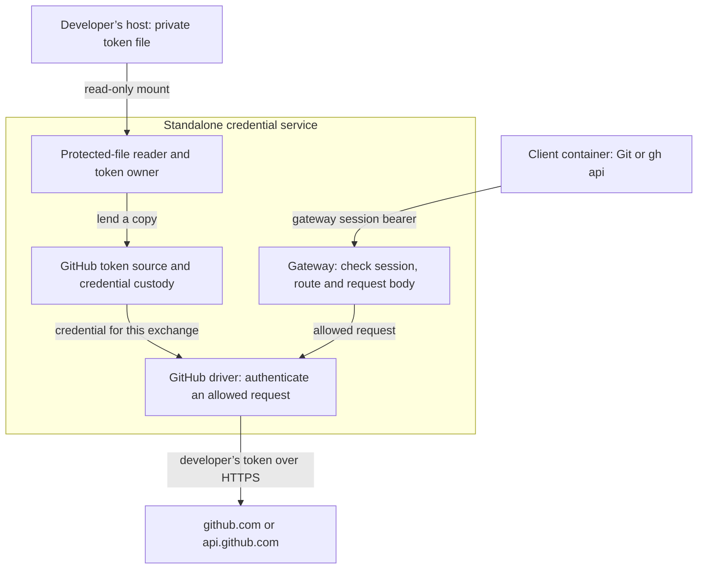
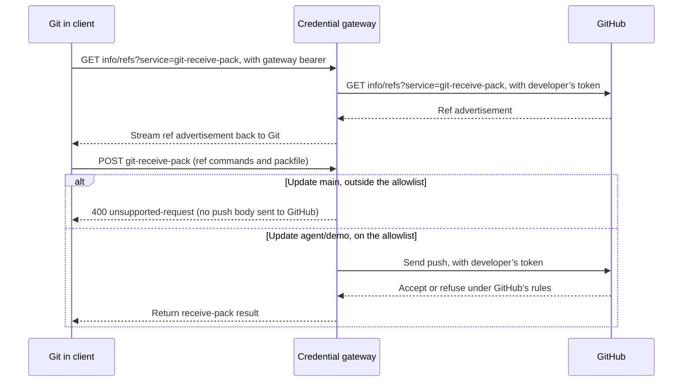

# Proposal: Use a developer’s GitHub token through the local credential gateway

- **ID:** RFC-0019 (provisional until merge)
- **Created:** 2026-10-04
- **Last updated:** 2026-10-15
- **RFC PR:** [#1196](https://github.com/openclaw/openclaw-enterprise/pull/1196)
- **Implementation plan:** None. The implementation [landed October 4](#delivery-and-verification). The decision is still proposed.

## Decision requested

Keep the `github-token` option for developers testing clone, push, and `gh api` against a scratch
repository with the standalone service and client. It saves setting up a GitHub App, installation,
and registry just to exercise the real credential path. The developer’s token stays in the
credential service. The client gets a bearer that works at our gateway, and GitHub sees requests
as the developer. An agent launched by `occ dev up` would continue to use the GitHub App.

Consider a developer who allows pushes only to `refs/heads/agent/*`. The gateway can forward a
push to `agent/demo` and refuse a push to `main` before sending that push body to GitHub, even if
the client hook is disabled. It checks **which branch changes**, not **what goes on that branch**.
If a stolen write session can push an Actions workflow to `agent/demo`, that workflow may run with
the repository’s secrets. Use a token limited to a disposable repository, preferably on a scratch
account, and revoke it in GitHub when finished. Closing the local session does not revoke it.

The owner’s decision is whether that tradeoff is acceptable for this standalone development path.
Kubernetes token support, SSH transport, and changes to production push handling would need
[separate decisions](#alternatives-and-open-decisions).

## Follow the two credentials

In the [development setup](../../docs/guides/repository-credentials/development-token.md), the
developer puts a fine-grained token, classic token, or the host’s `gh` token in a new private file
(mode 0600). The service reads it through a read-only mount. The client mounts only `/session` and
`/workspace`. Putting `GH_TOKEN` or the token file in the client would give it direct access to
GitHub and let it bypass every gateway check below.

The [loader](../../apps/controller/src/composition/repository-credentials/config.ts) requires both
`backend.kind: "github-token"` with literal `developmentOnly: true`, and the process flag
`--development-authority`. The [file reader](../../apps/controller/src/composition/repository-credentials/protected-file.ts)
checks ownership, mode, no symlink, and a stable inode. After removing one trailing LF or CRLF, the
token must be 1 to `limits.accessTokenBytes` non-space printable ASCII bytes (limit ceiling 16,384).
Invalid startup input yields `invalid-configuration`. [`check-config`](../../apps/controller/src/composition/repository-credentials/check-config.ts)
and the startup line report `github-token-development` and a token class inferred from its prefix,
not its value or proof of its permissions. See the [configuration contract](../../docs/reference/repository-credentials/development-token.md)
and [example](../../deploy/examples/repository-credentials/service-config.development-token.json).

The change to [RFC-0008’s credential path](0008-repository-credentials/index.md) is a
[`GitHubTokenSource`](../../apps/controller/src/drivers/repo/github/credentials/token-source.ts),
rather than a second driver that could drift on routes, URL rewriting, or cleanup. A session binds
`acquire` and `retire` at that seam. The [grant identity](../../apps/controller/src/drivers/repo/github/credentials/grants.ts)
includes `authority: "github-token"`, the static route policy, push allowlist, and the profile’s
REST write routes under `routePermissions`. Neither kind of service accepts the other’s binding.

## What the gateway allows

**Git over HTTPS.** A push starts with two requests to the gateway. Git first asks which refs
GitHub advertises. The gateway fetches that advertisement from GitHub and streams it back to Git.
Git then sends the branch update and packfile in a separate request. If the gateway refuses that
update, GitHub has seen the discovery request but receives none of the push body.

A `git-read` session cannot reach receive-pack. For a write session, a
[`pushRefAllowlist`](../../docs/reference/repository-credentials/push-ref-guardrail.md) is required,
and `[]` denies every push. The gateway [reads all ref commands](../../apps/controller/src/drivers/repo/github/credentials/routes/receive-pack.ts)
up to the first flush, including creates and deletes. It accepts `shallow` lines, refuses tags,
signed pushes, and unrecognized command forms, and never parses the packfile. Branch names must
be valid Git names under `refs/heads/`, encoded in strict UTF-8. The
[client’s ref rules](../../apps/controller/src/drivers/repo/credentials/client-contracts.ts)
reject control characters and a specific set of invisible and bidirectional formatting characters.
The gateway matches the allowlist byte for byte, without normalization. It refuses the whole push
if any ref is disallowed. More than 256 ref commands get `413 push-ref-limit-exceeded`. Split
those into smaller batches. A body above the configured limit (at most 64 MiB) gets
`413 limit-exceeded` before the gateway uses the token for that push. Buffering costs roughly
twice the push size per concurrent push. Streaming remains open.

**REST.** The gateway admits the selected profile’s routes for one repository. That is an
allowlist of requests we send, not a GitHub token narrowed to those permissions. In particular,
our App grants have `contents: write` without `workflows` permission. A classic or `gh` OAuth
token with `workflow` scope does not have that protection against pushing a workflow file.

**GraphQL.** Always denied for `git-read`, otherwise denied by default. Only a token classified
as fine-grained can enable `allowGraphql`, and then reads can reach *every repository that token
can read*. The [input check](../../apps/controller/src/drivers/repo/github/credentials/graphql-input.ts)
accepts one plain query document in a JSON object with only `query`, `variables`, and
`operationName` as possible keys. It refuses batches, persisted queries, document IDs, extensions,
the credential-bearing `tempCloneToken` field, and the whole name `mutation` even in string
literals. This deliberately rejects some harmless queries. Allowing mutations such as `updateRef`
would open a second way to change the very branch the push check protects.

## What ends when the session ends

The service caps a session at eight hours. [Static acquisition](../../apps/controller/src/drivers/repo/github/credentials/driver/static-acquisition.ts)
checks admission, cancellation, deadline, and required validity *before* borrowing a token copy
for custody. It makes no provider request, cannot have an uncertain acquisition, and returns
`authority-unavailable` if the owner is closed. The custody lease is configurable from 900 to
86,400 seconds (default 3,600), and must cover `exchangeMs + 2 * credentialMarginMs`. That hour
is a local lease, not an assertion that GitHub will expire the token in an hour.

The App source can retire its credential. The static source returns `unsupported` and declares
`cleanup: "expiry-only"`. At the next [lifecycle sweep](../../apps/controller/src/drivers/repo/credentials/lifecycle.ts),
a settled copy that is no longer the admitted credential and has no active use is released, including
superseded, refused, and post-close copies. A shorter default lease would add renewals without
releasing those copies sooner. Here `expired` counts ended custody leases, not GitHub revocations.

The loader clears its read buffer (also true for the App key, whose `KeyObject` can only be
dropped). The [token owner](../../apps/controller/src/drivers/repo/github/credentials/static-token.ts)
clears lent copies on return and its own copy on close. The host file lasts until the guide’s
`shred` step, the input mount lasts for the service container’s lifetime, and immutable upstream
`Authorization` strings can remain until garbage collection. A service heap or core dump may
therefore expose a long-lived token. To rotate it, replace the file and restart the service.
To invalidate it, revoke it in GitHub. The next exchange then receives an upstream 401, not a
local revocation receipt. See also [credential recovery](0015-repository-credential-recovery.md).

## Boundaries a future change would reopen

- **Kubernetes development (RFC owner).** Keep `occ dev up` on the App. [Projected inputs](../../apps/controller/src/composition/repository-credentials/projected-inputs.ts)
  refuse the token kind with `invalid-projected-inputs`, Helm has no token value or mount, the
  launcher selects the registry, and its factory accepts only an App authority. The two standalone
  opt-ins are separate. Startup reporting, distinct grants, and a test keeping token options out of
  shipped production examples are useful checks, not gates on an operator’s own configuration.
  Supporting a token here would require a registry authority choice, projected token, mutually
  exclusive Secret input, launcher custody, and a new gate review. It is unplanned.
- **Push checks for App grants (repository-credentials maintainers).** Keep the existing client
  hook. Applying this inspector to the App path would also introduce production push buffering.
  This RFC neither changes App grant identity nor adds an acquire-time repository probe. That
  probe would expand the privileged transport and needs separate review.
- **SSH transport.** A host SSH key authenticates neither our [HTTPS sender](../../apps/controller/src/drivers/repo/credentials/transport/upstream.ts)
  nor GitHub API requests. Do not mount `~/.ssh` or forward `SSH_AUTH_SOCK`. Any future
  smart-HTTP-to-SSH sender would need equivalent limits, an SSH agent that keeps the private key
  outside the credential service, and a separate RFC and security review. API calls would still
  need a token. No such transport is planned.

## Delivery and verification

On October 4, 2026, [#1197](https://github.com/openclaw/openclaw-enterprise/pull/1197) changed the
custody sweep and [#1206](https://github.com/openclaw/openclaw-enterprise/pull/1206) added the
development path. Its recorded live check used a host `gh` OAuth token and a private scratch
repository. Clone and an allowed push succeeded. A push outside the allowlist with the client
hook disabled got 400 and the default branch stayed unchanged. REST got 200, GraphQL got 400,
and the client, log, and `docker inspect` probes found no token bytes. Those are bounded
observations, not proof the token exists nowhere else or that the option is approved for production.

Also on October 4, [#1236](https://github.com/openclaw/openclaw-enterprise/pull/1236) made the
oversize 413 readable (a 60 MB push peaked near 117 MiB),
[#1239](https://github.com/openclaw/openclaw-enterprise/pull/1239) extended the
[client-isolation check](../../tests/fixtures/repository-credentials-isolation/harness.mjs), and
[#1257](https://github.com/openclaw/openclaw-enterprise/pull/1257) and
[#1266](https://github.com/openclaw/openclaw-enterprise/pull/1266) tightened the UTF-8 and
ref-count contract. The original live run did not exercise those later changes. Review the
[token](../../tests/conformance/repository-credentials-github-token.test.mjs),
[receive-pack](../../tests/conformance/repository-credentials-receive-pack.test.mjs), and
[integration](../../tests/integration/repository-credentials-github-token.test.mjs) contracts.
[RFC-0008 qualification](0008-repository-credentials/qualification.md) does not cover this authority.
