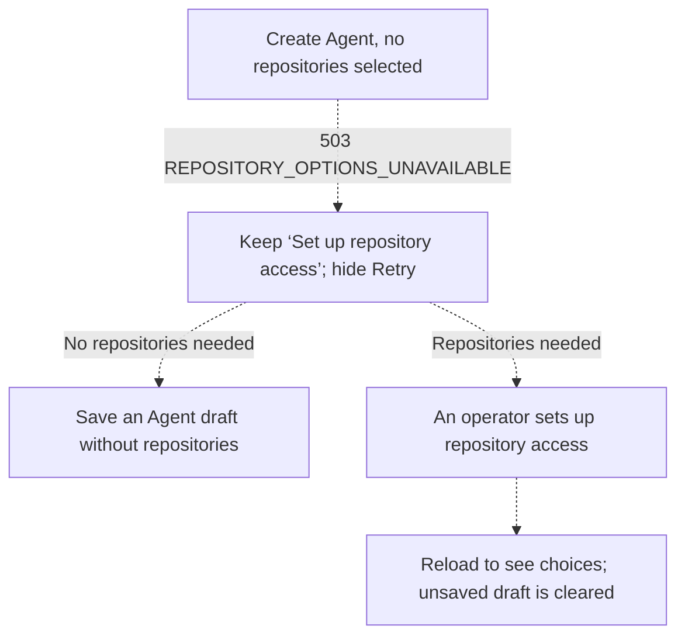

# Proposal: Explain when an Installation cannot offer repository choices

- **ID:** RFC-0019 (provisional on this branch)
- **Created:** 2026-10-02
- **Last updated:** 2026-10-15
- **RFC and draft implementation:** [PR #878](https://github.com/openclaw/openclaw-enterprise/pull/878)
- **Reviewers:** Controller API contract and Console Agent creation owners

## Tell the person creating an Agent when an operator needs to act

In [testing the repository picker](https://github.com/openclaw/openclaw-enterprise/pull/374),
we opened **Create Agent** on an Installation with no repository credential Driver.
The API said only “Repository options are unavailable.” The Console offered both
**Set up repository access**, which could help, and **Retry repository choices**,
which would repeat the same failure until an operator changed the Installation.
Someone who needed no repositories could already save an Agent draft without starting a workload.

**We recommend Option B.** Keep `503 REPOSITORY_OPTIONS_UNAVAILABLE`, explain the
setup problem in the API response, and hide Retry in this particular create form.
API reviewers should decide whether clients can keep relying on that status and code.
Console reviewers should decide whether to remove Retry: it is futile *before* an operator
fixes setup, but useful *afterward*, because [reloading the page clears the unsaved
draft](../../docs/reference/console/create-and-deploy.md). The draft implements both
changes; the decisions are still open.

## What the caller and the person at the Console would see

For the missing Driver we encountered, the proposed API message is:

> Repository options are unavailable. This Installation selects no repository
> credential Driver. See docs/guides/repository-credentials/team-runbook.md.

This applies to `GET /namespaces/<ns>/agents/repository-options` and its per-Agent
variant. The controller first checks permission to create the Agent or update the
existing one, then checks lifecycle state. Only then may it explain that the Installation
selects no repository credential Driver, the selected Driver is unavailable, the Compute
Driver lacks repository support, or its combination with the Sandbox Driver is incompatible.
The explanation
comes from controller-owned text, never a secret or an upstream error. Clients should
branch on status and code, not parse that sentence or automatically retry it.

The create form already links to the [operator’s setup guide](../../docs/guides/repository-credentials/team-runbook.md)
and says “You can continue without repository access.” It uses that guidance instead
of displaying the API message verbatim. Option B removes only the Retry button here:

Only that status and code, on a *new* Agent with *no* repositories selected, let the
person save a draft after discovery fails. Provisioning still requires successful discovery.
If a configured Driver fails to list repositories, the response remains
`503 DEPENDENCY_UNAVAILABLE` and Retry is useful. When editing an existing Agent’s
repository bindings, the Console keeps Retry and blocks saving until it can verify the
choices. The [repository access contract](../../docs/reference/repository-credentials.md)
and authorization on each write stay in force.

## When to choose a different contract

- **A. Return `409 REPOSITORY_DRIVER_NOT_CONFIGURED`.** This follows the credential-source
  precedent, `409 CREDENTIAL_GATEWAY_NOT_CONFIGURED`. But this picker treats a `409`
  as a Namespace lifecycle conflict and blocks creation. Choose A if we will also distinguish
  those cases in the Console, update OpenAPI and its generated reference, and notify clients.
- **C. Add `error.details.reason` to the existing response.** A value such as
  `not_configured` or `unsupported_composition` would let a client act differently for
  each cause. We have not identified a caller that needs that distinction.
- **Keep a manual Retry with B’s API response.** If preserving an open draft through an
  operator’s setup change matters, explain that setup must change first and let the person
  request fresh choices afterward. This needs no new API field and implies no automatic retry.

Before landing, align the draft with both review decisions. Its integration test asserts the
missing-Driver message and runbook path; its browser test distinguishes this state from
denied creation and checks the setup link, enabled **Create Agent**, and hidden Retry.
Review still needs Storybook screenshots and a short video showing the chosen behavior.
RFC-0019 was already occupied on `main` on October 15; allocate the then-current number at landing.
