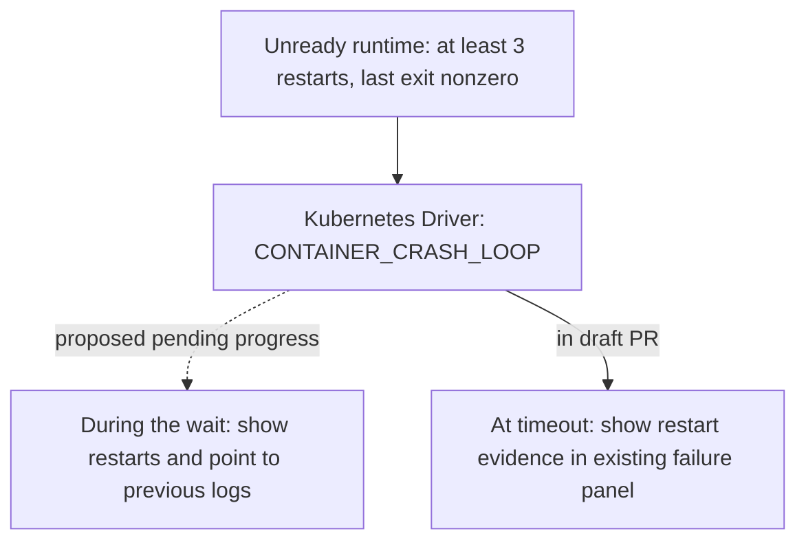

# Proposal: Show repeated runtime restarts while a deployment can still recover

- **ID:** RFC-0019 on this draft branch (renumber before merge)
- **Owners:** Controller worker and Kubernetes Compute Driver. API contract owners decide how pending progress is represented.
- **Created:** 2026-10-02. **Last updated:** 2026-10-15. **[RFC PR](https://github.com/openclaw/openclaw-enterprise/pull/883):** draft, needs human review.

## Summary

A Gateway exited with code 1 on every start. From 23:20 to 23:35, its deployment
said “Waiting for the runtime to become ready.” It then reported only that the
deadline had expired. The useful clue was available during the wait: the previous
Gateway’s logs showed that its configuration omitted `gateway.customBindHost`.

**Show the restarts and keep waiting.** We ask the API contract owners to approve
`RUNTIME_CRASH_LOOP` as a *pending* attempt code. An operator could read
`occ agent logs <agent> --previous` and correct that configuration immediately.
A Gateway waiting for a dependency would still have until the existing deadline
to recover. The proposed signal means “at least three restarts, last exit
nonzero.” It does not establish that all three starts failed for the same reason.

[Draft PR #883](https://github.com/openclaw/openclaw-enterprise/pull/883) implements
only the Kubernetes observation and its path to the existing failure panel *at the
deadline*. Reviewing that code and choosing what the operator sees *during the
wait* are separate decisions. Ending the deployment early is a third, optional
policy choice.

## What the operator would see

In live test D263, an embedded Agent had `gateway.bind=custom` without
`gateway.customBindHost`. Its Gateway restarted five times. `occ agent get` still
showed `active` with no revision, and the [deployment record](../../docs/reference/agents.md)
remained `running` with last attempt `REVISION_INCOMPLETE`. Here is how the
proposal would change that sequence:

1. **While starting:** Keep “Waiting for the runtime to become ready” until we have more specific evidence.
2. **On observing the restarts:** Show “The runtime keeps restarting. Run `occ agent logs <agent> --previous` to see why.” Kubernetes supplies the restart observation even when the Gateway exits before its status endpoint is available. The operator reads the [previous container’s logs](../../docs/guides/topics/agent-logs.md) for the explanation; we do not copy exit text into deployment status.
3. **On recovery or timeout:** If the runtime becomes ready, let the deployment proceed. If it is still unready at the deadline and we still observe the loop, retain `CONVERGENCE_DEADLINE_EXCEEDED` as the failure and attach the restart evidence. Fifteen minutes was the wait in D263, not a new timeout proposed here.

D263 exercised the status and log paths from [#696](https://github.com/openclaw/openclaw-enterprise/pull/696)
and [#747](https://github.com/openclaw/openclaw-enterprise/pull/747). The separate
Collector change to export `gateway.startup_failed` to Loki [merged in #879](https://github.com/openclaw/openclaw-enterprise/pull/879);
that does not put the restart clue in the deployment an operator is watching.

## Design



### Step 1: evidence (draft in this PR)

On an unready observation, `safeRuntimeFailureObservation` first checks for
`WORKSPACE_SETUP_FAILED` when workspace setup applies, then checks the wrapper’s
own failure evidence. If neither explains the wait, the Driver lists the
revision’s Pods, using the Gateway namespace for a Gateway. This fallback costs
up to one additional Pod list per runtime container per unready observation.

For a Pod not being deleted, the test is `restartCount >= 3` and a nonzero
`lastState.terminated.exitCode` on the same container. We need neither a
Kubernetes `CrashLoopBackOff` reason nor a history of three exit codes. An
unavailable observation supplies no failure evidence; cancellation still propagates.
The deadline failure carries this observation in `data.runtimeFailure`:

```json
{
  "component": "gateway",
  "check": "container",
  "code": "CONTAINER_CRASH_LOOP",
  "checkedAt": "<last exit time, or observation time if unavailable>"
}
```

`CONTAINER_CRASH_LOOP` is a new value of an existing open identifier. The console
failure panel can display the component, check and code. The Driver uses the exit
code to recognize the loop; it does not export that code, the termination message
or the reason in this observation.

### Step 2: visible while pending (needs a contract decision)

**Recommend a pending attempt code.** When the Driver reports `CONTAINER_CRASH_LOOP`,
the Controller worker would record `RUNTIME_CRASH_LOOP` in `progress.lastAttempt`.
`deploymentProgressForWork` would supply the message above. Keep the same
readiness recheck delay as `REVISION_INCOMPLETE`. The attempt code is a bounded
string, so this adds public vocabulary without changing the response shape.
Pending progress already distinguishes an unschedulable Pod from a runtime
that is not ready. This code would describe the latest observed attempt while
the deployment remains pending.

If clients need more than an actionable progress message, two alternatives remain:

- **A deployment warning named `RUNTIME_CRASH_LOOP`.** Today, plugin warnings describe a deployment that succeeded with a plugin disabled. This option would also use warnings while deployment is pending, expose `component` and `exitCode`, extend the closed warnings union, and require console and OpenAPI updates.
- **Structured evidence at `progress.lastAttempt.data.runtimeFailure`.** Add to the progress schema so clients can read the same evidence while pending and at the deadline.

### Step 3: fail early (owner decision)

Keep the existing deadline unless the Controller worker and Kubernetes Driver
owners choose a separate stopping rule. We already stop early for
`RUNTIME_AUTHENTICATION_FAILED`, but repeated restarts are less conclusive. In
D263, stopping around minute two instead of minute fifteen might have helped;
for a transient dependency, it might abort a deployment just before recovery.
Six restarts with the same nonzero exit code is an example to evaluate, not an
approved threshold or a history the draft observation can establish. Whether the
Docker Compute Driver should report analogous evidence is also open; its restart
policy differs.

## Verification of the draft

The draft conformance test, `Kubernetes embedded Gateway crash loop reports fixed
evidence after three restarts`, asserts no evidence at two restarts, the fixed
observation and exit timestamp at four, and no termination-message leak. Those
are the tested counts around the threshold of three. D263 establishes the
operator problem; the draft has not been verified on that installation.

If the pending code is approved, the decisive check is to see the restart message
*before* the deadline, then let the same deployment become ready. Also exercise
the case that stays unready through timeout. A Driver-only test cannot establish
either pending behavior.
