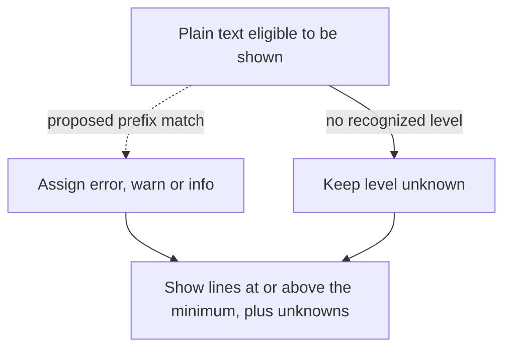

# Give known node-host messages a level in agent logs

**Decision requested from OCC runtime logs, API, CLI and Console owners.** Adopt Option A:
give recognizable node-host messages a severity, and keep showing text whose severity we
cannot tell. Before approving the mapping, decide whether an operator reading at
`--level error` must see that the node host *stopped retrying*. The draft hides both
`node host gateway closed (1006)` and `reconnect paused … waiting for operator action`
as warnings. Those messages call for different responses.

The [October 2 report](https://github.com/openclaw/openclaw-enterprise/pull/884) records why
this matters. After [the level filter landed](https://github.com/openclaw/openclaw-enterprise/pull/807),
an operator ran `occ agent logs <agent> --source agent --since 30m --level error` against a
dedicated Codex Harness. Of 46 lines, eight were errors and 38 reported closed or refused
gateway connections with level `unknown`. Keeping unknowns was intentional: an unrecognized
stack trace can be the only evidence of a crash. The 46 lines describe the original read,
not a before-and-after result.

## What an operator would see

The [agent logs contract](../../docs/guides/topics/agent-logs.md) treats the selected level as a
minimum. The [CLI](../../docs/reference/cli.md), API `minLevel` and Console Logs tab use the same
server-side filter. Option A changes the level assigned to certain text, not that filter or its
default. Here is the complete mapping in [the draft](../../packages/occ/src/runtime-logs/sanitize.ts):

| Start of the line (after trimming) | Assigned level | Shown at `--level error`? |
| --- | --- | --- |
| `node host gateway connect failed:` or `node host gateway closed (` | `warn` | No. This reports a failed attempt or closed connection, not whether a later attempt succeeded. |
| `node host gateway reconnect paused` | `warn` | No, even when the host says it is waiting for an operator or exiting for supervisor restart. **Owner decision needed.** |
| `node host gateway endpoint persistence failed:` | `warn` | No. The host could not save the selected gateway endpoint. **Confirm this may be hidden.** |
| `node host gateway permanently rejected connection` | `error` | Yes. The host reports the rejection before exiting. |
| `node host gateway connected:` or the tag `[node-host]` followed by a space | `info` | No. The tag rule matches any text after that prefix, not just startup announcements. |
| Other unrecognized plain text, such as a stack trace | `unknown` | Yes, if the line is otherwise eligible to be shown. |

The pause and exit distinction comes from the [node-host producer](https://github.com/openclaw/openclaw/blob/daf5cfeeee98dbc6cdaa89361fba73a50efdb68c/src/node-host/runner.ts),
not an inference from a close code. If operators need to see a pause at the error floor,
classify that message as `error`; if its severity is unresolved, leave it `unknown`. Neither
choice requires showing every routine close again.

A prefix is a display hint, not proof that the node host wrote the line. The record remains
`text`; authorization, redaction, withholding and existing wrapper-error handling still apply.
If upstream changes a prefix, an unrecognized line stays visible as `unknown`. The
[page filter](../../packages/occ/src/runtime-logs/read.ts) retains gaps and withheld counts.
Its cursor advances past hidden lines, too. To recover connection context, start a *fresh read
of the same time window* at `--level warn`; continuing from the error-view cursor cannot rewind it.

## What to settle before landing

1. **Agree on the mapping.** Start with this producer. Leave other plain-text sources
   unclassified unless their owners can say what a message means and who needs to see it.
2. **Test the operator's view.** The [draft conformance test](../../tests/conformance/runtime-logs-content.test.mjs)
   asserts assigned levels, not the filtered page, and omits reconnect-paused and
   endpoint-persistence failures. Exercise the agreed mapping at `error` and `warn` alongside a
   permanent rejection and unfamiliar crash text. The startup replay changes two lines from
   `unknown` to `info`; it can expose wording drift only for messages it exercises. No corresponding
   filtered read from a deployment is recorded here.
3. **Keep the public contract explicit.** Option B would let callers opt out of unknowns, for
   example with API `includeUnknown=false`, CLI `--level error --strict` and a Console control.
   Defer that new choice unless another source demonstrates the need. Option C would drop
   unknowns by default, contrary to the documented promise that “lines of unknown level stay.”

Filed October 2, 2026, from finding D266. The RFC number on this draft branch is provisional;
`implementation_status: Implemented` describes the accompanying Option A code, not acceptance
of the decision or deployment.
