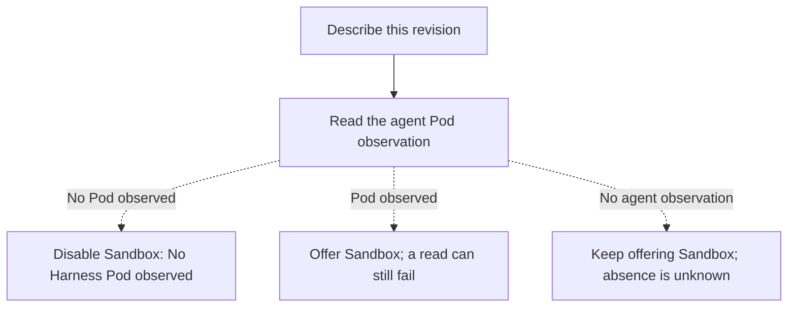

# Proposal: Disable the Sandbox log choice when Compute finds no Harness Pod

- **ID:** RFC-0019 (provisional)
- **Created:** 2026-10-02
- **Last updated:** 2026-10-15
- **RFC PR:** [#905 (draft)](https://github.com/openclaw/openclaw-enterprise/pull/905)
- **Related:** [Runtime log flow](../../docs/flows/agent-runtime-logs.md),
  [operator guide](../../docs/guides/topics/agent-logs.md),
  [runtime log design proposal #854](https://github.com/openclaw/openclaw-enterprise/pull/854)

## When a deployment fails before it gets a Sandbox

In dogfood finding D114, the Console disabled **Agent (no Pod)** but still offered
**Sandbox**. Selecting it returned `503 RUNTIME_LOGS_SANDBOX_NOT_FOUND`. The useful
fact was already on screen: the controller had looked for that revision’s Harness Pod
and found none.

**Recommendation:** When the runtime description reports `agent: NO_POD`, disable
**Sandbox** too and explain “No Harness Pod observed.” This is advice about what to try,
not a claim that OpenShell has no logs. During Pod replacement, the same observation
can temporarily hide useful startup logs from the picker. An operator who explicitly
requests `source=sandbox` must still be able to read whatever OpenShell retains.

API owners: decide whether that tradeoff is acceptable, then settle the proposed
`unavailableCode: "NO_SANDBOX"`. Its name implies more certainty than the observation
provides. If we proceed, the first implementation step is for the Kubernetes and
OpenShell Driver owners to verify that they identify the same Harness Pod.

## Describe what Compute observed; let OpenShell answer the read

The two requests answer different questions. In the [controller source reviewed
October 15](https://github.com/openclaw/openclaw-enterprise/blob/00bbc7cd976ab7be317ce1e0a9d36ad72ce10567/packages/occ/src/index.ts),
`GET …/deployments/<id>/runtime` offers `sandbox` if the revision’s Sandbox Driver
supports reading logs. We would keep omitting the source when the Driver cannot read
it. When it can, use the `agent` observation already in the description, without an
extra OpenShell request on each refresh:

Dashed arrows are proposed. [Kubernetes](../../apps/controller/src/drivers/compute/kubernetes/index.ts)
excludes terminating Pods from this list; a listed Pod need not be ready. An embedded
Harness has only a `gateway` source, and a failed Pod list is an error, not an empty
list. The controller can also report dedicated Harness status, but deliberately reports
some missing or deleting Sandboxes as `unknown` for an inactive revision. None of
these cases establishes that a Sandbox log is gone.

For a direct read, `readSandboxLogs` intentionally starts with an empty Pod list:
it *did not look*. Keep that path independent of the picker, with the existing log
permission, revision and Workspace restrictions, and audit before reading log text.
OpenShell’s `NOT_FOUND` can mean never provisioned, since removed, or outside the
controller’s Workspace. Preserve the [operator guidance for all three
cases](../../docs/guides/topics/agent-logs.md); a Pod observation cannot resolve them.

## What an implementation would have to demonstrate

1. **Identify this revision’s Pod.** Exercise the labels shared by `revisionPods` and
   `providerHarnessReady`: `openclaw.dev/agent`, `openclaw.dev/revision`, and
   `openclaw.dev/workload-role: agent`. Verify that the OpenShell Harness actually
   carries them; the proposal depends on identity, not on passing a readiness check.
2. **Explain the disabled choice.** For D114, return `available: false` and the agreed
   code on `sandbox`. Show its meaning in the Console and `occ agent runtime`. Extend the
   [public response type](../../packages/contracts/src/index.ts) and its
   [API schema](../../packages/contracts/src/api/resources.ts), both of which currently
   allow only `NO_POD`. Update the generated reference and account for clients that
   exhaustively match the old value.
   The [description validator](../../packages/occ/src/runtime-logs/description.ts) checks
   Compute’s container sources *before* the controller adds `sandbox`; keep that boundary.
3. **Recover across replacement.** With no current Pod but retained log lines, show
   the disabled choice, retrieve those lines by direct read, then show that the next
   description offers **Sandbox** once the replacement Pod appears. Test the ambiguous
   Workspace refusal separately. These are acceptance conditions, not reported results.

## If hiding retained logs is the wrong tradeoff

The recommendation above is option A. **B: Probe OpenShell on describe** would use
`GetSandbox` through the restricted reader. Success confirms a visible Sandbox;
`NOT_FOUND` still means “not found or not visible.” This adds a gRPC round trip to
each description and also requires agreement on the public reason code.
**C: Explain the failed read** would keep the source selectable and add “No Harness
Pod observed” when we know that fact. **D: Keep the current behavior** is reasonable
for a low-severity finding: the adjacent Agent status and the log guide already help
an operator interpret the failure.
