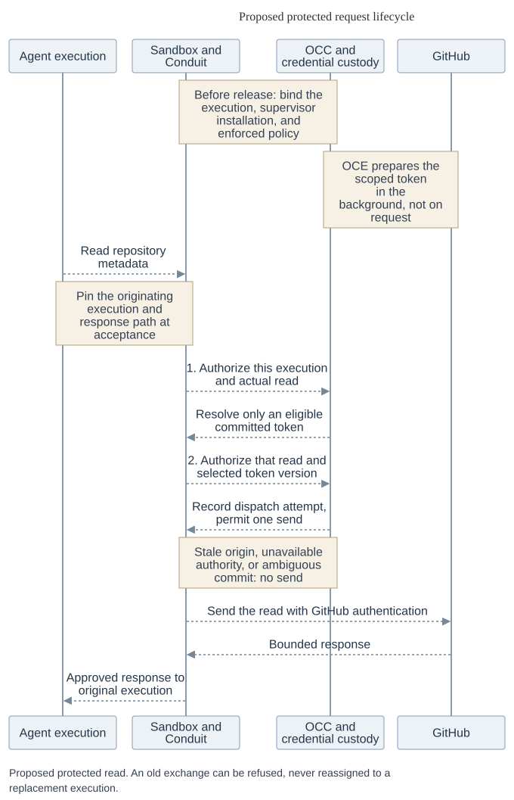

# Execution, forwarding and credential contracts

[RFC-0020](index.md) proposes these contracts. The control plane admits an *execution*, the trusted
sender authorizes an *exchange*, and a credential owner prepares *material*. None of those decisions
substitutes for another. The names below describe required behavior, not a public wire format.
[Security and release requirements](security.md) cover the evidence needed to enable protected mode
and the conditions for retiring the previous interfaces.

## Execution admission

OpenClaw Control Plane (OCC) records `EgressAdmission {contractVersion: 2, backend, protection}` in
both the admitted revision and the execution. The deployment selects the composition, which establishes
execution identity. Protection is explicit even with no plan or bindings. Fence readers that could
ignore it, refuse missing or unsupported admission, and require a new execution to change protection.

| Protection | What Compute may release |
| --- | --- |
| `unprotected` | An explicit no-op for local development or minimal CI. The Agent has a control-plane identity, but OCE does not govern its direct requests. Refuse managed routes, bindings, preparation or clone. Supply no managed or ambient substitute credential. |
| `protected {authority: execution}` | Sandbox prevents bypass. Every process in the execution shares its egress authority. A route may require no provider credential. Zero effective routes means deny all. Carry forward narrower legacy authority only with evidence of equivalence or fresh consent to the wider boundary. |

OCC validates closed, versioned schemas before reading a Secret or causing effects. A reference is
an immutable ID and configuration generation. Recreating an object gives it a new ID. Changing
policy, custody or approved material advances the affected generations. Routine material rotation
changes a *value version*, not the admitted configuration. The minimum associations are:

```text
SourceKey = (OCE installation, namespace, source ref, backend ref, provider ref)
Execution = (OCE installation, namespace, Agent, service principal, revision, execution ID, admission)
Binding   = (ref, exact execution or management context, SourceKey, normalized grant,
             grant hash, isolation ID, required for startup)
Route     = (ref, same context, HTTPS origin, methods, segment-aware path prefix,
             operation policy, response policy, binding or none, grant, deadline)
```

Normalize grants without implicit wildcards. For GitHub, bind App, GitHub installation, repository
IDs and permissions. Inference binds models, OAuth binds audience and scopes, and API grants bind
audience and operation policy. Isolate per Agent unless sharing is explicitly admitted. Freeze the
trusted Backend composition at admission, including permitted sender, resolver, owner and issuer.
Its provider definition supplies `normalizeInput`, `normalizeGrant`, `classify`, `injectionPlan`,
`responsePolicy` and `validateIssued`. Requests cannot load code or choose a Driver. Control commands carry a request ID,
absolute deadline, local cancellation signal and an OCC-issued permit binding principal, purpose,
action, exact target generations, audience, input digest and expiry.

| Owner and methods | Required result |
| --- | --- |
| OCC via Backend `CredentialSourceControl.describeTypes`, `applySource`, `sourceStatus`, `removeSource` | Admit the schema, source and custody. Project schema identity, kind and nonsecret routing fields to Egress, never a root or its Secret reference. Catalog withdrawal ends new admission, not responsibility for status, references or cleanup. |
| Compute via `EgressProxyDriver.capabilities`, `configureRevision`, `attachmentStatus` | Configure the whole plan or make none of it usable. Return an authenticated attachment binding execution, plan, Sandbox, sender, audience, version 2, policy generation and exact route and binding sets. Qualify the actual composition at startup and admission. |
| Sandbox via `installEgress`, `egressStatus` | Verify and enforce that plan. Attest the attachment, execution, trusted gateway, immutable sandbox ID, runtime generation, supervisor installation, applied policy and effective sets. Reject a stale install. |

`egress_proxy` is the one new registered capability. An OpenShell composition may implement both
Egress and Sandbox. To establish the live channel, Sandbox can enroll a supervisor-generated public
key over its *already authenticated* installation control channel. Compute verifies that enrollment
in the installation attestation before release. The supervisor keeps the private key outside the
Agent, identifies the execution at the enforced sandbox boundary, and connects to the sender on a
dedicated channel proving possession of the enrolled key. The sender verifies the exact installation
and channel. A copied receipt or a bearer identifying only the sandbox cannot prove this.
A future composition could use an execution-scoped bearer or SPIFFE workload identity; it must
establish the same execution and exchange association, not merely authenticate a long-lived Agent.

Before releasing the workload, Compute bounds the wait for applied configuration, eligible material
for each required dynamic grant, and enforcement of the exact attachment. After release, require
authenticated Harness `serving` for this execution before reporting readiness. The Agent needs no
egress credential or provider secret. Check static material by authorized resolution. A route
needing no credential skips only the material requirement.

## Capture and forward

For the first protected operation, use a bodyless metadata read for one admitted GitHub repository.
Withhold its entire bounded response until accepted. This exercises the following contract without
requiring Git transport or streaming.



[Editable request sequence](assets/request-lifecycle.mmd)

1. **Bind the exchange at acceptance.** In `EgressForwarder.capture(peer, exchange, bounds)`, trusted
   transport binds the immutable request, authenticated execution and supervisor installation, channel,
   stream and response destination *before queuing or consulting current policy*. Multiplexing needs
   equivalent provenance for each stream. Replacing installation A with B invalidates A's open
   channels and queued work. Current state may reject an exchange from A, never attribute it to B.
2. **Seal the operation.** Match method, canonical URL, address, TLS name, HTTP authority, ordered
   headers and policy-relevant body against exactly one route. Automatic selection requires a unique
   match. An explicit binding selector is untrusted intent and must also yield exactly one match.
   On failure, try no alternative identity or credential-free route. Seal any permitted transformation,
   classification and absolute deadline in a sender-bound `OperationHandle` usable for at most one
   dispatch. Bound and parse streams, treating a frame requiring a new decision as a new operation.
3. **Authorize material access.** `EgressAuthorizer.check(before_access, operation)` asks OCC online.
   Check current caller and applicable user rights, execution or delegation, installation and channel,
   applied policy, holds, withdrawals, generations, grant and actual operation. Check static adoption
   and material reference, or dynamic input-family generation and owner epoch. An `AccessPermit`
   allows one resolution for this operation, resolver and deadline. It permits no send.
4. **Authorize the exact dispatch.** `EgressForwarder.forward(operation)` owns both checks and
   the intervening resolution. Call `check(before_send, operation, materialEvidence | none)` with the
   same current checks and actual selection. After authorization, *before releasing the SendPermit*,
   durably commit the attempt, accepted origin and response destination, selection, original deadline
   and finite `sendStartBy`. If the commit acknowledgment is lost, release no permit, send nothing,
   and reconcile that attempt without issuing a replacement. Both checks apply to cache hits and to
   credential-free routes, which perform zero material reads. Never cache an allow decision.
5. **Send once and govern the reply.** Match the permit to the committed attempt, accepted exchange, sender,
   selected material (or none), and both deadlines. Any custody handle must belong to that operation
   and sender. A mismatch, replay, or uncertain prior consumption permits no write. Check usability,
   consume the permit once, strip execution authentication and selectors, and inject only at the admitted
   destination. Apply response policy to status, headers, body, trailers and encoding, including on
   errors and at each streaming release. Deliver only to the accepted destination. If a write may
   have reached the provider but the reply was lost, record possible dispatch and do not send again.
   A redirect or another operation on the connection needs fresh capture and both checks within the
   original deadline. The permit bounds when a send may start, not exactly-once provider execution.

Return `refused` only if no send was possible, with a safe `denied`, `not_ready`, `unavailable`,
cancellation or deadline result. Otherwise record `response`, `provider_rejected`, `response_blocked`
or `uncertain` with an authenticated `SendReceipt` binding the committed attempt, operation, origin,
response destination, sender, material evidence or absence, deadlines and confirmed or possible
dispatch. Return only the policy-approved response to the caller. Blocking it cannot undo a write.

Git discovery, upload-pack and receive-pack are separate operations. For ref-constrained push, the
trusted sender must parse the *complete* bounded command list, check every old object ID, new object
ID and ref, and dispatch the identical checked commands and operation. A forbidden second ref
rejects the entire push before any provider write. If the sender cannot enforce this, refuse push.
An Agent hook cannot satisfy the contract, nor does this check establish pack or branch safety.

## Credential resolution

`CredentialResolver.resolve(operation, accessPermit, maxStaticAgeMs, minRemainingValidityMs)`
returns a single-use custody handle and nonsecret evidence, or a refusal. Enforce associations at
runtime. Only the admitted trusted sender can consume the handle, never an Agent, UI, arbitrary
callback or diagnostic. Bind evidence to SourceKey, binding, grant hash, isolation, store-qualified material
identity, value version and `usableUntil`. Caller limits may tighten, never widen, admitted policy.
Resolve neither contacts the provider nor signs, issues, refreshes or schedules work.

**Static.** Retain `SecretDriver.readCredentialInput(secret, material, permit, retention, bounds)`.
It returns an authorized custody handle, immutable version, authoritative observation time and any
expiry. New sources default to `live`. Migrated `explicit_update` sources select an exact approved
version or immutable snapshot in the same OCE installation and namespace. The read permit binds
the adoption mode, exact selected store and target version, consumer and `static_read` purpose.
Lifecycle input reads require separate `issuer_input` authority. In snapshot mode, the
admitted snapshot owner serves that version. The original Secret is provenance and need not still
exist. Evidence and reuse keys retain adoption, selected store, target, version and revocation
association. Only exact source-update authority and access to the selected target may change that
approval. A failed opt-in leaves it intact, subject to current denial or known revocation.

Default freshness is ten minutes. The default four-hour limit is *total age from authoritative
read*, usable after freshness only on positively classified transport, timeout or throttling failure.
No fallback on missing, denied, revoked, unknown failure, cancellation or unavailable authority.
Neither failure nor a lower cache resets age. Either cache duration zero, or request age limit zero,
requires an authoritative read of the *selected target*, no reusable retention or fallback at any
layer, and use bounded by deadline and expiry. Zero means read again, not expire instantly.

**Dynamic.** `WarmCredentialReader.readWarm` reads only eligible committed material for
`WarmKey = (SourceKey, exact normalized grant, grant hash, isolation ID)`. Add family generation,
owner epoch, preparation attempt, actual grant and provider expiry to the evidence. Cold, expired
or insufficient validity returns `not_ready` and starts no work. Eligible material can outlast an
issuer outage. An unavailable resolver permits no proxy cache, token push or fallback.

| Lifecycle owner interface | Responsibility |
| --- | --- |
| `CredentialRefreshDriver.configureRefresh`, `refreshStatus` | Admit family, single owner, issuer, input authority, grant keys, renewal lead and minimum validity. Report configuration, eligibility, current attempt, activity, next renewal and required recovery separately. |
| `prepare`, `removeRefresh` | Separately authorized management may ensure readiness or request rotation. Removal stops preparation and settles owned artifacts. Retain a family while another admitted source or grant depends on it. |
| `CredentialIssuer.issue`, `inspect`, `retire` | Bind attempt, input version, grant, family, epoch and deadline. Distinguish known refusal, no dispatch, candidate and uncertain exchange. Inspect without repeating issuance. Retire exact custody and report provider revocation only where supported. |

Serialize rotating-input consumption across the *family*, not just a grant key. Fence owner epoch
and attempt in durable storage. Record possible issuance before calling the issuer, validate actual
grant and expiry, then durably commit any replacement input and the candidate before publishing
readiness. A successor must fence the former owner, reconcile its attempt and retain late candidates
for cleanup. If a rotated input was lost, reauthorization may be necessary. Neither a lost lease
nor the original bootstrap Secret licenses replay. Routine renewal must not interrupt eligible use or require a restart.
Exceptional reauthorization may interrupt the affected credential; make that recovery visible.
Show readiness and failures to the Agent owner at provisioning; give operators renewal failures
and time to expiry, with alert policy and thresholds left to the deployment.

OCE alone owns the GitHub App key, signs the App JWT, exchanges it for an installation token scoped
to admitted repositories and permissions, verifies effective grant and expiry, and commits the token,
version, attempt and epoch together in encrypted custody. OCE owns background renewal, withdrawal
and fenced takeover. OpenShell may be the sole lifecycle owner for a different credential family.

**Other callers.** Trusted bootstrap proves OCC delegation for the executor, execution, repository,
clone, source, grant, audience and deadline. It runs both checks for each Git operation and cannot
prepare a token. Compute opens the default clone gate only on authenticated success naming the
requested ref, observed commit if known, workspace, attempt, outcome and cleanup. Compute and
bootstrap retain responsibility for a partial workspace or uncertain clone. For management
discovery or configuration, a trusted sender *inside OCC* captures the business operation, obtains
preparation authority bound to the service, initiating user, captured operation, exact source and
grant, destination, and original deadline. After preparation it performs both fresh checks.
Return sanitized business data, never material or an injection callback.

## Withdrawal and recovery

OCC commits denial and durable withdrawal intent. Egress `withdrawBinding` advances the policy
generation, tombstones the removed binding and exposes the reducing successor attachment while
pending. Sandbox installs it. Settle only on evidence of that exact generation and remaining route
and binding sets. Keep tombstones past possible late installs. `removeRevision` needs confirmed
destruction or installed deny-all. Reductions affect the next check, but a send whose final check
raced withdrawal can *start after acknowledgment*. Report OCC denial, detachment, source removal
and provider revocation separately.

`configureRevision` can apply a newly admitted plan to the same running execution. To remove a
credential-free route, advance the generation and verify the exact remaining routes and bindings;
removing the last route leaves deny-all enforced. While expansion awaits exact-scope material,
narrower operations may continue only under bindings that remain authorized.

On authenticated credential rejection, `CredentialResolver.reportRejection` must *durably commit
before acknowledging*: deduplicate by sender, operation, attempt and store-qualified material
version, fence that exact version, and record the recoverable obligation. Redelivery after lost
acknowledgment returns the recorded disposition. Coalesce recovery at the dynamic owner. Rejection
of N cannot invalidate or schedule recovery for N+1. A static fence survives eviction, restart and
reread without approving replacement. Never retry the business operation automatically.

Every mutating control facet supports `inspect(operationId, bounds)` and
`reconcile(operationId, cleanupPermit, bounds)`. Record request ID, input digest, purpose, action,
exact targets, owner, attempt, deadline and cleanup obligations. An identical request returns its
recorded result, changed input conflicts, and a superseded generation cannot apply even on late
completion. Distinguish refusal before acceptance, pending, applied, known failure with cleanup,
and uncertain effect. OCC may renew cleanup authority for that exact accepted work after use rights
expire. It permits no new use, issuance or broader deletion. Cancellation is local, not proof that
a remote operation stopped.
