# Proposed source and egress management contracts

[RFC-0020](index.md) gives OCC source admission and durable intent, Egress the execution’s binding
set, and Sandbox its installation and enforcement. Installation proves neither credential readiness
nor permission for an operation.



[Editable diagram](assets/credential-architecture.mmd) ·
[Configuration and warmup](lifecycle.md#1-configure-and-warm). “Token Service” denotes the retained
`CredentialRefreshDriver` responsibility.

These transport-neutral proposals are not exports or public configuration syntax. Require all fields
unless marked optional; reject unknown fields. Wire encodings must preserve these semantics.
[Runtime](runtime-contracts.md) and [lifecycle](lifecycle.md#lifecycle-interface) use the same
definitions.

## Identities and admission

| Shape                | Fields and meaning                                                                                                                                                                                                                                                                                                                                                 |
| -------------------- | ------------------------------------------------------------------------------------------------------------------------------------------------------------------------------------------------------------------------------------------------------------------------------------------------------------------------------------------------------------------ |
| `Id`, `Ref`          | `Id`: immutable opaque string; deletion/recreation gets a new ID. `Ref`: `{id: Id, generation: positive integer}`. Generations increase on configuration change, never material rotation.                                                                                                                                                                          |
| `Scope`, `SourceKey` | `Scope`: `{installationId: Id, namespaceId: Id}`. `SourceKey`: `{scope: Scope, source: Ref, backend: Ref, provider: Ref}`.                                                                                                                                                                                                                                         |
| `Execution`          | `{scope: Scope, agentId: Id, servicePrincipalId: Id, revisionId: Id, executionId: Id}`. OCC assigns the execution; the stable Agent principal is separate.                                                                                                                                                                                                         |
| `Management`         | `{scope: Scope, servicePrincipalId: Id, initiatingPrincipalId: Id, purpose: configuration\|discovery, authorizationId: Id}`; OCC derives this context, not permission to skip current checks.                                                                                                                                                                      |
| `Context`            | `execution{execution: Execution}` or `management{management: Management}`. Route and Binding must carry the same variant and exact context.                                                                                                                                                                                                                        |
| `Bounds`, `Command`  | `Bounds`: `{deadlineAt: UTC timestamp, cancellation: local cancellation signal}`. Cancellation cannot prove remote cancellation. `Command`: bounds plus `requestId: UUID`, `admission: Permit`.                                                                                                                                                                    |
| `Permit`             | Runtime-verifiable OCC reference binding authenticated principal, purpose, exact target refs/generations, action, audience, input digest and expiry. Control action/purpose are constrained below; runtime purposes are defined at their methods. Issued after authorization, never caller assertions.                                                             |
| `SecretRef`          | `{scope: Scope, secretId: Id, secretDriver: Ref}`; exact Secret identity, not a value or value version.                                                                                                                                                                                                                                                            |
| `StaticMaterialRef`  | `{id: Id, target: live{secret: SecretRef}\|version{secret: SecretRef, valueVersion: string}\|snapshot{scope: Scope, snapshotId: Id, owner: Ref, valueVersion: string}}`. OCC assigns an immutable identity for this exact target; snapshot `owner` identifies its admitted Secret Driver facet, not a refresh owner.                                               |
| `Grant`              | Initial closed schemas: `inference` with `models: string[]`; `github` with `appId`, `installationId`, `repositoryIds: nonempty Id[]`, `permissions: {contents: read\|write, metadata: read}`; `oauth` with `audience: string, scopes: string[]`; `api` with `audience: string, operationPolicy: Ref`. Registered extensions follow the typed admission rule below. |
| `Binding`            | `{binding: Ref, context: Context, source: SourceKey, grant: Grant, grantHash: SHA-256, isolationId: Id, requiredForStartup: boolean}`. Canonical sorted/deduplicated grants have no implicit wildcard. Default isolation is per Agent; sharing requires explicit admission.                                                                                        |
| `Route`              | `{route: Ref, context: Context, origin: HTTPS origin, methods: HTTP method[], pathPrefix: string, operationPolicy: Ref, responsePolicy: Ref, use: Binding\|none, grant: Grant, deadlineMs: positive integer}`. Prefix matching is segment-aware; provider classification supplies finer constraints. Credential-free routes still have grants.                     |
| `Custody`            | `{sender: Ref, resolver: Ref, owner: Ref\|none, issuer: Ref\|none}` identifies trusted permitted consumers. Source policy must admit each material transfer.                                                                                                                                                                                                       |

OCC’s source service validates the schema, authorizes the change, and records intent, generations
and audit. The trusted Backend supplies provider definitions. A caller cannot choose implementation
code.

Keep configuration generations separate from credential versions. Changing an input reference, route
policy, custody, adoption mode or approved static material advances the source generation. A live
Secret value changing from `v1` to `v2` does not. Changing a grant or its selection advances the
affected binding and route generations. Only exact source-update authority can change adoption mode
or approve replacement material; permission to consume the source cannot do either.

For management, OCC admits a route and binding for a registered configuration or discovery operation
using current service and initiating-user rights. Give it scoped, versioned references, an explicit
grant, isolation, a bounded deadline and `requiredForStartup: false`. It needs no Agent, execution
or Sandbox attachment. `authorizationId` identifies the operation; OCC still checks current
authority. Agent and bootstrap callers cannot select management context, and management cannot
borrow an Agent binding. Sharing material always requires admitted isolation.

`Source` is `{key: SourceKey, schemaVersion: registered positive integer, custody: Custody, input: Input}`.
`Input` selects one registered closed schema; initial forms are:

| Kind             | Required fields                                                                                                                                                                                                                                                                                 |
| ---------------- | ----------------------------------------------------------------------------------------------------------------------------------------------------------------------------------------------------------------------------------------------------------------------------------------------- |
| `static`         | `secret: SecretRef`, `adoption: live\|explicit_update`, `material: StaticMaterialRef`, `cache: none\|bounded{freshMs, totalEligibleAgeMs}`; bounded durations are positive milliseconds, total ≥ fresh. Either public duration set to zero normalizes to `none`. Defaults: 600000 and 14400000. |
| `github-app`     | `appId: Id, installationId: Id, signingKey: SecretRef, familyId: Id`                                                                                                                                                                                                                            |
| `oauth-client`   | `tokenEndpoint: HTTPS URL, clientId: string, clientSecret: SecretRef, familyId: Id`                                                                                                                                                                                                             |
| `oauth-rotating` | `tokenEndpoint: HTTPS URL, clientId: string, refreshSeed: SecretRef, clientSecret: SecretRef\|none, familyId: Id`                                                                                                                                                                               |

New static sources default to `live`. Migrated legacy sources retain
`explicit_update` until an authorized operator opts in. Admission enforces these
combinations:

| Adoption          | Material target and serving Driver                                                                                                                                                           |
| ----------------- | -------------------------------------------------------------------------------------------------------------------------------------------------------------------------------------------- |
| `live`            | Only `live`; target `secret` equals Input's `secret`. Its `secretDriver` reads the current value.                                                                                            |
| `explicit_update` | Only `version` or `snapshot`. A version's `secret` equals Input's `secret`; its `secretDriver` reads exactly `valueVersion`. A snapshot's `owner` reads exactly `snapshotId`/`valueVersion`. |

Input SecretRef and every target scope must equal SourceKey.scope. Composition
must admit the selected Driver and its custody; refuse mismatched owners, refs,
versions or scopes. In snapshot mode, Input's `secret` is provenance, not a
routing or current-value dependency. Authorization targets the selected
snapshot/store/version; it requires no read or current existence of the provenance
Secret. Preserve the approved origin/version's revocation association.

Only exact source-update authority and required access to the selected target
can replace approved material or opt into live mode. A mutable ref or longer TTL
cannot implement explicit update. Failed opt-in leaves approved state intact;
known revocation still denies. [Migration](migration.md#preserve-approved-static-material)
defines candidate validation and cutover.

Dynamic roots go only to the lifecycle owner/issuer. Generic egress provisioning
receives `SourceProjection`: key, schemaVersion, custody and input kind, with
familyId for dynamic inputs. Static projections carry `adoption`, `materialRefId:
Id` and `approvedVersion: string|none` (none only for live), matched to Source's
exact material selection. Secret/root references stay in trusted resolution;
projections contain no such references or values. Cross-Namespace references,
unsupported schemas and grants are refused before effects. Bindings may overlap
for explicit selection; capture must select one exact route. Admission refuses
indistinguishable routes within a binding. See [binding selection](runtime-contracts.md#binding-selection).

Provider registration supplies versioned closed Input, Grant and Classification
schemas, validators, normalizers and trusted injection definitions. An admitted
value is typed by `(provider Ref, schemaVersion, kind)`; hooks accept only that
schema's validated result. Custom providers and additional GitHub permissions
extend provider-owned schemas without core provider switches or arbitrary
context bags. SourceProjection preserves this schema identity and only admitted
nonsecret routing fields; Secret/root fields never enter it.

Trusted Backend factories publish an immutable `Composition` record keyed by
backend Ref: `sourceControl: CredentialSourceControl`, registered provider Refs
and schema versions, egress/sandbox/secret Refs, and `lifecycle:
{owner: Ref, refresh: CredentialRefreshDriver, warmReader: WarmCredentialReader,
issuer: CredentialIssuer}|none`. References resolve only to installed facets.
OCC binds SourceKey to this record at admission, checks versions/custody and uses
its facets for status and cleanup even after catalog withdrawal. Composition
changes advance backend generation; requests cannot discover/load plugins.

Illustrative **proposed admission record**, after OCC resolves user-facing names;
this is not accepted public YAML:

```yaml
key:
  scope: { installationId: inst-1, namespaceId: ns-1 }
  source: { id: source-1, generation: 2 }
  backend: { id: openshell-1, generation: 1 }
  provider: { id: github-1, generation: 1 }
schemaVersion: 1
custody:
  sender: { id: sender-1, generation: 1 }
  resolver: { id: resolver-1, generation: 1 }
  owner: { id: lifecycle-1, generation: 1 }
  issuer: { id: github-issuer-1, generation: 1 }
input:
  kind: github-app
  appId: app-1
  installationId: github-installation-1
  familyId: family-1
  signingKey:
    scope: { installationId: inst-1, namespaceId: ns-1 }
    secretId: signing-key-1
    secretDriver: { id: secrets-1, generation: 1 }
```

## Results and recovery

`Error` is `{code}` from this closed set: `unauthorized`, `invalid_input`,
`unsupported`, `stale_generation`, `request_conflict`, `ownership_conflict`,
`references_remaining`, `backend_failed`, `unavailable`, `cancelled`, `deadline_exceeded`.
No provider-controlled text is returned. `Read<T>` is `ok(value: T)` or
`refused(error: Error)`.

`Change<T>` distinguishes acceptance and effect:

| Result                                                                     | Meaning                                                                 |
| -------------------------------------------------------------------------- | ----------------------------------------------------------------------- |
| `applied(value: T, operation: Operation)`                                  | Operation applied; applied configuration is not material readiness.     |
| `pending(operation: Operation)`                                            | Accepted work is incomplete.                                            |
| `uncertain(operation: Operation)`                                          | The external outcome is unknown.                                        |
| `failed(operation: Operation, error: Error, cleanup: CleanupObligation[])` | Known failure after acceptance, possibly with partial external effects. |
| `refused(error: Error)`                                                    | No effect accepted.                                                     |

A failed result or rollback does not erase cleanup obligations.
`Operation` contains `id`, requestId, target refs, action, exact-input digest,
purpose, owner Ref, attemptId, original deadline, `cleanup: CleanupObligation[]`,
and state `pending|uncertain|applied|failed`, with optional safe Error and
completion time.
An applied configuration does not establish material readiness.

`Action` is facet-qualified: CredentialSourceControl `applySource|removeSource`,
EgressProxyDriver `configureRevision|withdrawBinding|removeRevision`, SandboxDriver
`installEgress`, CredentialRefreshDriver `configureRefresh|prepare|removeRefresh`,
or CredentialIssuer `issue|retire`.
`purpose` is `configuration|discovery|lifecycle|cleanup`, restricted by that
method's caller and Permit. OCC derives both; Agent claims cannot select them.
`CleanupObligation` records resource Ref, owner Ref, attemptId, allowed cleanup
Action and `state: pending|uncertain|complete`. Removal, withdrawal and retirement
qualify, plus Sandbox `installEgress` restricted to the reducing successor of an
accepted withdrawal/removal. Cleanup can never broaden routing; obligations
persist independently of completion.

Every mutating facet below implements `inspect(operationId, bounds) → Read<Operation>`
and `reconcile(operationId, cleanupPermit, bounds) → Change<Operation>` for its
own operations. OCC's durable reconciler drives these after disconnect/restart;
it observes or completes the original intent, never blindly replays issuance.
Inspection and reconciliation retain the original action and purpose; cleanup
authority cannot start new source-use or issuance intent. An exact requestId
returns the recorded result; changed input conflicts. Stale or superseded
generations cannot apply, including late completion. Shared profiles also
require a monotonic applied policy generation.

`CleanupPermit` is a Permit limited to an already accepted operation, exact
resource/action/attempt and cleanup audience. Durable obligations survive expiry
and loss of source-use rights; OCC may issue a successor cleanup permit after
verifying that obligation. It cannot authorize use, new issuance or broader deletion.

## Source control

`CredentialSourceControl` is an internal Backend facet called by OCC, not a new
registered Driver. All methods are required.

| Method and input                                                         | Result and responsibility                                                                                                    |
| ------------------------------------------------------------------------ | ---------------------------------------------------------------------------------------------------------------------------- |
| `describeTypes(backend: Ref, bounds: Bounds)`                            | `Read<Descriptor[]>`; configuration-dependent catalog.                                                                       |
| `applySource(source: Source, command: Command)`                          | `Change<SourceStatus>`; reconciles registration or admitted configuration replacement. Does not copy every root into egress. |
| `sourceStatus(key: SourceKey, bounds: Bounds)`                           | `Read<SourceStatus>`; observes exact source configuration.                                                                   |
| `removeSource(key: SourceKey, cleanup: CleanupPermit, command: Command)` | `Change<Removal>`; coordinates lifecycle retirement, provider/profile deletion and absence confirmation.                     |

`Descriptor` contains provider Ref, schemaVersion, input kind, supported Grant
kinds, config/Secret field lists (`name`, scalar type, required, purpose,
issuerRotated), `rotation: none|external|refresh`, and
`harnessAuth: none|{modelProvider: string, loginMode: api_key}`. Field lists describe
the registered closed Input schemas. Catalog removal blocks new admission, not status,
withdrawal or cleanup of existing identities.

`SourceStatus`: key, `appliedGeneration: integer|none`,
`state: pending|applied|failed|absent`, `operationId: Id|none`, `error: Error|none`.
Dynamic per-grant readiness comes from `CredentialRefreshDriver.refreshStatus`.
Static sources have no warm lifecycle; resolve checks the admitted material selection.
`Removal`: `state: removed|absent|cleanup_pending|references_remaining`,
`outstandingOperationIds: Id[]`, `remainingBindingRefs: Ref[]`. Pending cleanup
is not reported as removed.

## Egress and Sandbox handoff

`EgressProxyDriver` is the **one new registered capability**, `egress_proxy`.
`SandboxDriver` retains networking/enforcement and consumes its exact attachment.
One OpenShell object may implement both; two daemons are not required. Keeping
all protection management inside Sandbox was an alternative, but would obscure
replaceable egress configuration and withdrawal ownership.

| Method and input                                                                                  | Result                                                                                                                                                     |
| ------------------------------------------------------------------------------------------------- | ---------------------------------------------------------------------------------------------------------------------------------------------------------- |
| `capabilities()`                                                                                  | `Capabilities` below; declarations require qualification of the exact composition at startup/admission.                                                    |
| `configureRevision(plan: Plan, command: Command)`                                                 | `Change<Attachment>`; Compute configures the complete binding set, all-or-refuse. Partial effects remain owned cleanup, never a partial usable attachment. |
| `attachmentStatus(attachment: Attachment, bounds: Bounds)`                                        | `Read<AttachmentStatus>`; Compute/worker reads Egress state joined with Sandbox-issued installation evidence.                                              |
| `withdrawBinding(attachment: Attachment, binding: Ref, cleanup: CleanupPermit, command: Command)` | `Change<Withdrawal>`; egress owns detachment and prevents late reattachment.                                                                               |
| `removeRevision(attachment: Attachment, cleanup: CleanupPermit, command: Command)`                | `Change<Removal>`; retires all revision bindings.                                                                                                          |

| Shape              | Required fields                                                                                                                                                                                                                                                                                                                          |
| ------------------ | ---------------------------------------------------------------------------------------------------------------------------------------------------------------------------------------------------------------------------------------------------------------------------------------------------------------------------------------- |
| `Capabilities`     | `contractVersion: 1`, `attachmentVersions: integer[]`, supported input/Grant kinds, `protocols: (https\|sse)[]`, `enforcement: enforced\|disabled`, booleans for authenticated capture, per-operation resolution, two online checks, protected responses and admitted custody. Protected admission requires every applicable capability. |
| `Plan`             | `plan: Ref, execution: Execution, sandbox: Ref, egress: Ref, attachmentVersion: 1, routes: Route[], sources: SourceProjection[]`                                                                                                                                                                                                         |
| `Attachment`       | Adapter-issued authenticated reference: `id: Id, plan: Plan, policyGeneration: positive integer, bindingRefs: Ref[], audience: Ref`. No values, root refs or permission inferred from provider names.                                                                                                                                    |
| `InstallReceipt`   | Sandbox-authenticated `id: Id, attachmentId: Id, plan: Ref, execution: Execution, sandbox: Ref, egress: Ref, attachmentVersion: 1, policyGeneration: positive integer, bindingRefs: Ref[], enforcement: applied\|refused, observedAt: UTC timestamp`.                                                                                    |
| `AttachmentStatus` | attachmentId, `effectiveAttachment: Attachment\|none`, `receipt: InstallReceipt\|none`, per-binding Ref and `state: pending\|applied\|withheld\|failed\|revoked\|absent`, `error: Error\|none`                                                                                                                                           |
| `Withdrawal`       | attachmentId, binding Ref, `state: pending\|detached\|absent`, `successor: Attachment`, `receipt: InstallReceipt\|none`, observation timestamp; detachment evidence records the remaining exact binding set.                                                                                                                             |

The proposed Sandbox networking facet adds
`installEgress(attachment, command) → Change<InstallReceipt>` and
`egressStatus(attachment, bounds) → Read<InstallReceipt|none>`, with the same
inspect/reconcile contract. Every Plan route and binding must use the execution
variant matching its exact Execution; management contexts cannot enter
attachments or installation.
Compute calls `installEgress` with `egressAttachment: Attachment` in place of
`credentialAttachments`. Sandbox verifies the version, audience, execution and entire plan before it
reports enforcement. Egress owns the binding set; Sandbox enforces that set and reports what it
installed.

For example, withdraw a repository binding while an inference binding remains. OCC can already deny
repository use. Egress must still prove that Sandbox installed the *remaining* binding set:

1. Egress advances policyGeneration, tombstones withdrawn binding Refs and
   records a successor attachment with the remaining bindings and effective
   routes, bounded by the original admitted plan.
2. `attachmentStatus` exposes the successor while withdrawal is pending.
   Compute/worker calls `installEgress`; Sandbox enforces its effective routes
   and refuses stale installation.
3. Egress remains pending until Sandbox evidence confirms that generation and
   binding set. Older receipts cannot settle withdrawal. Tombstones outlive any
   possible late installation.

Revision removal uses the same handoff with empty routes, or confirmed Sandbox
destruction, before reporting absence.

`configureRevision` also reconciles a newly admitted Plan for the **same running
Execution**; a grant change does not inherently require an Agent restart.
Reductions affect subsequent OCC checks immediately, subject to the accepted
check-to-send race. Expansion needs separate admission and exact-scope preparation
before new use. Existing narrower operations may continue only where their
current bindings remain authorized. Policy generations and withdrawal tombstones
prevent an older installation from restoring access.

Compute needs four distinct observations: applied source configuration, usable material for each
required dynamic grant, Sandbox’s receipt for the exact attachment, and authenticated Harness
`serving` status. None implies another. Check a static source through authorized resolution, not an
invented warm-status API.

At startup and admission, qualify capabilities against the actual implementation versions,
configuration, custody, enforcement, provider and protocol. Keep the existing same-Backend and
Kubernetes pairing guards until replacement adapters prove this join.

## Complete legacy disposition

[Migration and legacy disposition](migration.md) maps all eight methods and
consumers. Preserve existing static sources' approved immutable material until an
operator authorized for the exact source update opts into live adoption. Retire
the old capability only after consumer migration and adapter parity.
