# Conduit and credential lifecycle

**RFC-0020** · [Proposal #1530](https://github.com/openclaw/openclaw-enterprise/pull/1530) · [Interfaces and records](contracts.md) · [Protocol](protocol.md) · [Security and migration](security.md)

## Decision

Let an Agent use a provider without giving it the provider credential. If `build-agent` may read GitHub repository `123`, it makes an ordinary request; a trusted sender verifies which execution sent it, checks whether the read is still allowed, and authenticates to GitHub. A child process has the same access as its parent. A different execution needs its own admitted authority.

Replace `CredentialGatewayDriver` with the `conduit` capability and its `ConduitDriver`. It configures and withdraws egress; `SandboxDriver` installs that configuration and prevents bypass. We retain `SecretDriver` and `CredentialRefreshDriver` for credential access and preparation. These are [distinct responsibilities](contracts.md), not a requirement to run four services.

[Diagram source](assets/overview.mmd)

## Two deployment modes

The deployment selects an egress implementation; it does not separately select an authentication mechanism. Protection is an explicit admission decision, independent of how many credentials are configured.

| Mode | What it means |
|---|---|
| **Unprotected** · minimal CI or simple local development | OCE knows the Agent exists but does not authenticate or govern its direct requests. No managed route, clone, or provider credential. Asking for one fails admission, rather than silently using ambient credentials. |
| **Protected** · OpenShell, in production or locally | Authenticate the whole Agent execution, prevent direct egress, and authorize each operation. A route may need no provider credential; no effective routes means deny all. Failure to establish protection never selects unprotected mode. |

## From Agent startup to one repository read

1. **Establish the execution.** The OpenClaw Control Plane (OCC) admits the execution, routes, and grants. Before allowing protected traffic, bind the execution to the authenticated sandbox, the specific supervisor installation, and its enforced policy. One design enrolls a supervisor-held key on the installation channel, then proves possession on the request channel. The Agent needs neither a proxy bearer nor a GitHub token. This is a [property the installation must demonstrate](security.md), not a claim about stock OpenShell.
2. **Prepare the GitHub credential in the background.** OCE owns the GitHub App key, obtains an installation token for the admitted repositories and permissions, verifies the actual grant and expiry, and commits the token in encrypted custody. The request path can use eligible committed material; it cannot mint a token or schedule renewal.
3. **Authorize the actual read, then send once.** At acceptance, bind the request *and its reply path* to the originating execution. Check current authority before reading the prepared token, then check the same operation and the actual token version before sending. If access was removed between checks, refuse. If removal races the final check, the read can still reach GitHub. Replacing execution A with B can invalidate A’s request; it can never turn it into B’s request or deliver A’s reply to B.

[Request protocol and failure semantics](protocol.md#capture-and-authorize-a-request) · [Verification and migration](security.md)
