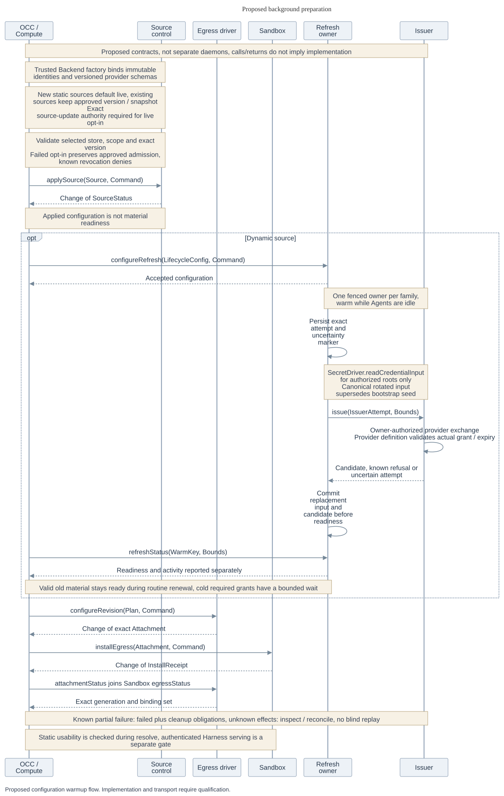
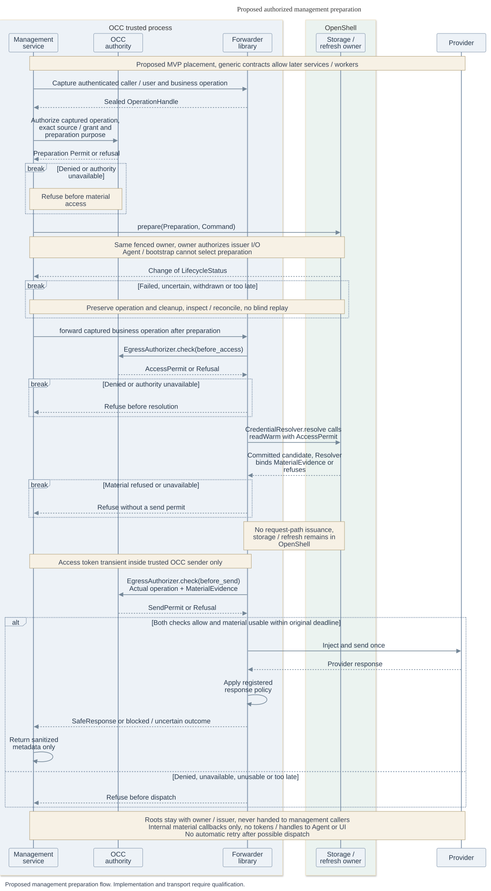
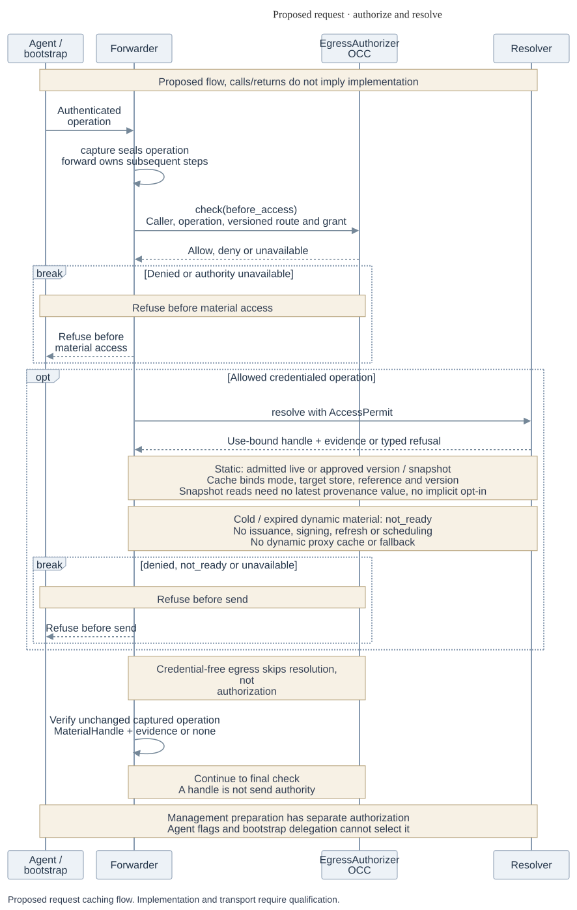
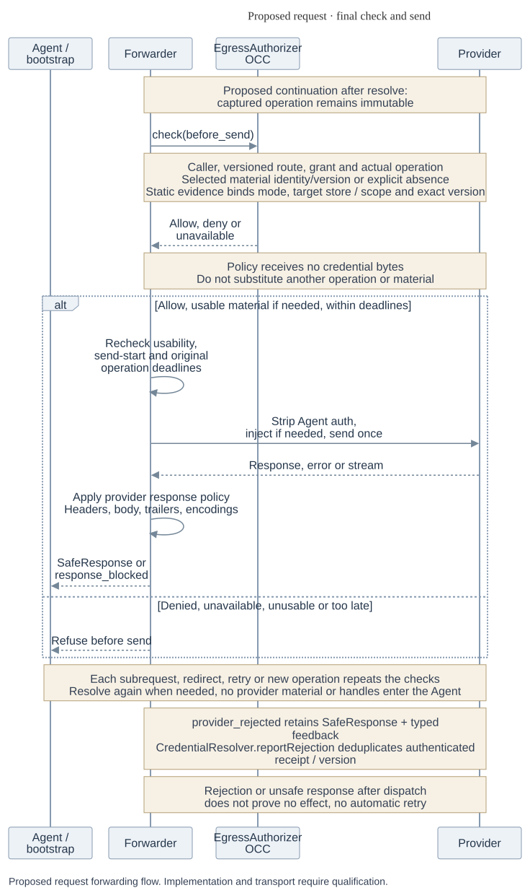

# Proposed credential lifecycle

This [RFC companion](index.md) uses proposed [management](control-contracts.md)
and [runtime](runtime-contracts.md) contracts. Token Service means the retained
`CredentialRefreshDriver` capability, not a required separate service.

## 1. Configure and warm



_All interactions are proposed. Sequence arrows distinguish calls/returns, not
implementation status. [Editable source](assets/configuration-warmup.mmd)._

OCC admits configuration and grants. The owner prepares dynamic material
independently of requests, including while Agents are idle. Compute observes
four separate states:

| State                 | Evidence                                               |
| --------------------- | ------------------------------------------------------ |
| Configuration applied | Source configuration is accepted and applied.          |
| Material ready        | The required dynamic grant has eligible warm material. |
| Binding installed     | Sandbox confirms the exact revision attachment.        |
| Harness serving       | The Harness reports authenticated serving status.      |

Compute gates required dynamic startup on all four within a configured warm wait.
Static inputs have no warm lifecycle; authorized resolution checks usability.
Acceptance alone proves neither dynamic readiness nor static usability.

### Lifecycle interface

Evolve `CredentialRefreshDriver` (`credential_refresh`) without importing any
`CredentialGateway` context, source-input or attachment types. It uses SourceKey,
Grant, Bounds, Command, Permit, Read, Change, Operation, CleanupPermit and Removal
from [management contracts](control-contracts.md). Prepared material is separate
from the request-bound MaterialEvidence in [runtime contracts](runtime-contracts.md).

| Shape             | Required fields and semantics                                                                                                                                                                                                                                                                                                                                                                             |
| ----------------- | --------------------------------------------------------------------------------------------------------------------------------------------------------------------------------------------------------------------------------------------------------------------------------------------------------------------------------------------------------------------------------------------------------- |
| `WarmKey`         | `{source: SourceKey, grant: Grant, grantHash: SHA-256, isolationId: Id}`. Exact normalized admitted scope, never source-only caching.                                                                                                                                                                                                                                                                     |
| `Family`          | `{scope: Scope, familyId: Id, generation: positive integer, owner: Ref, ownerEpoch: positive integer}`. Canonical input family shared across all grants consuming that input. OCC admits one owner; its durable store fences epochs.                                                                                                                                                                      |
| `LifecycleConfig` | `{source: Source, family: Family, warmKeys: WarmKey[], renewBeforeMs: positive integer, minValidityMs: positive integer, issuer: Ref, inputAuthority: Permit}`. Source's roots are delivered only to its admitted owner/issuer.                                                                                                                                                                           |
| `LifecycleStatus` | family, WarmKey, `configuredGeneration: integer\|none`, `committed: CommittedDynamic\|none`, `readiness: ready\|cold\|expired\|insufficient_validity\|withheld`, `activity: idle\|preparing\|refreshing\|uncertain\|reauthorization_required\|removing`, `attempt: Operation\|none`, `nextRenewalAt: timestamp\|none`, `error: Error\|none`, `recovery: none\|reconcile\|reauthorize\|fix_configuration`. |
| `Preparation`     | `{target: WarmKey, family: Family, mode: ensure_ready\|rotate, minRemainingValidityMs: nonnegative integer, authorization: Permit}`. Permit binds management caller, initiating user, captured Use, source/grant, purpose, destination and original deadline.                                                                                                                                             |

`CommittedDynamic` is `{target: WarmKey, family: Family, materialId: Id,
materialVersion: string, preparationAttemptId: Id, actualGrant: Grant,
providerExpiresAt: UTC timestamp}`. It contains no request, execution or binding
handle. The same admitted warm entry may serve distinct authorized bindings;
preparation and readiness do not establish permission to use it.

`CredentialRefreshDriver` methods are required for a dynamic source:

| Method and caller                                                                               | Result/semantics                                                                                                                                                                           |
| ----------------------------------------------------------------------------------------------- | ------------------------------------------------------------------------------------------------------------------------------------------------------------------------------------------ |
| OCC `configureRefresh(config: LifecycleConfig, command: Command)`                               | `Change<LifecycleStatus[]>`; accepts configuration and authorizes independent warming, not readiness. Reauthorization changes family generation/input authority; routine renewal does not. |
| Authorized management `prepare(request: Preparation, command: Command)`                         | `Change<LifecycleStatus>`; ensure-ready may reuse eligible committed material; rotate requests one owned refresh. Neither implies issuer revocation of the old token.                      |
| OCC/Compute `refreshStatus(target: WarmKey, bounds: Bounds)`                                    | `Read<LifecycleStatus>`; readiness evaluated for admitted minimum validity at observation time.                                                                                            |
| OCC cleanup `removeRefresh(family: Family, cleanup: CleanupPermit, command: Command)`           | `Change<Removal>`; stop new preparation, settle attempts and dispose/revoke owned artifacts as supported. Preserve uncertain cleanup.                                                      |
| OCC reconciler `inspect(operationId, bounds)` / `reconcile(operationId, cleanupPermit, bounds)` | `Read<Operation>` / `Change<Operation>` for the exact accepted attempt, as in management contracts. Family status alone cannot settle it.                                                  |

Known failures return `failed` with the exact operation, safe error and cleanup;
pending and uncertain remain distinct. Partial effects and late candidates stay
owned until settled. Failure permits neither assumed rollback nor repeated issuance.

The owner exposes the internal read-only facet
`WarmCredentialReader.readWarm({target: WarmKey, authorization: AccessPermit, minRemainingValidityMs}, bounds)`
to the Resolver. It returns `warm(candidate: trusted custody handle, evidence: CommittedDynamic)`
or [Refusal](runtime-contracts.md#forwarding-sequence-and-results). The handle
binds the operation/Resolver and expires within Bounds. Resolver verifies WarmKey
and current binding, then adds request binding and clamped usability to produce
MaterialEvidence and the sender's single-use MaterialHandle. Read performs no
issuance, signing, refresh, scheduling or refresh-capable retrieval.

### One owner and durable attempts

Retire a shared family only after all admitted source/grant dependencies are
released. Otherwise `removeRefresh` returns `references_remaining`; removing one
source must not destroy another source's canonical input or usable material.

Warm-key isolation does not lock a rotating family: two grants can share one
input. The owner:

1. Serializes **family-wide** consumption and fences the exact epoch/attempt.
2. Durably records the attempt and uncertainty marker before effects, then calls
   `CredentialIssuer.issue`.
3. Validates returned scope and expiry, and durably commits the replacement input
   and runtime candidate before readiness.
4. Publishes only under the current fence; retains late results for cleanup.

An interrupted exchange remains uncertain until provider-supported inspection
settles it or explicit reauthorization establishes new input. Timeout, process
replacement and lease/lock loss do not authorize blind replay. Once replacement
input is canonical, rereading a bootstrap Secret cannot overwrite it. Custody
transfer from native Harness refresh state must stop the previous consumer first.

Eligible old committed material remains ready during ordinary refresh; activity
is separate. Renewal must not restart the proxy/Agent or periodically interrupt
use. Exceptional reauthorization may interrupt only the affected credential,
fail closed and expose recovery status. Hot cutover remains later work.

### Management preparation and retrieval



_All interactions are proposed; arrows distinguish calls/returns. Management can
prepare through the one owner, then uses the common Forwarder.
[Editable source](assets/management-preparation.mmd)._

The MVP configuration/discovery service uses a trusted Forwarder library inside
OCC; OpenShell owns storage and refresh. The trusted OCC sender may hold an
access token transiently for injection. Management callers receive no roots.
Later service/worker placements use the same contracts.

1. Authenticate caller and initiating user, capture the business operation, and
   authorize its exact source, purpose, grant and destination before any access.
   Only then may management call the same owner's `prepare`.
2. Call `forward` after preparation. It performs fresh check 1 before resolution,
   then check 2 over the captured operation and selected material before each
   business send. Preparation grants no lasting authority or fake Agent identity.
3. Return sanitized metadata, never roots or tokens. Material-consuming callbacks
   are internal to trusted sender/custody code, never caller-provided functions.

Issuer calls are independently owner-authorized. Agent and bootstrap callers
cannot obtain preparation through an `allowRefresh` flag.

A refresh-capable retrieval is not `readWarm`, even after a readiness check.
Its uncertain effects remain owned if retrieval fails or is cancelled.

### Live Secret cutover

New static sources default to live adoption. Existing sources retain their
approved immutable version or owned snapshot in `explicit_update` mode until an
operator authorized for the exact source update opts in. Consumer permission is
not replacement approval; a mutable ref or longer TTL cannot preserve this
boundary. Failed opt-in preserves approved state; known revocation still denies.

A live source's Secret writer may change consumed material without readmission.
Value changes preserve source generation; changing mode, approved material or
policy requires admission. These bounds apply to reusable reads; explicit update
never substitutes the latest value for its approved version or snapshot.

| Policy                 | Default and behavior                                                                                                                                                                               |
| ---------------------- | -------------------------------------------------------------------------------------------------------------------------------------------------------------------------------------------------- |
| Freshness              | Ten minutes, configurable per source. Then read the admitted material selection.                                                                                                                   |
| Eligible stale age     | **Four hours total**, configurable per source, and only for positively classified transport, timeout or throttling errors. A 09:00 observation is fresh until 09:10 and eligible only until 13:00. |
| Fail closed            | Cold, denied, revoked, missing, unknown-error and unavailable-authority paths do not use fallback. Failed reads and lower-cache hits never reset authoritative age.                                |
| Zero retention         | Disables caching and fallback at every serving layer. The normalized cache is `none` or positive bounded durations; either public zero duration selects `none`.                                    |
| Zero request-age limit | Forces an authoritative read. Fresh material remains usable for that request within its original deadline and provider/Secret expiry; zero does not make it immediately expired.                   |

Recheck usability at dispatch. Snapshot reads use the admitted owner/version
without a current provenance Secret read. Authoritative reads establish cache age,
not snapshot approval time. Zero preserves the snapshot but disables reusable reads.

[Secret read results](runtime-contracts.md#versioned-secret-access) define version
and age evidence. [Migration](migration.md#preserve-approved-static-material)
preserves adoption mode and material references through admission, attachments,
resolution, evidence and caches without expanding Secret-writer authority.

## 2. Prepare the optional repository



_All edges are proposed. Bootstrap has execution/repository delegation, no
management preparation authority. [Editable source](assets/clone-startup.mmd)._

1. OCC admits repository IDs/permissions and authentic URL mapping. Repositories
   remain optional and first-class; Repo retains discovery, profiles, grants,
   sessions, deadlines and cleanup.
2. The lifecycle owner prepares the exact WarmKey in the background. Compute
   observes `refreshStatus` within the startup bound and the exact installation
   receipt; expiry requires a fresh check, not a remembered ready boolean.
3. Compute obtains an OCC Permit for executor, Execution, repositoryId, clone
   operation, source/grant, audience and original deadline. Trusted bootstrap
   `capture`/`forward` checks every Git HTTP operation; it need not use the Agent's
   own proxy. No request-time issuance or Agent-visible Git credentials.
4. Bootstrap returns authenticated completion to Compute: execution, repositoryId,
   admitted requested Git ref (or none for the repository default), observed
   commit ID (or none), attemptId, workspace Ref, deadline,
   `outcome: succeeded|failed|uncertain`, and
   `cleanup: none|required|complete`. Only observed success satisfies the default
   clone gate. Failure/uncertainty blocks startup unless explicitly configured to
   opt out of that gate; the opt-out grants no extra authority.

Compute/bootstrap owns partial-workspace cleanup and exact-attempt reconciliation;
unknown clone effects are not blindly replayed. Revision-selection UX is later
work. Repo-plus-Sandbox guards stay until integration is qualified. Owners need
provisioning/credential failure status; operators need refresh/expiry visibility.
Alert channels and thresholds remain implementation choices.

### GitHub issuer bridge

The MVP uses OpenShell's OAuth refresh mechanism to call an OCE-hosted
[GitHub issuer](runtime-contracts.md#provider-semantics-and-issuer-boundary).
OpenShell owns renewal and commits installation tokens. OCE retains the App
private key and GitHub grant validation; the issuer runs no second renewal loop.

The proposed paths are separate:

```text
Background preparation: OpenShell refresher → OCE issuer → GitHub → OpenShell warm store
Agent/bootstrap request: Capture → fresh OCC check → warm read → fresh OCC check → send
```

The bridge authenticates the owner and maps an opaque identifier to an
OCC-admitted installation, repository set and permissions; callers cannot expand
the grant. OCE signs an App JWT, exchanges it for an installation token,
validates actual authority and expiry, and returns an OAuth-compatible token
response. OCE retains the App key; OpenShell receives only its issuer-call
credential and resulting token.

The adapter must correlate grant, owner epoch, issuance attempt, material
identity/version and provider-backed expiry across the OAuth exchange and warm
read; a fallback TTL cannot establish validity. The source schema and bridge
protocol require qualification; transport and encoding remain implementation
choices. Agent/bootstrap reads never invoke the issuer or refresh-capable retrieval.
Keep refusal, temporary failure and uncertain issuance distinct; reconcile unknown
effects without blind replay.

An OCE-owned lifecycle remains a fallback under the same contracts if the bridge
cannot satisfy these requirements. It requires an explicit implementation decision
and must still deliver GitHub in MVP. Each family has one owner at a time.

## 3. Resolve and forward



_All interactions are proposed; arrows distinguish calls/returns.
[Editable source](assets/request-caching.mmd)._



_Continuation of the same proposed request, including material absence.
[Editable source](assets/request-forwarding.mmd)._



_All edges are proposed. Dynamic reuse remains behind Resolver; no proxy fallback
or stale grace. [Editable source](assets/credential-selection.mmd)._

The [runtime contract](runtime-contracts.md#two-policy-checks-and-common-resolution)
owns capture, checks, resolution, evidence and responses. Cold lookup starts no
work. Eligible material may survive issuer outage; unavailable Resolver or
authority refuses use. Readiness cannot replace either check.

## 4. Withdraw and recover


_All interactions are proposed; arrows distinguish calls/returns. Owners retain
attempts after process replacement. [Editable source](assets/revocation-recovery.mmd)._

1. OCC commits logical denial and durable withdrawal intent.
2. Egress `withdrawBinding` owns detachment; Sandbox reports enforcement evidence.
3. Retain revision-specific suppression and late-create rechecks. An earlier
   absence observation cannot erase a tombstone while an attachment may arrive.

Logical denial, detached binding, removed source and issuer revocation are
distinct results. Issuer retirement requests provider revocation only when
supported. OCE denial and detach stop mediated future use; neither recalls an
exported bearer nor undoes sent effects. Report each result and outstanding cleanup.

`reportRejection` carries authenticated SendReceipt, source/grant generations
and exact material version. Resolver durably deduplicates the receipt/version
and coalesces recovery for that version; duplicates cannot trigger repeated
recovery work. Static version fences survive cache eviction and reread without
approving replacement. Dynamic recovery stays with the one owner; late N cannot
invalidate or recover N+1. The sender returns the provider failure through
SafeResponse, unchanged where policy permits or redacted/refused where required,
without retry.

Preserve the owner, deadline, attempt and cleanup for unknown send/refresh/clone
effects through restart, including late outcomes. Use inspect/reconcile or explicit
reauthorization, never blind replay. Restored configuration is not warm readiness.
Ordinary retirement waits for replacement visibility/adoption and old in-flight
use; emergency revocation may precede those observations.

## Parking and forks

[Security](security.md#withdrawal-and-owner-loss) retains confirmed last-owner
hold, asynchronous parking and data preservation; remaining team owners keep
working. Unknown directory state is not confirmed owner loss. [Authorized deep
forks](security.md#authorized-forks) receive fresh stopped identities,
independent data and no inherited credentials, grants, approvals or sessions.
External IdP synchronization, copy-on-write and stronger stream revocation remain
separate work.

## Earlier Token Service proposal

[Earlier Token Service decisions](migration.md#earlier-token-service-proposal)
retain their scope, custody and recovery requirements.

## Implementation discovery and qualification

[The migration inventory](control-contracts.md#complete-legacy-disposition) covers
legacy methods and consumers. Implement admission/attempt state, migrate source
and egress management, connect runtime checks/Resolver, qualify static inference
and GitHub, then integrate Harness/optional clone before retiring old exports,
composition and persistence coupling.

| Area               | Required evidence                                                                                                                                                                                                                                                                                                                                                       |
| ------------------ | ----------------------------------------------------------------------------------------------------------------------------------------------------------------------------------------------------------------------------------------------------------------------------------------------------------------------------------------------------------------------- |
| OpenShell join     | Versioned Egress/Sandbox receipt, authenticated capture, final OCC check after material selection, actual warm-only read, response policy and no bypass. Current adapters do not satisfy the complete contract.                                                                                                                                                         |
| Lifecycle          | Prove family-wide fencing, durable replacement, attempt-correlated outcomes and continued old-token reads during routine renewal.                                                                                                                                                                                                                                       |
| Static and custody | Versioned reads, trustworthy cache age/errors, zero retention, new-source live defaults, preserved explicit-update snapshots, authorized opt-in and exact permitted consumers.                                                                                                                                                                                          |
| Providers          | Real scoped GitHub, safe responses, bootstrap completion/cleanup and Codex account integration; qualify the actual selected protocol.                                                                                                                                                                                                                                   |
| Composition        | Qualify each protected capability against the actual versions, configuration, provider/protocol slice and custody; self-declared flags are insufficient. Preserve initial Kubernetes/same-Backend/Repo guards until replacements work. Additional loading, independent backends, strong local development, DNS, packaging and scale/HA require follow-up qualification. |

Package loading and protocols need composed qualification. Dedicated Codex
needs a qualified WebSocket or HTTP/SSE path; management retrieval cannot replace
warm-only resolution. Generalized bootstrap, including cloud-init, remains
follow-up work beyond the optional repository clone gate.

The Egress Proxy MVP requires qualification of static inference and GitHub,
including the issuer bridge. OCE 1.0 also requires GitHub preclone, Codex OAuth
and custom dynamic paths.
Rotating OAuth may follow MVP, but any slice using rotating inputs must meet its
concurrency/restart/recovery requirements. Source, fixture, installed-runtime and
live-provider evidence support distinct claims; no-op CI and deployment acceptance
prove neither enforcement nor readiness.

Related: [security validation](security.md#required-validation),
[Credential Gateway RFC](../0016-sandbox-credential-injection/index.md) and
[Agent egress RFC](../0017-agent-egress-0x/index.md).
