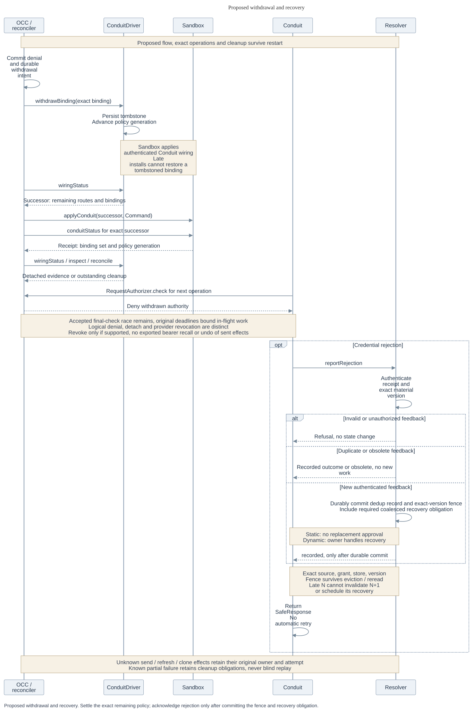

# Security, verification and retirement of the Credential Gateway

[RFC-0020](index.md) lets a potentially compromised Agent use an approved provider operation without
receiving the provider credential. The security principal is the **whole admitted Agent execution**.
If a repository read is allowed, the Agent, its child process and code it downloads can all make
that read and see the permitted response. Another execution, even of the same Agent, has no claim
on that exchange. The [contracts](contracts.md) specify how to enforce this boundary. The evidence
below is required before relying on it.

## Where authority and secrets reside

| Caller | Authority and exposure |
| --- | --- |
| Agent in protected mode | Sandbox prevents direct egress. Before queuing, the trusted sender binds the request **and its response destination** to the authenticated execution and exact supervisor installation. The installation receipt says which installation to expect. The connection must prove it, for example with a supervisor-only client key enrolled to that verified installation. A sandbox bearer presented first, an old receipt or a relay that sees only voluntary traffic is insufficient. Refuse admission if provenance or enforcement is unavailable. |
| Agent in explicit unprotected mode | OCE gives the Agent a control-plane identity but does not govern its direct network requests. Admit no managed binding, clone, policy route or provider credential, including an ambient substitute. Protection is versioned independently of binding count. A protected execution with no effective routes denies all egress. |
| Trusted repository bootstrap | Authenticated delegation covers this executor, execution, repository and original deadline. Each Git operation needs current authority and already prepared material. Compute gates startup on observed clone success and retains ownership of partial-workspace cleanup. |
| Configuration or discovery in OCC | Authenticate the service and initiating user, capture the business operation, then authorize preparation for that source, scope and destination. The trusted sender in the OpenClaw Control Plane (OCC) checks authority before material access and again before each send. Return a sanitized business response, never a token or a callback that can consume one. |

OCE alone holds the GitHub App key, signs and exchanges the App JWT, validates the actual repository
grant and expiry, and commits encrypted installation tokens. OCE owns background renewal,
withdrawal and fenced takeover. OpenShell may own a *different* credential family. An Agent request
can read eligible committed material during an issuer outage. A cold or expired lookup cannot
issue, refresh or schedule preparation. An authority partition or unavailable Resolver fails closed.

The sender, Resolver, credential owner, Secret Driver and their configuration are trusted. A custody handle
cannot confine hostile code in a trusted process, and a route cannot constrain a bearer stolen there.
Keep keys, tokens and handles out of the Agent, UI and diagnostics. Record nonsecret caller, scope,
purpose, version and attempt evidence. Check response status, headers, body, trailers and encoding on
errors as well as success. Start with a bounded response withheld in full until accepted. Blocking
it cannot undo a provider action, and streaming needs protection at each release boundary.

## Required verification on the protected path

Start with one bodyless metadata read of repository `123` and a recognizable, safe response. Record
**source**, **independent contract-peer**, **installed runtime** and **live-provider** evidence
separately. The peer exercises the portable contract. The actual protected OpenShell composition,
including local use, must demonstrate channel ownership and bypass prevention. Record exact versions,
policy, custody, clocks and deadlines. Accepted configuration, usable material, installation of the
exact policy and a serving Agent are four separate observations. No-op CI establishes none of the
protected-path guarantees.

For each exchange, count allowed access permits, released send permits, material reads, requests
observed at the provider, and response bytes **at each recipient**. Record denials too. A missing
observation is unknown, not zero. In the replacement cases, A and B are successive supervisor
installations. Current state may invalidate A's exchange but can never relabel it as B's.

| Exercise | Required observation |
| --- | --- |
| Parent and sibling each make the admitted read | For **each** exchange: one access permit, one material read, one send permit, one matching provider request. Only its bound recipient gets the expected response. No executable allowlist or client hook is needed. |
| Cross two live executions or splice another stream onto an authenticated connection | Reject the mismatched origin, stream or recipient before material access. Zero allowed permits, reads, provider requests or provider bytes at either execution. |
| Replace A before the first check | Try A's queued request, its still-open channel and B presenting A's proof first. The same zero counts apply. A fresh admitted exchange from B succeeds. |
| Replace A after its material read, or lose its response destination after dispatch | In the first case, count A's access permit and read, then zero send permits and provider requests. In the second, count the provider request, zero response bytes at B, actual or unknown delivery at A, and no retry. |
| Allow a protected read needing no credential, then withdraw the last route | Both permits, **zero** material reads, one provider request and the expected response only at its recipient. After withdrawal, deny even this read. Losing the entire policy plan or rolling back to an incompatible reader must never release an execution into direct networking. |
| Lose the dispatch-record acknowledgment *before permit release* | Zero send permits released, zero provider requests. Reconcile the exact committed attempt without releasing a replacement permit. |
| Lose the provider reply *after a write* | Record the send permit and write; the provider effect remains uncertain. One permit does not prove exactly-once delivery. Never replay to resolve the uncertainty. |
| Lose the credential-rejection acknowledgment, then restart and redeliver | Before acknowledgment, durably deduplicate the authenticated receipt, fence its exact store and version, and commit any coalesced recovery obligation. Observe one obligation for rejected N, none for N+1, no second recovery and no business retry. |

Exercise DNS, destination and TLS authority, redirects, raw TCP, opaque SSH, UDP and QUIC from the
sandbox. Deny operations that cannot be classified. Swap two live custody handles or replay a consumed permit:
neither permits a provider write. Put forbidden data in the last response trailer: for the bounded
read, release no provider bytes. A metadata read qualifies neither clone nor push. For ref-constrained push,
the trusted sender must parse *all* ref commands, including object IDs, authorize each, and dispatch exactly the checked operation. An allowed first ref followed by a
forbidden second must result in no provider write. Otherwise refuse protected push.

Cover static inference and GitHub first. For rotating credentials, race grants sharing one input
family, crash between provider rotation and durable replacement, and attempt stale-owner publication.
Preserve uncertain work and require reauthorization if the replacement cannot be recovered. Later
coverage includes GitHub preclone, custom dynamic providers, and actual Codex OAuth startup, account
metadata and renewal or reconnect over the selected WebSocket or HTTP/SSE path.

## Withdrawal, last-owner loss and recovery

[Diagram source](assets/revocation-recovery.mmd). Observe OCC denial, confirmed detachment and
provider-supported revocation separately. A send may **start after withdrawal was acknowledged** if
its final check raced the change. Bound dispatch start and the original deadline; cancellation is
best effort. Ordered send admission and renewable stream leases are later work.

Keep the withdrawal tombstone while a late installation is possible. Test stale commands, conflicting
request IDs, forged receipts, cleanup after catalog removal, and withdrawal of one binding while
another continues. Accepted cleanup survives loss of the requester's access. After restart, reconcile
the original owner, attempt and outstanding effects; neither a timeout nor an earlier observation of
absence settles them.

Confirmed loss of the *last* authorized owner installs a hold and fences new admissions. Report
`parking` until stop and data preservation justify `parked`. A team Agent with another authorized owner
continues; an unavailable directory is not confirmed owner loss. Restart, repair, deletion and
garbage collection must respect the hold. Release requires current authority and fresh admission.
External identity-provider offboarding is separate work.

For an authorized deep fork, capture the declared readable artifacts at an immutable version and
recheck source-read and destination-create rights before visibility. Give the copy independent data
and a fresh, stopped runtime home. Inherit no credentials, grants, approvals or sessions; keep copied
schedules, hooks and pending work inert. Preserve authorized read-only access to the original.

## Retire the legacy path without widening existing grants

Migrate execution authority and static-material approval **independently**. If a legacy grant
allowed the parent read but barred the sibling above, retain its safe authorized path or withhold
the binding until someone authorized to bind this Agent to this source explicitly admits whole-execution
access. Carry authority forward only with durable evidence of equivalence. Fence incompatible readers first. Moving to
unprotected requires a new execution without old mounts, helpers, sessions or late reattachment.

If an operator approved static `v1` and a Secret writer later stored `v2`, keep serving approved
`v1` in `explicit_update` mode unless revoked. Verify its exact version or owned immutable snapshot,
including scope and store. If material or ownership cannot be verified, fail closed until an
authorized source update. Running attachments keep their approved material until replacement
installation is verified, subject to current denial or revocation. The provenance Secret need
not remain readable. With zero retention, read that snapshot again. Test rejection, eviction and reread; the version fence must survive. To adopt
live updates, require `credential_source:update` and `secret:operate`, stage and validate a separate
candidate, then activate mode, material reference and generation together. Failed opt-in preserves
approval; uncertain activation requires reconciliation. Verify adoption and outstanding use before
retiring the old key.

| Credential Gateway method | Responsibility that must survive retirement |
| --- | --- |
| `listSourceTypes` | `CredentialSourceControl.describeTypes`, including provider schema and Harness compatibility |
| `registerSource` | `applySource`, then separately `configureRefresh` for dynamic inputs |
| `updateSource` | `applySource` with admitted configuration and static adoption or approved replacement |
| `sourceStatus` | Configuration status, distinct from per-grant `refreshStatus` |
| `removeSource` | `removeSource`, `removeRefresh` and owned provider/profile cleanup |
| `attachForRevision` | `configureRevision`, then Sandbox `installEgress` |
| `attachmentStatus` | Join Egress `attachmentStatus` to Sandbox `egressStatus` for the exact installation |
| `withdraw` | Durable withdrawal, `withdrawBinding` and late-attachment rechecks |
| Additional `validateSourceConfig` | OCC schema validation and provider `normalizeInput`, without I/O and before Secret access |

Move persisted driver IDs, revision and Harness snapshots, Agent bindings and authentication
selection to exact source, binding, route and execution admissions. Replace resolved-string inputs and
Sandbox credential attachments with scoped custody and authenticated installation evidence. Preserve
Namespace isolation, provider type semantics, source APIs, IAM denial before existence disclosure,
audit, console, setup and generated schemas.

Keep Kubernetes, same-Backend and Repo guards until their replacements qualify. Move worker,
Compute, maintenance, withdrawal and companion-revision consumers with their attempts and cleanup.
A withdrawn required model binding blocks startup; an optional tool can be omitted. Transfer native
OAuth input custody only after stopping the old refresher. Keep Repo discovery, profiles and sessions,
and use separately authorized OCC preparation for management retrieval. Migrate repositories,
constraints and source-copy utilities without rewriting historical migrations. Disable legacy
reattachment and refresh before removing capability selection, registration, exports, package checks
and persistence coupling. A temporary adapter is useful only while those obligations remain.
