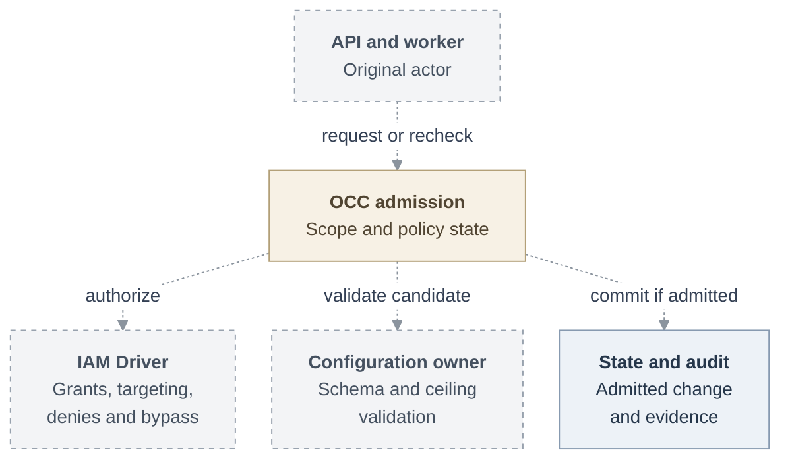

# Proposal: Guardrails for permissions and configuration ceilings

- **ID:** RFC-0023
- **Created:** 2026-10-19
- **Last updated:** 2026-10-20
- **RFC PR:** [#2968](https://github.com/openclaw/openclaw-enterprise/pull/2968)
- **Related:** [shared configuration definitions](0022-driver-configuration-contributions.md), [managed runtime](0021-managed-runtime-mode/index.md)

<a id="decision-and-motivation"></a>
<a id="problem-and-decision"></a>

## Summary

Suppose a team may edit its Agents’ network policies, but the only rule it may
add lets Python reach `api.example.com` on port 443. IAM decides who may edit.
A configuration ceiling limits what they may save, and the worker checks the
current ceiling before applying the change. Tightening it does not rewrite a
running Agent’s policy.

We propose an OCC-owned Guardrail that can limit configuration or deny an
operation across the Installation or in one Namespace. A Guardrail grants
nothing. The policy model, who a binding selects, and the administrator
exemption are open for architecture review.

## Motivation

Today [IAM Restrictions](../../docs/reference/authorization.md) deny exact actions
but have no public management API. [Sandbox policies](../../docs/reference/sandbox-policies.md)
have a startup delegation ceiling and a temporary per-Agent editing switch.
Neither provides reusable, inspectable configuration ceilings. RFC-0022 supplies
the proposed schema and validation foundation; it remains unimplemented.

<a id="scope"></a>

## Goals

- Let administrators set global and Namespace ceilings for operations and
  configuration, with no Namespace override of global limits.
- Apply every matching binding restriction, with an audited blanket bypass for
  Installation administrators.
- Share Driver-owned ceiling validation between configuration editors, API
  admission, and workers, using RFC-0022's proposed definitions.
- Reject unauthorized changes before effects and preserve existing IAM,
  validation, and platform limits.

## Non-goals

- Inspect existing resources for compliance, run on-demand or background scans,
  or show existing-resource compliance status.
- Automatically reconfigure or terminate running Agents after policy changes.
- Provide an AWS firewall or prevent out-of-band native runtime changes. Runtime
  protection depends on RFC-0021 and qualified Drivers.
- Add resource-specific Guardrail filters, arbitrary AWS condition expressions,
  a generic Driver configuration store, or hot-editable startup configuration.

<a id="design"></a>

## Proposal

### Architecture

OCC owns Guardrail CRUD, scope, policy versions, persistence and attributable
audit. The selected IAM Driver owns identity/Group/Role resolution and evaluates
deny rules alongside existing Restrictions. Extend its decision evidence with
matched Guardrail IDs/generations and require a complete targeting result for
configuration checks; a missing capability is unavailable, never an empty match.
Do not derive targeting from the first successful grant alone.

Configuration Drivers validate their domain; they cannot choose which Guardrails
apply or grant an exemption.

The diagram shows proposed Guardrail integration; dashed arrows are not
implemented paths. Base IAM and platform limits still apply to bypassed operations.



### Resource and policy model

`Guardrail` has server-owned `id`, `generation`, timestamps, `name`, `scope`,
`policy`, and `configurations`. Its scope is immutable:

| Scope       | Meaning                                                                             |
| ----------- | ----------------------------------------------------------------------------------- |
| `global`    | All current and future Namespaces in this Installation; `namespaceId` is forbidden. |
| `namespace` | Exactly one server-validated `namespaceId`, which is required.                      |

Global does not mean cross-Installation or all AWS accounts. Installation
administration is outside this Namespace policy boundary.

Keep two lists because permission denial and value constraints have different
inputs and enforcement points. Require at least one nonempty list.

```json
{
  "name": "Restricted operators",
  "scope": "namespace",
  "namespaceId": "<namespace-id>",
  "policy": [
    {
      "effect": "deny",
      "actions": ["delete", "administer"],
      "resourceKind": "agent",
      "accessBindings": [{ "roleId": "<operator-role-id>" }]
    }
  ],
  "configurations": [
    {
      "capability": "sandbox",
      "driverId": "<selected-sandbox-driver-id>",
      "target": "networking",
      "configuration": {
        "maxAdditions": 4,
        "ceiling": [
          {
            "id": "approved-api",
            "binary": "/usr/bin/python3.11",
            "host": "api.example.com",
            "ports": [{ "from": 443, "to": 443 }]
          }
        ]
      }
    }
  ]
}
```

These are proposed wire fields; placeholders stand for real validated IDs.
`actions` is a nonempty, duplicate-free list of existing action names for the
given kind. Any listed action matches. Initially support only `effect: deny`;
reject wildcards, unknown actions, arbitrary condition expressions, and
`resourceId` filters. Rules constrain the whole selected scope, not individual
resources. Use ordinary IAM bindings for resource-specific grants.

#### Binding selectors are conditions, not grants

Either kind of entry may have `accessBindings`. Omission matches everyone in
scope. Reject an empty array. Match any selector, and every field within it.

A selector accepts a `subjectKind`/`subjectId` pair, a `roleId`, or both.
Use the selected IAM authority to resolve IDs.
Reject unknown or cross-scope references. Global selectors may reference only
Installation-wide identities, Groups, or Roles. No binding ID, resource kind,
or resource ID belongs in a selector.

Inspect every binding for the identity or its current Groups in this Namespace
or Installation, including bindings that did not grant this request. For example,
a Role bound on Agent A can select its holder for a deny on Agent B in the same
Namespace. Another grant cannot evade that deny. Audit membership changes that
remove a restriction.

Unbound configuration ceilings follow the target Namespace. Bound ceilings are
checked against the requesting actor; non-bypassed Agent deployment and application
also check the Agent's own ServicePrincipal, applying the union of matching ceilings.
Shared Configuration saves check the actor; each later Agent use checks its own
context again. Agents inherit neither their creator's identity nor an administrator's
bypass.

### Configuration interface

Extend RFC-0022 definitions at their owning configuration surface:

```ts
interface GuardrailCapableDefinition<TValue, TCeiling> extends ConfigurationDefinition<TValue> {
  readonly guardrailsConfiguration: GuardrailsConfigurationDefinition<TValue, TCeiling>;
}

interface GuardrailsConfigurationDefinition<
  TValue,
  TCeiling,
> extends ConfigurationDefinition<TCeiling> {
  readonly scope: "guardrail";
  candidateSchema(ceilings: readonly TCeiling[]): JSONSchema;
  validateCandidate(value: TValue, ceilings: readonly TCeiling[]): ConfigurationResult<TValue>;
}
```

`scope: guardrail` identifies the administrative configuration definition, not
whether a Guardrail is global or Namespace-scoped. Its inherited schema and
`validateConfiguration` describe and validate **ceiling documents**.
`candidateSchema` projects structural constraints on **candidate values**;
`validateCandidate` checks those values plus domain semantics and returns the
unchanged value or RFC-0022 field errors. All methods are deterministic,
side-effect-free, and fail closed on malformed results or unexpected exceptions.

Bind each definition explicitly to its caller: Sandbox
`networkPolicyConfiguration` for `networking`, and a new native-values definition
on ConfigurationDriver for `openclaw`. Composition resolves the selected
capability/Driver/target tuple. This adds neither a general configuration store
nor arbitrary plugin dispatch. Unsupported targets refuse policy creation;
changing Drivers must validate existing ceilings rather than silently orphan them.
Installation startup values are not made hot-editable by this contract.

#### Structural choices and semantic ceilings

For native OpenClaw values, the proposed ceiling contains `fields`: approved JSON
Pointers with a TypeBox-compatible schema and an explicit presence requirement:

```json
{
  "fields": [
    {
      "path": "/plugins/entries/codex/config/appServer/sandbox",
      "required": true,
      "schema": { "enum": ["read-only", "workspace-write"] }
    }
  ]
}
```

The Configuration Driver validates supported paths and assertions against its
native-values contract. Do not accept arbitrary unknown paths, remote references,
secret-value inspection, or schema annotations as enforcement. `required: false`
means optional; `schema: false` forbids presence. A required path
must exist, including its parents; removing a parent cannot evade its rule.
This example applies to Codex configurations, not a mixed-Harness global policy.
Guardrails select a deployment population through scope and bindings; reject an
incompatible deployment rather than infer that a missing path disables the rule.

| Constraint                  | Composition across applicable ceilings                            |
| --------------------------- | ----------------------------------------------------------------- |
| `enum` / fixed `const`      | Candidate must satisfy every set/value.                           |
| `maximum`, `maxItems`       | Smallest upper bound wins.                                        |
| `minimum`                   | Largest lower bound wins.                                         |
| Required or forbidden field | Enforce presence/absence, not a default or hidden input.          |
| Network ceiling             | Every requested executable/host/port range must fit each ceiling. |

Combine constraints conjunctively, never by last-writer replacement or list union.
An empty intersection denies candidates with field diagnostics rather than
falling back. Saving validates each ceiling; it does not promise a general schema
satisfiability solver. Preview checks a concrete candidate against all ceilings.
Omitted constraints add no limit; an empty network ceiling permits
no additions. Existing Driver capabilities and platform limits remain binding.
No Guardrail can enable an unsupported feature or create an IAM grant.

Network containment reuses the [existing matcher](../../packages/contracts/src/sandbox-policy.ts):
exact executable paths, its defined DNS wildcard semantics, and complete range
coverage. JSON Schema alone cannot prove this relationship. `maxAdditions` bounds
array length; it does not bound the authority of a wildcard entry. This ceiling
covers additions only. Driver defaults and generated transport rules remain separate.

<a id="ownership-and-enforcement"></a>

### Administrator bypass

An **Installation administrator** is an actor currently allowed `administer` on
the exact singleton Installation by base IAM authorization, including existing
Restrictions but excluding Guardrails. This avoids recursive evaluation; a role
name or Namespace/Agent administration alone does not qualify. Such actors bypass
all global and Namespace Guardrail denies and configuration ceilings for their
operations, including prerequisite and additional Agent-identity checks. Ordinary
IAM grants, Restrictions, base validation, startup ceilings, and platform limits
still apply. This exemption grants no permanent authority to a deployed Agent.

### Request lifecycle

API and worker use the same admission path:

1. Authenticate; resolve server-owned scope; authorize the exact operation and
   determine the original actor's current administrator status through base IAM.
2. Load current global/Namespace Guardrails and IAM targeting in the policy-consistent
   State unit. Unless bypassed, a matching deny stops the operation before effects.
3. Build the complete effective configuration after defaults, Presets, overlays,
   Secret references and Driver contributions. Validate base schemas and every
   non-bypassed matching ceiling. Inspect references, never secret plaintext.
4. Persist only under a current policy/version check. Record the applied policy
   generations and any bypass with its administrator-authority evidence in the
   audit record. Preview is not an authorization token.
5. Recheck queued work before effects against current policy and the original
   actor's current administrator status, never the worker's identity. Without a
   current bypass, recheck Agent identity where applicable and reject violations.

Cover Configuration create/update, Preset materialization, provisioning,
deployment/redeployment/rollback, SandboxPolicy save/apply, and worker retries.
Templates with unresolved variables receive structural checks at save and full
checks at materialization; never label them preapproved. No later transformation
may widen a validated candidate. Repair identity-access-coverage checks too:
their current assumption that Restrictions affect everyone equally becomes false
with targeted Guardrails.

A ceiling governs the next save, deployment, or live policy application. An
operation denial governs the next authorization decision, even for a running
Agent. Neither establishes that the Agent’s current configuration meets the ceiling.

For example, the [Credential Proxy proposal](https://github.com/openclaw/openclaw-enterprise/pull/2484)
checks the Agent’s `operate` permission on the exact CredentialSource twice in
its exact-dispatch path: before accessing credential material and before
authorizing a send. Apply current denials at both IAM checks. The Agent does not
inherit its deployer’s exemption, and a denial cannot recall an authorized send.

Keep the startup network ceiling. On a fresh installation, deny delegated
SandboxPolicy updates until an administrator sets the intended policy. On an
existing installation, keep the per-Agent editing switch until cutover can
preserve the intended access or the administrator explicitly changes it. Retire
the switch and old write paths together. Recheck pending work under current
policy; if an earlier apply may have reached the sandbox, establish its outcome
before issuing another. Removing a deny still grants no permission.

### API, IAM, and console

Proposed routes use the existing `{ data, meta }` and error envelopes:

| Routes                                             | Operations                                              |
| -------------------------------------------------- | ------------------------------------------------------- |
| `/installation/guardrails` and `/{id}`             | Global collection GET/POST; item GET/PUT/DELETE.        |
| `/namespaces/{namespaceId}/guardrails` and `/{id}` | Namespace equivalents; route and body scope must agree. |

PUT replaces content with `expectedGeneration`; DELETE also requires the current
generation. Scope changes require a new resource. Invalid policies return field
errors; stale generations return conflict. Policy state and mutation audit commit
atomically. Namespace deletion removes only its own Guardrails and audits cleanup.
Referenced IAM identity/Group/Role deletion returns conflict until selectors are
removed or changed; it must not silently disable them.

Add `guardrail` permissions `create`, `read`, `update`, `delete`: create checks the
parent scope; item operations check the exact Guardrail. Initially all mutations
additionally require Installation `administer`, and Namespace operations require
Namespace `read`. Exclude Guardrail administration from deny-rule targets. The
administrator bypass also covers prerequisite Guardrail denials, including
Namespace reads, so a policy cannot block its own repair. Base IAM permissions
remain required. Delegated Namespace policy administration is deferred.

Extend existing configuration/policy views with effective schema, safe ceiling
details, policy generations and field errors. Return these only to authorized
configuration readers; complete Guardrail documents require Guardrail read.
An effective view shows inherited global constraints separately from local ones.
Non-bypassed editors explain disabled choices and read-only fields with their
limiting rule. Administrator editors show base-schema choices and the bypass.
These views describe candidate admission limits, not existing-resource compliance.
JSON, CLI and HTTP have identical admission.
Do not silently clamp values or erase an invalid draft. A read-only field is a
constraint, not merely a disabled widget.

## Delivery and verification

Plan implementation after architecture review. Verify through the real API, IAM,
PostgreSQL, and Agent workflow, then check the final native values and sandbox
behavior with a qualified runtime. In particular:

- Save and apply an allowed rule. Refuse a wider host or port range, a missing
  required parent, or a stale preview. A denial must produce no new effect.
- Exercise global and Namespace limits, alternate grants, Group changes,
  cross-Namespace references, policy races, safe errors, and cleanup.
- Repair a Guardrail despite a Namespace-read deny. Prove base Restrictions and
  startup limits still bind an administrator. If the original actor loses the
  exemption while work is queued, proceed only if current policy permits it.
- Tighten a ceiling: the running Agent stays unchanged; its next non-exempt
  application outside the ceiling is refused.
- In the Credential Proxy exact-dispatch path, keep the credential and grant
  valid. Commit a matching deny between its two checks; the second must issue
  no send permission, and the provider must receive no request.
- Cover two Agents with opposite editing settings and the same broadly authorized
  operator, an old writer, queued work, and an apply whose outcome is unknown.

Verify Console changes in rebuilt Storybook, screenshots, and video. Fixtures
alone do not establish enforcement.

<a id="alternatives-decisions-and-proof"></a>
<a id="alternatives-and-open-decisions"></a>

## Rationale and alternatives

Existing Restrictions deny operations but cannot constrain configuration values.
Both kinds of operation denial belong in the selected IAM Driver’s decision.
Configuration Drivers own value containment; JSON Schema alone cannot establish
network containment, and neither a general configuration registry nor the AWS
condition language is needed for the two proposed targets.

## Unresolved questions

1. **Where to author operation denials.** Extend Restriction or add Guardrail
   alongside it? Existing Restrictions can target one resource and still bind
   Installation administrators. Preserve those semantics under either design.
2. **Who a binding selects.** Should a Role bound on Agent A select its holder
   for a rule on Agent B? This draft proposes that Namespace-wide effect.
3. **When administrators bypass policy.** The proposal exempts ordinary
   Installation administration as well as recovery. Would a narrower recovery
   path be sufficient?
4. **When to remove the editing switch.** A Namespace-wide rule cannot generally
   preserve opposite per-Agent settings for an operator with the same broad
   grants. Agree on the cutover before removing that admission check.

## References

- [Shared Driver configuration definitions (RFC-0022)](0022-driver-configuration-contributions.md).
- [Managed runtime contract (RFC-0021)](0021-managed-runtime-mode/index.md).
- [Current IAM authorization](../../docs/reference/authorization.md).
- [Current SandboxPolicy lifecycle and ceilings](../../docs/reference/sandbox-policies.md).
- [Network containment contract](../../packages/contracts/src/sandbox-policy.ts).

Source baseline: `5f494a0fdf8f36f5b4cdf0a2886987ca49a5248c`.

## Manual Notes

[keep this for the user to add notes. do not change between edits]

## Changelog

- 2026-10-20: Clarified delegated editing, operation denials, and the transition from the per-Agent switch; identified decisions for architecture review.
- 2026-10-19: Reorganized under the RFC template, with explicit goals, non-goals, architecture, request lifecycle, verification, and rationale.
- 2026-10-19: Deferred existing-resource inspection and compliance reporting; retained admission enforcement and the administrator bypass.
- 2026-10-19: Drafted Guardrail scope, binding selectors, configuration ceilings, and admission boundaries from the proposed outline and current contracts.
