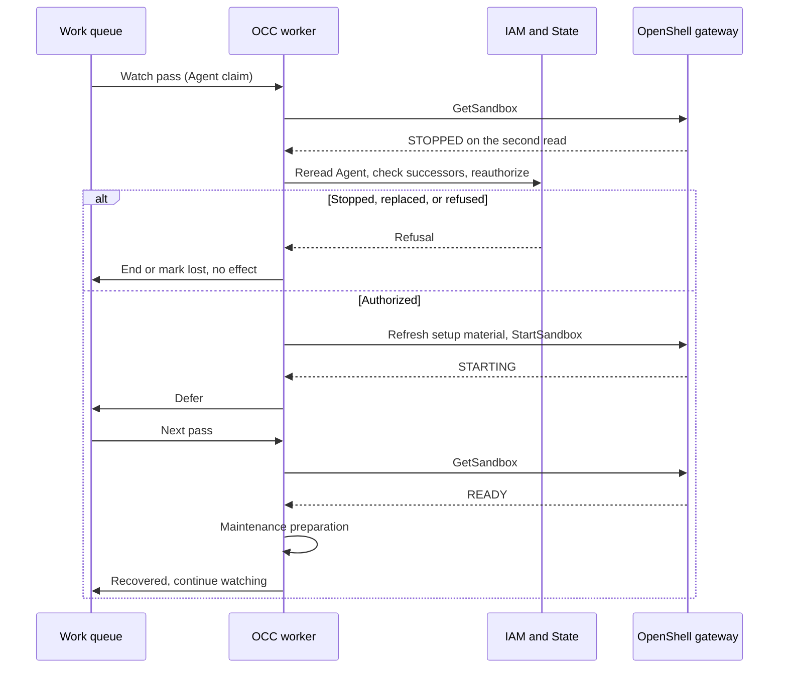

# Proposal: Recover a lost Harness Sandbox by resuming it

- **ID:** RFC-0025
- **Created:** 2026-10-22
- **Last updated:** 2026-10-22
- **RFC PR:** [#3233](https://github.com/openclaw/openclaw-enterprise/pull/3233)
- **Related:** [Sandbox Driver contract](../../docs/reference/drivers/sandbox.md),
  [Compute Driver contract](../../docs/reference/drivers/compute.md),
  [controller worker flow](../../docs/flows/controller-worker.md)

## Summary

After a node restart, the OpenShell Sandbox of a dedicated Agent revision stays stopped. The Agent's
Gateway comes back, the Agent still reads `active`, and every chat fails until someone deploys a new
version. This RFC makes the OCC worker watch each running dedicated revision's Sandbox and resume the same
Sandbox with OpenShell `StartSandbox` when it is lost. The same revision then serves again. Recovery runs
under the authority of the account that deployed the revision, is bounded, and shows as `recovering`,
`recovered`, `stalled`, or `lost` wherever the Harness status shows today.

## Motivation

- `observeHarness` reads the Sandbox record, and `GET .../harness-status`, `occ agent get`, and the Console
  show **Sandbox lost**. Nothing acts on it; the documented remedy is to deploy a new version
  ([Harness Sandbox status](../../docs/reference/drivers/sandbox.md#harness-sandbox-status)).
- Kubernetes Compute declares no maintenance interval, so an ordinary dedicated revision gets no worker
  pass after activation. Preparing a stopped Sandbox fails with "has stopped; remove the stale Sandbox".
- A revision with a standing repository approval and a lost Sandbox re-checks every 5 seconds or less,
  with no end and no visible status (`REPOSITORY_EXECUTION_UNVERIFIED`).
- A new version re-admits current Agent settings, replaces the Sandbox, and closes repository Git access.
  A node restart must not require it.

## Goals

- Detect a lost Sandbox of a running dedicated revision within about two intervals.
- Resume the same Sandbox for the same revision, without new authority.
- Never resume a Sandbox that an operator stopped through OCC, or a revision that a newer revision replaces.
- Bound every retry and show recovery state in the API, CLI, Console, events, and metrics.
- Keep repository Git custody fail-closed.

## Non-goals

- Embedded Harnesses and Gateway Pods. Kubernetes already restarts Gateways.
- Changing `occ agent stop`, which continues to delete the Sandbox.
- Restarting an exited Harness process. OpenShell `restart_policy: ALWAYS` does that.

## Proposal

### Ownership

The OCC worker owns detection and recovery. It already holds the OpenShell client, the per-Agent work
claim, revision reauthorization, and repository Git custody. The Gateway is not used: it is the Agent's own
workload, cannot authorize an effect, and does not know stop intent. A Kubernetes controller that watches
`sandboxes.agents.x-k8s.io` is not used: OpenShell owns those resources, OCC has no access to them, and
their conditions are the same for a reboot and a stop.

### What OpenShell provides

At the pinned OpenShell 0.1.4 (`5a7728c3`):

- After a node restart, the Kubernetes driver's 30-second reconcile suspends a Sandbox whose supervisor Pod
  is gone, with the same patch as `StopSandbox`. The Sandbox reads `STOPPED`. No field records whether a
  stop was requested. Only an explicit `StopSandbox` passes through the short `STOPPING` phase.
- `StartSandbox` accepts `STOPPED`, `COMPLETED`, `STARTING`, an `ERROR` from a failed main process, and an
  `ERROR` from a provisioning timeout after its cleanup. `READY` is a no-op. It refuses other `ERROR`
  records. It needs the `sandbox:write` scope and workspace `user` role that OCC already holds.
- A start keeps the Sandbox ID, stored spec, endpoints, and storage. It creates new Pods, rotates the
  Sandbox's gateway token and bootstrap secrets, starts a new supervisor session, and admits the stored
  provider configuration again.
- Each mutation sent with a `request_id` holds one of 1,000 durable admissions for OCC's identity, and a
  failed one never expires. Recovery therefore sends no `request_id`; the phase makes a repeated start safe.

### Detection

1. A revision is **watched** while it is the active revision of an `active` Agent set to run, its Namespace
   is `ready`, its Harness is dedicated with a Sandbox Driver, and Compute implements `observeRevision`. It
   must also pass the maintenance preamble: its deployment did not fail terminally, no later saved revision
   requires stopped predecessors, and its required model credential is not withdrawn. Otherwise watching
   ends. After a failed redeploy, the predecessor stays down, as the
   [exclusive replacement](../../docs/reference/drivers/compute.md) contract requires.
2. A watched revision without a maintenance chain gets one work item, `agent_revision:<id>:watch`, at
   activation, with the deploying account as actor. Each pass rereads the Agent under the claim, calls
   `observeRevision`, and defers the same item by the interval without evidence or audit. It does not
   prepare. Revisions that have a maintenance chain observe at its start.
3. `OCC_WORKER_HARNESS_WATCH_INTERVAL_MS` sets the interval (default `60000`; `0` disables watching).
4. On worker start, a bounded sweep inserts the missing watch items for revisions activated before the
   upgrade. It copies the actor from the revision's deployment work and spreads the first passes over one
   interval.
5. The per-Agent claim lets one worker act on an Agent at a time, exclusive with its deploy, stop, and
   delete work. No leader election is added.

Each pass costs a Namespace list and read, a gateway `GetSandbox`, and about four short transactions.
For 1,000 dedicated Agents at 60 seconds, that is about 17 passes, 50 API calls, and 70 transactions per
second across all workers. A per-worker Namespace cache can remove most of the API calls.

### Stop intent

OpenShell records no stop reason, so OCC state is the record of intent. `Agent.desiredRuntimeState`
records an OCC stop before any effect, and OCC stops a revision by deleting its Sandbox, never with
`StopSandbox`. Therefore:

- Every pass and recovery step rereads the Agent under its claim, and a stop ends the incident.
- If a watch read sees `STOPPING`, someone called `StopSandbox`. The revision goes `lost` with
  `SANDBOX_STOPPED_EXTERNALLY` and is not resumed.
- Otherwise, a `STOPPED` Sandbox of an Agent that OCC wants running counts as involuntary and is resumed.

OCC asks OpenShell for a durable stop reason. When one exists, OCC never resumes a requested stop.

### Incidents

| Observation        | Rule                                                                                      |
| ------------------ | ----------------------------------------------------------------------------------------- |
| `running`          | No action. An open incident runs one full maintenance preparation and closes `recovered`. |
| `starting`         | No action. After 15 minutes without an incident, open a status-only `stalled` incident.   |
| `unknown`          | No action and no attempt spent.                                                           |
| First `lost`       | Observe again after 10 seconds.                                                           |
| Second `lost`      | Open an incident and start recovery.                                                      |
| Attempts exhausted | `lost`. Observe every 5 minutes; a later `running` closes it `recovered`.                 |

Attempts back off 0 s, 30 s, 1 min, 2 min, 5 min, and 10 min: six attempts in about 20 minutes. An attempt
fails if the Sandbox does not serve 10 minutes after its start. The incident record owns the next attempt
time and is written in the same transaction as the work item.

### Recovery attempt

Under the Agent's work claim:

1. Repeat the watch checks.
2. Reauthorize as maintenance does: `deploy` on the Agent as the deploying account, the Backend binding,
   the revision's credential sources, pending credential withdrawals, and repository authority. A refusal
   ends the incident `lost` with the refusal code.
3. Build the revision's preparation context, then call `ComputeDriver.resumeRevision`, which calls
   `SandboxDriver.resumeHarness`. The OpenShell Driver:
   - requires the Sandbox's revision annotation and the same stored-spec check that preparation uses;
   - decides from the read whether a start is allowed, and makes no call when it is not;
   - refreshes the workspace node setup material before the start;
   - rereads the Agent's desired state and pending withdrawals;
   - calls `StartSandbox` for at most 60 seconds. A timeout means the start continues; the next pass
     observes it.
4. When the Sandbox reads `running`, run the revision's normal maintenance preparation. Success closes the
   incident `recovered`.

Each attempt writes the audit event `openclaw.agents.lifecycle.recover` with the Agent, the deploying
account, the incident, and the outcome.

This adds no authority. The actor, checks, and admitted revision are those of a maintenance pass, and
maintenance already repairs a running revision through preparation, including creating a missing Sandbox.
A stop or credential withdrawal committed during the start waits at most for the bounded call; the stop
then deletes the resumed Sandbox.

### Fallbacks

- **Missing Sandbox:** maintenance preparation already creates it again for revisions without Git.
- **Unstartable `ERROR`** (question 1): delete the Sandbox and create it again for the **same** revision.
  Agent workspaces and the runtime home are on Compute-owned volumes. Never for repository Git revisions.
- **New revision:** never automatic.

### Repository Git revisions

A resumed Sandbox has new Pods and a new supervisor. The Git route pins both, so it closes for good. In
the first delivery, a lost Git revision goes `lost` with "deploy a new version". Its work item is
completed and queued again at 5 minutes, never failed permanently, because a permanent failure retires the
runtime. A later delivery may re-attach Git after its own security review. It must:

1. withdraw the old Git provider generation before the start, because OpenShell re-admits stored providers;
2. keep the old route and standing execution closed, and adopt nothing;
3. bootstrap a new route epoch in first-deployment order, with launch witness, new continuity pins, and full
   repository authority;
4. add an epoch to the standing execution record and decide its deadline rule;
5. allow at most three epochs per revision.

### Status

- A table holds each revision's last incident: state, times, attempts, next attempt, last observation,
  outcome, and whether a stop was seen.
- `GET .../harness-status` adds `recovery` (`state`, `since`, `attempts`, `maxAttempts`, `nextAttemptAt`,
  `code`, `recoveredAt`). `occ agent get` prints it. Agent lists may show `harnessHealth` from the table
  without a Driver call (question 4).
- The Console's **Live serving** shows recovering, recovered, stalled, or lost with the reason.
- Deployment status adds `HARNESS_RECOVERING`, `HARNESS_RECOVERED`, `HARNESS_STALLED`, `HARNESS_LOST`, and a
  message for `REPOSITORY_EXECUTION_UNVERIFIED`.
- The worker emits `worker.harness-recovery`. Metrics: `occ_harness_recovery_attempts_total{outcome}`,
  `occ_harness_incidents_total{result}`, and `occ_harness_incidents{state}`, with no per-Agent labels.
- The 5-second loop observes first. A lost Sandbox follows the incident rules; an unverified execution backs
  off to 60 seconds and shows its status after two minutes.

### Contract changes

All are optional. A Driver without them keeps today's behavior plus the status.

- `ComputeDriver.resumeRevision?(revision, context, signal)`
- `SandboxDriver.resumeHarness?(context)`
- `observeHarness` lost code `SANDBOX_STOPPING`
- OCC's OpenShell protocol copy adds `StartSandbox` and the Sandbox readiness reason.

### Request lifecycle

Proposed flow; nothing is implemented.

## Delivery and verification

1. Status only: watch items, seeding, incident table, `lost` and `stalled`, and a bounded 5-second loop.
2. Resume for revisions without Git, with audit, metrics, and docs.
3. Delete and create for an unstartable `ERROR`, if question 1 is accepted and the case occurs.
4. Git route epochs, after a security review.

Required evidence:

- Shared test helpers: one fake OpenShell gateway with `StartSandbox`, `STOPPING`, and scripted phases, and
  one PostgreSQL worker fixture for watched revisions.
- Worker integration with the real queue: a reboot resumes once and closes `recovered`; `STOPPING` blocks
  resume; an OCC stop, a saved successor, a withdrawn model credential, or a revoked account calls nothing;
  an unreadable gateway spends no attempt; two workers start once; a Git revision never fails permanently;
  the watch item adds no rows. Each case has a mutant that it catches.
- Real OpenShell 0.1.4 on k3d: restart the node under a dedicated Codex and a native OpenClaw Agent; each
  must read `recovered` and complete a chat turn. Record the phases after a node restart, a deleted
  supervisor or workload Pod, a drain, and an out-of-band stop. This also shows whether a resumed native
  node host reconnects.

## Rationale and alternatives

- **Automatic new revision:** re-admits current settings and closes Git access. The owner asked to avoid it.
- **Recreate before resume:** replaces the Sandbox's identity. Kept only for an unstartable `ERROR`.
- **Gateway self-report or Kubernetes controller:** see [Ownership](#ownership).
- **OpenShell list or watch:** `ListSandboxes` has no phase filter and `WatchSandbox` is one stream per
  Sandbox. A cached per-workspace list can replace per-revision reads if cost requires it.
- **A new maintenance row per pass:** work rows are kept until the Agent is deleted, so one deferred item
  per revision is used instead.
- **Keep today's behavior:** every node restart needs a manual deploy of each dedicated Agent.

## Unresolved questions

The owner decides each question.

1. **Unstartable `ERROR`.** May OCC delete and create the Sandbox again for the same revision, without Git?
   Proposed: yes, if the node-restart proof shows the case occurs on 0.1.4.
2. **Repository Git.** Re-attach through route epochs, or keep "deploy a new version"? Proposed: `lost`
   first, epochs after a security review.
3. **Out-of-band stop.** Resume a `STOPPED` Sandbox when no `STOPPING` was seen (proposed), or never resume
   `STOPPED`, which also leaves reboots down?
4. **Status scope.** Show `harnessHealth` in Agent lists, and label messages with Kubernetes node events as
   a hint?
5. **Footprint and defaults.** One watch item and about three API calls per dedicated Agent per interval;
   60 or 120 seconds; six attempts in about 20 minutes; `stalled` after 15 minutes.

## References

- [Sandbox Driver contract](../../docs/reference/drivers/sandbox.md)
- [Compute Driver contract](../../docs/reference/drivers/compute.md)
- [Controller worker flow](../../docs/flows/controller-worker.md)
- [Agent troubleshooting](../../docs/guides/topics/agent-troubleshoot.md)
- OpenShell 0.1.4: `proto/openshell.proto`, `crates/openshell-server/src/compute/mod.rs`,
  `crates/openshell-driver-kubernetes/src/driver.rs`
